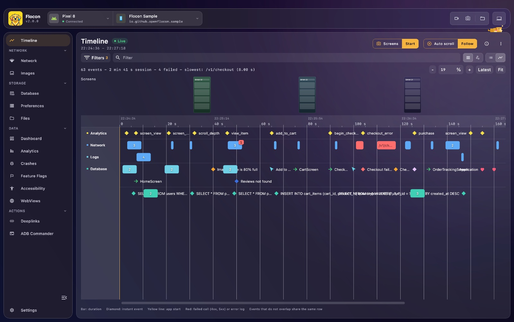

# Flocon

**Flocon lets you see what your Android, Kotlin Multiplatform, iOS and Flutter apps do: network, databases, preferences, analytics, crashes... from your desktop, and lets AI agents see it too.**

Inspired by [Flipper](https://github.com/facebook/flipper) by Meta, Flocon is a desktop debugger plus lightweight SDKs. Your app connects to the desktop app, and you observe, inspect and drive it in real time.



Full documentation: **[openflocon.github.io/Flocon](https://openflocon.github.io/Flocon/)**

## 1. Install the desktop app

**macOS** (Homebrew, no Gatekeeper prompt):

```bash
brew install --cask openflocon/tap/flocon
```

**Linux**: `brew install openflocon/tap/flocon` (Linuxbrew), or the `.deb` / `.rpm` (x64 and arm64) from the [releases](https://github.com/openflocon/Flocon/releases).

**Windows**: the `.msi` installer from the [releases](https://github.com/openflocon/Flocon/releases).

More in the [macOS](https://openflocon.github.io/Flocon/macos-install) and [Linux](https://openflocon.github.io/Flocon/linux-install) guides (manual install, `adb`).

## 2. Add the SDK to your app

Pick the SDK of your app. Each one connects to the same desktop app.

| SDK | Version | Install | Repository |
|---|---|---|---|
| **Android & Kotlin Multiplatform** | [](https://central.sonatype.com/artifact/io.github.openflocon/flocon) | `debugImplementation("io.github.openflocon:flocon:LAST_VERSION")` + one module per feature | this repository ([`FloconAndroid/`](FloconAndroid)) |
| **iOS / macOS (Swift)** | [](https://github.com/openflocon/FloconSwift/releases) | Swift Package Manager: `https://github.com/openflocon/FloconSwift.git` | [FloconSwift](https://github.com/openflocon/FloconSwift) · gRPC add-on [FloconSwiftGrpc](https://github.com/openflocon/FloconSwiftGrpc) |
| **Flutter** | [](https://pub.dev/packages/flocon) | `flutter pub add flocon` | [FloconFlutter](https://github.com/openflocon/FloconFlutter) |

Then start Flocon in your app (`startFlocon { ... }` in all three SDKs) and run it: **[Connect your app](https://openflocon.github.io/Flocon/setup)** walks you through it step by step, emulators and physical devices included. Coming from Flocon 1.x? See the [migration guide](https://openflocon.github.io/Flocon/migration).

## What you can inspect

Support per SDK (details and limits in the [platform support matrix](https://openflocon.github.io/Flocon/#platform-support)). Click a feature for its page.

| Feature | Android | KMP | Swift | Flutter |
|---|:---:|:---:|:---:|:---:|
| [HTTP inspector](https://openflocon.github.io/Flocon/network) (OkHttp, Ktor, URLSession, Dio, `http`) | ✅ | ✅ | ✅ | ✅ |
| [Request mocking](https://openflocon.github.io/Flocon/mocking) and [bad network](https://openflocon.github.io/Flocon/bad-quality) | ✅ | ✅ | ✅ | ✅ |
| [GraphQL](https://openflocon.github.io/Flocon/graphql) | ✅ | ✅ | ✅ | ✅ |
| [WebSocket](https://openflocon.github.io/Flocon/websocket) | ✅ automatic (OkHttp) | ✅ manual | ✅ manual | ✅ manual |
| [gRPC](https://openflocon.github.io/Flocon/grpc) | ✅ | ❌ | ✅ (add-on) | ❌ |
| [Images](https://openflocon.github.io/Flocon/image) | ✅ | ✅ | ✅ | ✅ |
| [Databases](https://openflocon.github.io/Flocon/database) (Room, SQLDelight, SQLite) | ✅ | ✅ | ✅ | ✅ |
| [Preferences](https://openflocon.github.io/Flocon/sharedpref) (SharedPreferences, DataStore, UserDefaults) | ✅ | ✅ | ✅ | ✅ |
| [Files](https://openflocon.github.io/Flocon/files) | ✅ | ✅ | ✅ | ✅ |
| [Dashboards](https://openflocon.github.io/Flocon/dashboard) and [tables](https://openflocon.github.io/Flocon/table) | ✅ | ✅ | ✅ | ✅ |
| [Deeplinks](https://openflocon.github.io/Flocon/deeplink) | ✅ | ✅ | ✅ | ✅ |
| [Analytics](https://openflocon.github.io/Flocon/analytics) | ✅ | ✅ | ✅ | ✅ |
| [Feature flags](https://openflocon.github.io/Flocon/featureflags) | ✅ | ✅ | ✅ | ✅ |
| [Timeline](https://openflocon.github.io/Flocon/timeline) | ✅ | ✅ | ✅ | ✅ |
| [Crash reporter](https://openflocon.github.io/Flocon/crashreporter) | ✅ | ✅ | ✅ | ✅ |
| [Accessibility](https://openflocon.github.io/Flocon/accessibility) | ✅ | ⚠️ partial | ❌ | ❌ |
| [WebView](https://openflocon.github.io/Flocon/webview) | ✅ | ⚠️ manual API | ❌ | ❌ |
| [QR code connection](https://openflocon.github.io/Flocon/setup/#4-connect) | ✅ | ❌ | ✅ | ✅ |
| [AI agents (MCP)](https://openflocon.github.io/Flocon/mcp) | ✅ | ✅ | ✅ | ✅ |

## AI agents (MCP)

Flocon Desktop runs an MCP server (`http://localhost:9042/mcp`), so AI agents can work with your running app:

- inspect network calls, mock them, simulate a bad network
- read your app files, databases, preferences and analytics events
- works with Claude Code, Codex, Cursor, Gemini CLI, Antigravity, Copilot, Android Studio and more

Install the plugin in Claude Code (it also ships for Codex, Cursor and Gemini):

```
/plugin marketplace add openflocon/Flocon
/plugin install flocon@flocon
```

See [MCP setup](https://openflocon.github.io/Flocon/mcp), the [tool reference](https://openflocon.github.io/Flocon/mcp-tools) and the [cookbook](https://openflocon.github.io/Flocon/mcp-cookbook).

## Requirements

- **Desktop**: macOS, Linux or Windows. The portable jar needs JDK 21.
- **Android**: emulator or device, with `adb` for screenshots, recordings and deeplinks.
- **Kotlin**: KMP targets Android, JVM, iOS and Wasm.
- **Swift**: iOS 15 / macOS 12, Xcode 16+, Swift Package Manager.
- **Flutter**: Flutter 3.38.1+ (Dart 3.10+).

Stuck? See [troubleshooting](https://openflocon.github.io/Flocon/troubleshooting).

## Contributing

Issues and pull requests are welcome on [GitHub](https://github.com/openflocon/Flocon/issues). Thanks to everyone who makes Flocon better: [see all contributors](https://openflocon.github.io/Flocon/contributors).

## License

Flocon is MIT licensed, as found in the [LICENSE](/LICENSE) file.
