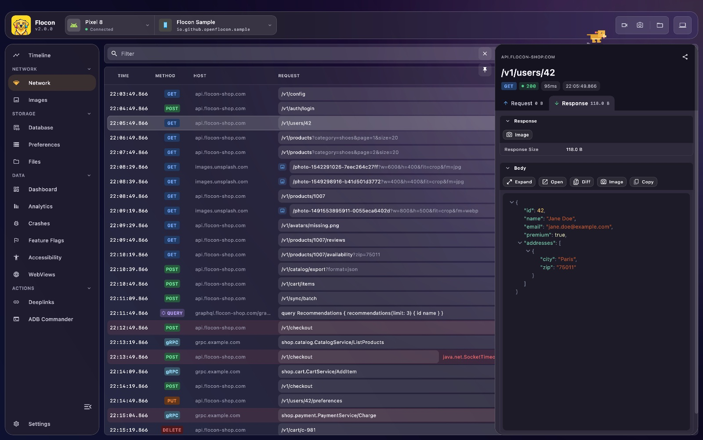
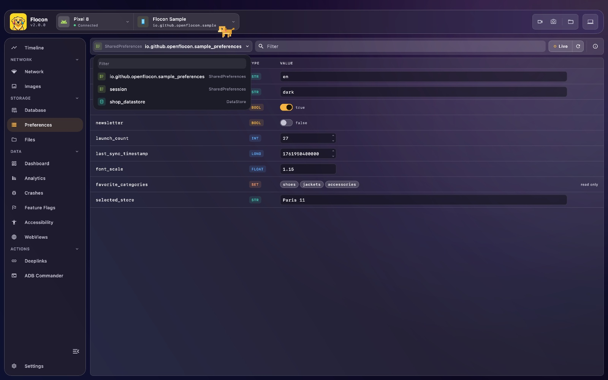
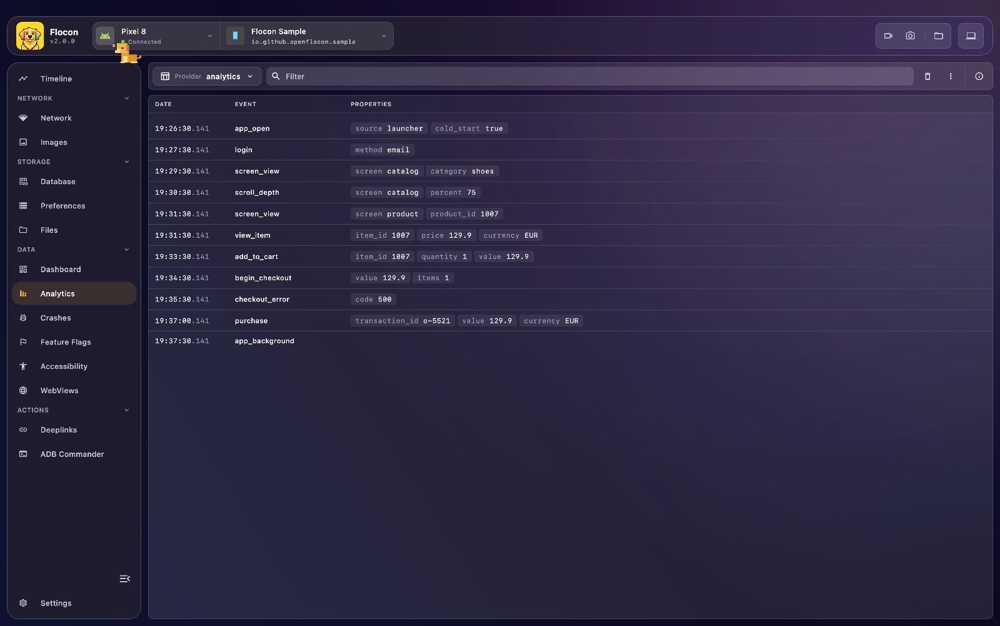
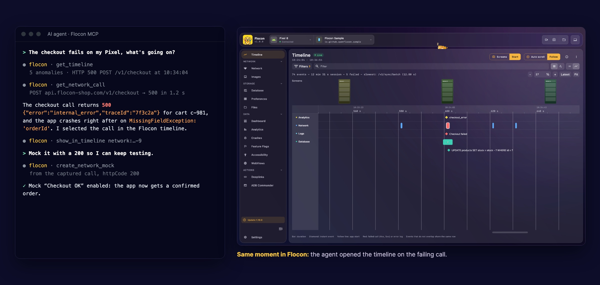
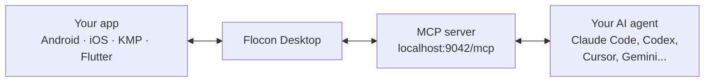

<p align="center">
  
</p>

<h1 align="center">Flocon</h1>

<p align="center">
  <b>See what your mobile app does, live on your desktop: network, databases, preferences, analytics, crashes...<br/>
  And let your AI agent see it too.</b>
</p>

<p align="center">
  <a href="https://central.sonatype.com/artifact/io.github.openflocon/flocon"></a>
  <a href="https://github.com/openflocon/FloconSwift/releases"></a>
  <a href="https://pub.dev/packages/flocon"></a>
  <a href="https://openflocon.github.io/Flocon/mcp"></a>
  <a href="LICENSE"></a>
</p>

<!-- screenshot: hero -->
| **Network**: every HTTP, GraphQL and gRPC call. Mock it, slow it down. | **Timeline**: what happened in the app. |
|:---:|:---:|
|  |  |
| **Preferences**: read and edit SharedPreferences, DataStore, UserDefaults. | **Analytics**: every event your app sends, per provider. |
|  |  |

Inspired by [Flipper](https://github.com/facebook/flipper) by Meta, Flocon is a desktop debugger plus lightweight SDKs for Android, Kotlin Multiplatform, iOS and Flutter. Your app connects to the desktop app, and you observe, inspect and drive it in real time.

Full documentation: **[openflocon.github.io/Flocon](https://openflocon.github.io/Flocon/)**

## Your AI agent can see your app

Flocon Desktop runs an MCP server (`http://localhost:9042/mcp`). Claude Code, Codex, Cursor, Gemini CLI, Antigravity, Copilot, Android Studio and more can read the network calls, timeline, databases, preferences and crashes of your running app, then mock calls, simulate a bad network, open deeplinks and take screenshots.





Try asking:

- *"What happened right before the crash?"*
- *"Mock `/profile` with a 503 and take a screenshot."*
- *"Which analytics events are sent on checkout?"*
- *"Turn on a slow network config and tell me which calls time out."*

Install the plugin in Claude Code (it also ships for Codex, Cursor and Gemini):

```
/plugin marketplace add openflocon/Flocon
/plugin install flocon@flocon
```

See [MCP setup](https://openflocon.github.io/Flocon/mcp), the [tool reference](https://openflocon.github.io/Flocon/mcp-tools) and the [cookbook](https://openflocon.github.io/Flocon/mcp-cookbook).

## 1. Install the desktop app

**macOS** (Homebrew, no Gatekeeper prompt):

```bash
brew install --cask openflocon/tap/flocon
```

**Linux**: `brew install openflocon/tap/flocon` (Linuxbrew), or the `.deb` / `.rpm` (x64 and arm64) from the [releases](https://github.com/openflocon/Flocon/releases).

**Windows**: the `.msi` installer from the [releases](https://github.com/openflocon/Flocon/releases).

More in the [macOS](https://openflocon.github.io/Flocon/macos-install), [Linux](https://openflocon.github.io/Flocon/linux-install) and [Windows](https://openflocon.github.io/Flocon/windows-install) guides (manual install, `adb`).

## 2. Add the SDK to your app

Pick the SDK for your platform. They all connect to the same desktop app.

<table>
<tr><th align="left"><a href="https://github.com/openflocon/Flocon/tree/main/FloconAndroid">Android &amp; Kotlin Multiplatform</a> &nbsp; <a href="https://central.sonatype.com/artifact/io.github.openflocon/flocon"></a></th></tr>
<tr><td>

**Install**

```kotlin
// build.gradle.kts
debugImplementation("io.github.openflocon:flocon:LAST_VERSION")
// + one module per feature you need
```

<a href="https://openflocon.github.io/Flocon/install-kotlin"></a>

</td></tr>
</table>

<table>
<tr><th align="left"><a href="https://github.com/openflocon/FloconSwift">iOS / macOS (Swift)</a> &nbsp; <a href="https://github.com/openflocon/FloconSwift/releases"></a></th></tr>
<tr><td>

**Install**

```text
// Xcode › File › Add Package Dependencies…
https://github.com/openflocon/FloconSwift.git
```

<a href="https://openflocon.github.io/Flocon/install-swift"></a>

</td></tr>
</table>

<table>
<tr><th align="left"><a href="https://github.com/openflocon/FloconFlutter">Flutter</a> &nbsp; <a href="https://pub.dev/packages/flocon"></a></th></tr>
<tr><td>

**Install**

```bash
flutter pub add flocon
```

<a href="https://openflocon.github.io/Flocon/install-flutter"></a>

</td></tr>
</table>

---

<table>
<tr><th align="left">Start Flocon &nbsp; <sub>same API on every platform</sub></th></tr>
<tr><td>

```kotlin
startFlocon { ... }
```

Then run your app. **[Full documentation](https://openflocon.github.io/Flocon/setup)**, emulators and physical devices included.

</td></tr>
</table>

## Coming from Flocon 1.x?

See the [migration guide](https://openflocon.github.io/Flocon/migration).

## Requirements

- **Desktop**: macOS, Linux or Windows. The portable jar needs JDK 21.
- **Android**: emulator or device, with `adb` for screenshots, recordings and deeplinks.
- **Kotlin**: KMP targets Android, JVM, iOS and Wasm.
- **Swift**: iOS 15 / macOS 12, Xcode 16+, Swift Package Manager.
- **Flutter**: Flutter 3.38.1+ (Dart 3.10+).

Stuck? See [troubleshooting](https://openflocon.github.io/Flocon/troubleshooting).

## Contributing

Issues and pull requests are welcome on [GitHub](https://github.com/openflocon/Flocon/issues). Thanks to everyone who makes Flocon better: [see all contributors](https://openflocon.github.io/Flocon/contributors).

## License

Flocon is MIT licensed, as found in the [LICENSE](/LICENSE) file.
