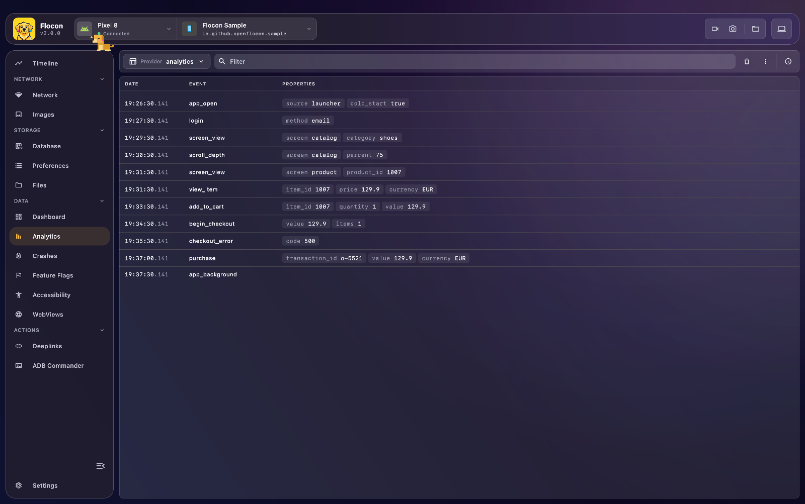

# 📊 Analytics Event Viewer

Flocon streams and displays the **analytics events** emitted by your app in real time, so developers, QA engineers and product teams can verify tracking payloads without opening a dashboard on the analytics provider's side. Each provider (Firebase, Segment, a custom tracker...) is its own table.



<!-- screenshot: analytics-detail | scenario=doc-analytics | screen=analytics | an event selected with its payload detail panel open -->


Every recorded event shows:

- **Event Name**: the tracking identifier.
- **Parameters & Properties**: the full key-value dictionary.
- **Timestamp & Source**: when it was logged and the stream (table) it belongs to, for example `firebase`, `segment` or a custom one.

## Platform support

| | Android | KMP (iOS / JVM / Wasm) | Swift (iOS / macOS) | Flutter |
|---|:---:|:---:|:---:|:---:|
| Log events (one table per stream) | ✅ | ✅ | ✅ | ✅ |

Property values are always strings.

## Setup

=== "Kotlin"

    Add the module (the `-no-op` twin keeps the same API in release builds, see [Release builds](setup.md#release-builds)):

    ```kotlin
    dependencies {
        debugImplementation("io.github.openflocon:flocon-analytics:LAST_VERSION")
        releaseImplementation("io.github.openflocon:flocon-analytics-no-op:LAST_VERSION")
    }
    ```

    Then install the plugin:

    ```kotlin
    startFlocon(FloconContext(context)) {
        install(FloconAnalytics)
    }
    ```

=== "Swift"

    Analytics are part of the `Flocon` product. Install the plugin:

    ```swift
    import Flocon

    startFlocon { flocon in
        flocon.install(.analytics)
    }
    ```

    `Flocon.initialize()` installs every plugin.

=== "Flutter"

    ```bash
    flutter pub add flocon
    ```

    The analytics plugin is part of the `flocon` package and is always available: no `install(...)` is needed, you only have to start Flocon (see [Setup](setup.md)). Logging does nothing before Flocon is started, so you can leave the calls in your code.

    ```dart
    import 'package:flocon/flocon.dart';

    await startFlocon((flocon) => flocon..connect(host: 'localhost'));
    ```

## Usage

The **stream** is the table the events appear in on the desktop. Use one stream per analytics provider to check what each of them receives (`firebase`, `segment`, `app_telemetry`...).

### Log events

=== "Kotlin"

    Log individual or batched events; `analyticsTableId` is the stream:

    ```kotlin
    import io.github.openflocon.flocon.Flocon
    import io.github.openflocon.flocon.analytics.analyticsPlugin
    import io.github.openflocon.flocon.analytics.model.AnalyticsEvent
    import io.github.openflocon.flocon.analytics.model.analyticsProperty

    Flocon.analyticsPlugin.log(
        AnalyticsEvent(
            eventName = "button_clicked",
            analyticsTableId = "firebase",
            "button_id" analyticsProperty "checkout_pay",
            "cart_total" analyticsProperty "49.99",
            "currency" analyticsProperty "EUR"
        )
    )
    ```

    To log several events to the same stream, create a sender once and reuse it:

    ```kotlin
    val firebase = Flocon.analyticsPlugin.sender("firebase")

    firebase.log("button_clicked", "button_id" analyticsProperty "checkout_pay")
    ```

=== "Swift"

    ```swift
    Flocon.analyticsPlugin.sender("firebase").logEvents(
        AnalyticsEvent(
            eventName: "button_clicked",
            AnalyticsProperty("button_id", "checkout_pay"),
            AnalyticsProperty("cart_total", "49.99"),
            AnalyticsProperty("currency", "EUR")
        )
    )
    ```

    `logEvents` also takes an array of events. Keep the sender to reuse it:

    ```swift
    let firebase = Flocon.analyticsPlugin.sender("firebase")
    firebase.logEvents(AnalyticsEvent(eventName: "app_opened"))
    ```

=== "Flutter"

    ```dart
    Flocon.analytics.sender('firebase').logEvents([
      AnalyticsEvent(
        eventName: 'button_clicked',
        properties: [
          AnalyticsProperty('button_id', 'checkout_pay'),
          AnalyticsProperty('cart_total', '49.99'),
          AnalyticsProperty('currency', 'EUR'),
        ],
      ),
    ]);
    ```

    For a single event, the sender also has `log`:

    ```dart
    final firebase = Flocon.analytics.sender('firebase');
    firebase.log('app_opened');
    ```

### Generic analytics forwarder

Forward all your app's tracking calls to Flocon alongside your existing provider. The sender is bound to one stream, so you do not repeat it at each call.

=== "Kotlin"

    ```kotlin
    class AnalyticsTracker(private val firebaseAnalytics: FirebaseAnalytics) {

        // bound to the "app_telemetry" stream: no need to repeat it at each call
        private val flocon = Flocon.analyticsPlugin.sender("app_telemetry")

        fun track(event: String, parameters: Map<String, Any> = emptyMap()) {
            // 1. Forward to Flocon Desktop
            flocon.log(
                eventName = event,
                properties = parameters.map { it.key analyticsProperty it.value.toString() }
            )

            // 2. Forward to Firebase
            val bundle = Bundle().apply {
                parameters.forEach { (k, v) -> putString(k, v.toString()) }
            }
            firebaseAnalytics.logEvent(event, bundle)
        }
    }
    ```

=== "Swift"

    ```swift
    final class AnalyticsTracker {
        // bound to the "app_telemetry" stream: no need to repeat it at each call
        private let flocon = Flocon.analyticsPlugin.sender("app_telemetry")

        func track(_ event: String, parameters: [String: Any] = [:]) {
            // 1. Forward to Flocon Desktop
            flocon.logEvents(
                AnalyticsEvent(
                    eventName: event,
                    properties: parameters.map { AnalyticsProperty($0.key, "\($0.value)") }
                )
            )

            // 2. Forward to your analytics provider
            provider.track(event, parameters)
        }
    }
    ```

=== "Flutter"

    ```dart
    class AnalyticsTracker {
      // bound to the "app_telemetry" stream: no need to repeat it at each call
      final _flocon = Flocon.analytics.sender('app_telemetry');

      void track(String event, [Map<String, Object> parameters = const {}]) {
        // 1. Forward to Flocon Desktop
        _flocon.log(event, [
          for (final entry in parameters.entries) AnalyticsProperty(entry.key, '${entry.value}'),
        ]);

        // 2. Forward to your analytics provider
        provider.track(event, parameters);
      }
    }
    ```

## In Flocon Desktop

Open **Analytics** in the sidebar.

- The **table selector** switches between streams, the **filter** field matches event names and properties.
- Click an event to open its full payload in the detail panel.
- Right-click an event to **Remove** it, **Remove lines above**, **Exclude** its name, or **Clear old sessions** (the events of previous app launches).
- The trash icon clears the events of the selected table. The overflow menu has **Export CSV**, **Auto scroll**, **Invert list** and **Clear old sessions**.

<!-- screenshot: analytics-context-menu | scenario=doc-analytics | screen=analytics | the right-click menu on an event row with the Exclude entry -->

### Excluding noisy events

Right-click an event row and choose **Exclude** (followed by the event name in quotes) to hide every event with that name. An **N excluded** button then appears next to the filter field: open it to restore one event name, or **Restore all**.

- Exclusions are saved per app (package name) and kept when you restart Flocon.
- Events are only hidden from the list. They are not deleted, and **Export CSV** still includes them.

<!-- screenshot: analytics-excluded | scenario=doc-analytics | screen=analytics | the "N excluded" button next to the filter field with its popup listing the excluded events -->

## With AI agents (MCP)

- `list_analytics_tables`: the streams (tables) of the app.
- `list_analytics_events`: the events, newest first, filtered by table, event names, text or time.
- `count_analytics_events`: the number of events per event name, most frequent first.

By default only the current app launch is read; pass `includeOldSessions` to include previous ones.

> "Count the analytics events of the last session and tell me which event is sent too often."

> "Was `checkout_completed` sent with a `currency` property after I paid?"

See the [MCP cookbook](mcp-cookbook.md) for full workflows.
