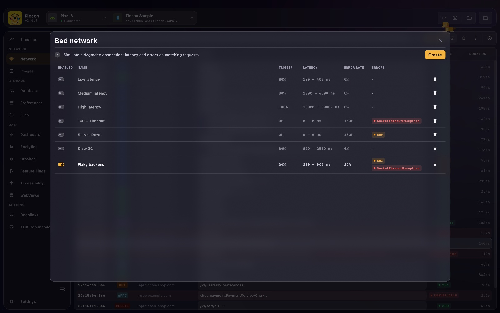
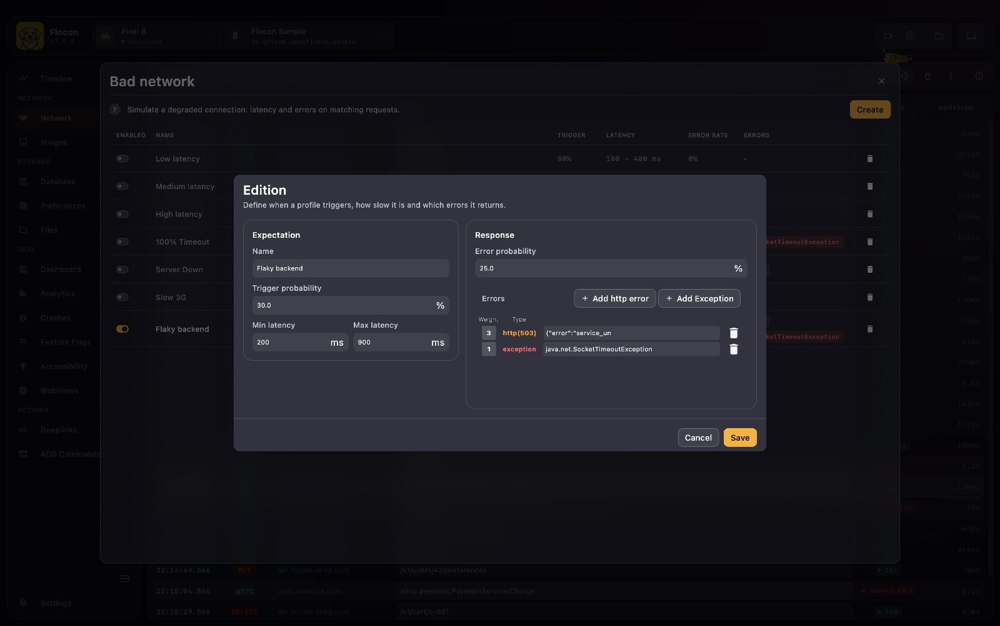

# 📉 Bad Network Simulation

Testing on a fast Wi-Fi hides bugs. Flocon can **slow down and randomly break the calls of your app** from the desktop, without touching the network settings of your device. Use it to check your loaders, timeouts, retries and error screens.




A **profile** describes how the network misbehaves. Only one profile is active at a time, and it applies to every call the interceptors handle.

## What a profile contains

- **Latency**: a **trigger probability** (the share of calls that get delayed, from 0 to 1) and a **min / max latency** in milliseconds. The delay of each call is picked in that range.
- **Error probability**: the share of calls that fail.
- **Errors**: the list of errors a failing call can get. Each one has a **weight**: the higher it is compared to the others, the more often it is picked. An error is either:
    - an **HTTP error**: a status code, a body and a content type, returned as the response;
    - an **exception**: a class to throw, such as `java.net.SocketTimeoutException`, `java.net.UnknownHostException`, `java.net.ConnectException`, `javax.net.ssl.SSLHandshakeException` or `java.io.IOException`.

## Platform support

| | Android | KMP (iOS / JVM) | Swift (iOS / macOS) | Flutter |
|---|:---:|:---:|:---:|:---:|
| HTTP calls | ✅ OkHttp, Ktor | ✅ Ktor (and OkHttp on JVM) | ✅ `URLSession` | ✅ Dio, `package:http` |
| gRPC calls | ✅ | ❌ | ❌ | ❌ |

- On Android, gRPC calls get the **latency** and the **exception** errors. The HTTP errors of a profile are ignored for gRPC. See [gRPC](grpc.md).
- On Swift and Flutter, the exception class of the profile is turned into the closest native error (`URLError` on Swift, `DioException` on Dio). A timeout class gives a timeout, a connection class a connection error.
- The active profile is saved on the device, and applies from the next launch too.

## Setup

There is nothing specific to add: the simulation uses the [network setup](network.md#setup). Any call that goes through the Flocon interceptor is affected.

=== "Kotlin"

    ```kotlin
    startFlocon(FloconContext(context)) {
        install(FloconNetwork)
    }
    ```

    === "OkHttp"

        ```kotlin
        val okHttpClient = OkHttpClient.Builder()
            .addInterceptor(FloconOkhttpInterceptor())
            .build()
        ```

    === "Ktor"

        ```kotlin
        val httpClient = HttpClient {
            install(FloconKtorPlugin)
        }
        ```

    === "gRPC"

        Android only, with `flocon-grpc-interceptor` or `flocon-grpc-interceptor-lite` (see [gRPC](grpc.md)):

        ```kotlin
        val channel = ManagedChannelBuilder.forAddress(host, port)
            .intercept(FloconGrpcInterceptor())
            .build()
        ```

=== "Swift"

    ```swift
    #if DEBUG
    startFlocon { flocon in
        flocon.install(.network)
    }
    #endif

    let session = URLSession(configuration: .default.withFlocon())
    ```

    The simulation applies to `URLSession.shared` and to the sessions created with `withFlocon()`. A request excluded by `shouldLog` is not affected.

=== "Flutter"

    ```dart
    await startFlocon((flocon) => flocon..install(FloconNetwork()));

    final dio = Dio().withFlocon();             // flocon_dio
    final client = http.Client().withFlocon();  // flocon_http
    ```

## In Flocon Desktop

1. Open the **Network** tab and click the **Bad network** button in the toolbar.
2. Create a profile: set the latency (trigger probability, min and max), the error probability, and add errors (HTTP errors or exceptions, each with a weight).
3. Turn the profile **on** with its switch. Turning another one on turns the first one off, and turning the active one off stops the simulation.
4. Use your app. Calls are delayed or fail according to the profile.

### Scenarios to try

- **Subway (intermittent drops)**: error probability `0.4`, with a `java.net.SocketTimeoutException` and a `java.net.UnknownHostException`. Check that the app shows a retry banner instead of crashing.
- **Slow 3G**: trigger probability `1`, latency between `2000` and `5000` ms. Check loaders, skeletons and cancellation when leaving a screen.
- **Backend outage**: error probability `1`, with one HTTP error `503`. Check the maintenance screen.

## With AI agents (MCP)

- `list_bad_network_configs`: lists the profiles and tells which one is active.
- `create_bad_network_config`, `update_bad_network_config`, `delete_bad_network_config`: manage the profiles.
- `set_active_bad_network_config`: activates a profile (the others are turned off), or turns the simulation off when no profile is given.

> "Simulate a flaky network with 30% of timeouts, then check that the login screen handles it."

See the [MCP cookbook](mcp-cookbook.md) for full workflows.

## Limitations

- The simulation does not throttle bandwidth: it adds latency and errors to calls.
- It cannot target a domain or a path. To break one endpoint only, use a [mock](mocking.md).
- WebSocket frames are not affected.
