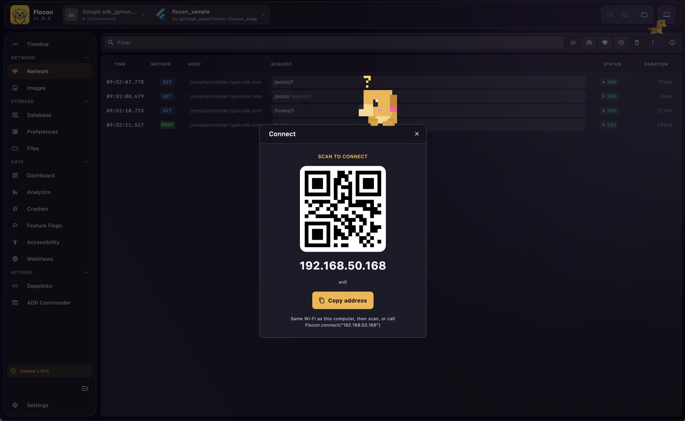
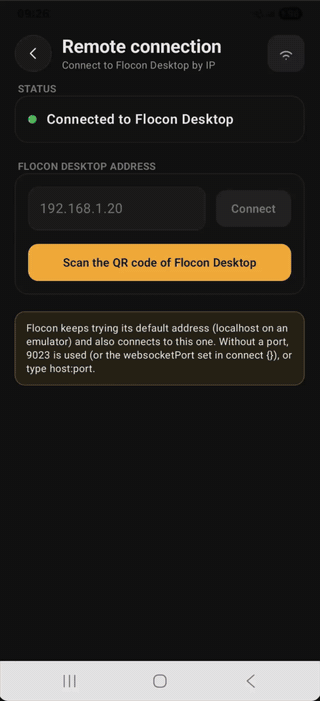

# Connect with a QR code

Instead of typing the address of your computer, scan it. The device and the computer must be on the same network, as for a [Wi-Fi connection](connect-wifi.md).

## 1. Show the QR code on the desktop

Click the **Connect** button (laptop icon) in the top bar of Flocon Desktop. If your computer has several networks, pick the one your phone is on.




The QR code holds the IP address of your computer, followed by both ports (`ip:ws:http`) as soon as one of them is not the default.

## 2. Scan it from the app

Add a scanner to your app (in a debug menu, for example). Once the code is read, the SDK calls `Flocon.connect` with the address for you.

{ width="280" }


=== "Kotlin"

    Android only. Add `flocon-qr-scanner` (and its `-no-op` in release), then call:

    ```kotlin
    import io.github.openflocon.flocon.qrscanner.scanQrCodeAndConnect

    val result = Flocon.scanQrCodeAndConnect(context) // suspend, null when the user closes the scanner
    ```

    It opens the Google code scanner, so it needs no camera permission but requires Google Play Services; without it, the result is `FloconConnectResult.Failed` and you [connect with the address](connect-wifi.md) instead.

=== "Swift"

    `FloconQRScannerView` (AVFoundation, no extra dependency) reads the QR code and calls `Flocon.connect(address:)` for you. Your app needs `NSCameraUsageDescription`; the simulator has no camera, use `Flocon.connect(address:)` there.

    ```swift
    .sheet(isPresented: $isScanning) {
        FloconQRScannerView { result in
            if result == .connected { isScanning = false }
        }
    }
    ```

=== "Flutter"

    Add the `flocon_qr_scanner` package (Android, iOS, macOS):

    ```bash
    flutter pub add flocon_qr_scanner
    ```

    ```dart
    FloconQrScannerView(onResult: (result) {
      if (result is FloconConnectResultConnected) Navigator.pop(context);
    })
    ```

    It needs the camera permission: `NSCameraUsageDescription` (iOS, macOS), `CAMERA` (Android) and `com.apple.security.device.camera` (macOS entitlements). On Android, `mobile_scanner` needs `minSdk` 23, `compileSdk` 36 and the Android Gradle plugin 8.9.1 or higher.

If the app does not connect after the scan, see [Connect over Wi-Fi](connect-wifi.md#when-it-does-not-connect).
