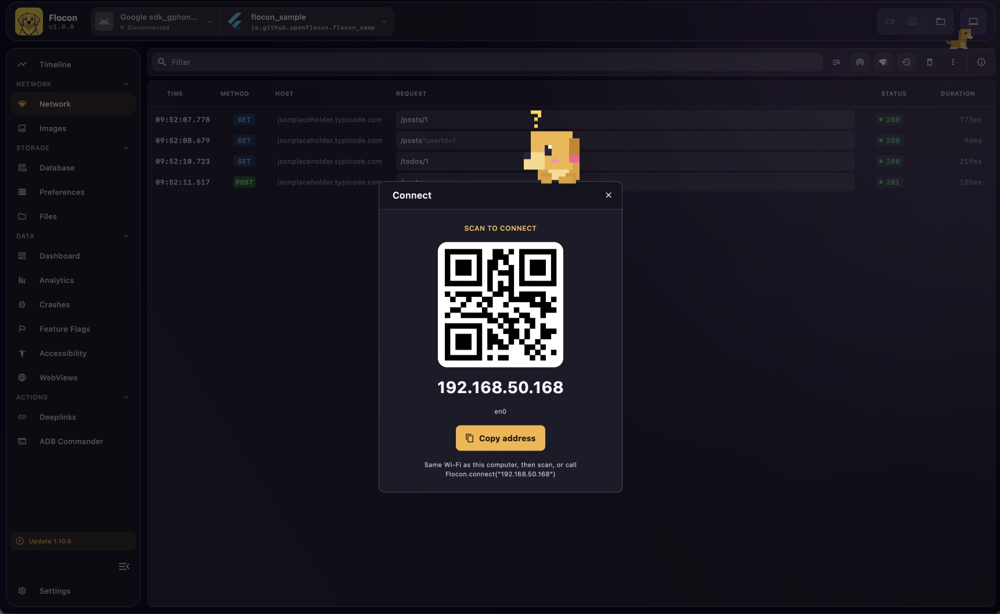
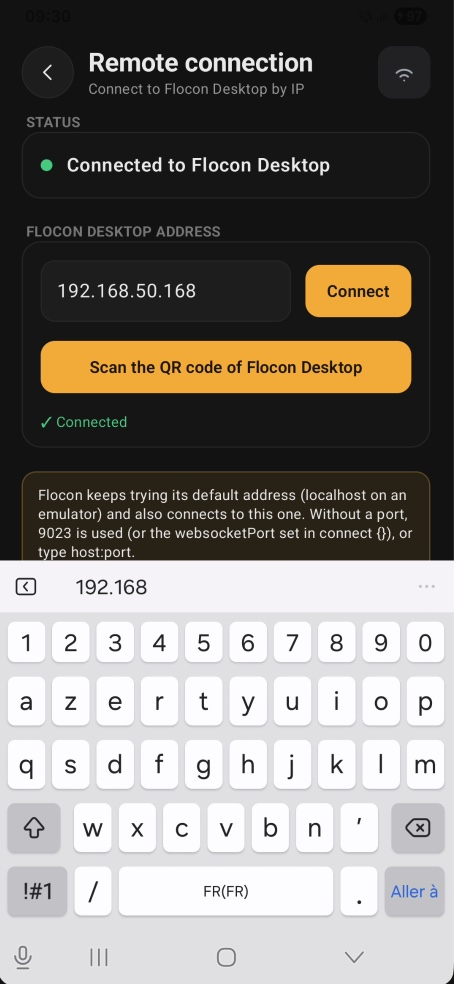

# Connect over Wi-Fi

A physical device on Wi-Fi has no `adb reverse`: give the SDK the IP address of your computer. The device and the computer must be on the same network.

To find the address, click the **Connect** button (laptop icon) in the top bar of Flocon Desktop: it lists the local addresses of your computer, with a **Copy address** button. Or skip typing it and [scan the QR code](connect-qr-code.md).




## Give the address to the SDK

Pass it at start, or later (from a debug menu, for example) with `Flocon.connect`:

{ width="280" }

=== "Kotlin"

    ```kotlin
    startFlocon(FloconContext(this)) {
        connect {
            address = "192.168.1.10"  // host, host:ws or host:ws:http
        }
        install(FloconNetwork)
    }

    // or, once the address is known
    val result = Flocon.connect("192.168.1.10")   // suspend, returns a FloconConnectResult
    Flocon.disconnect()                            // suspend, forgets the address
    ```

    `connect { }` also has `bufferCapacity` (messages kept while not connected) and `rememberLastAddress` (the last connected address is tried again at the next launch and wins over `address`, `true` by default).

=== "Swift"

    ```swift
    Flocon.initialize(config: FloconConfig(host: "192.168.1.20"))

    // or with the builder
    #if DEBUG
    startFlocon { flocon in
        flocon.config(host: "192.168.1.20")
        flocon.install(.network)
    }
    #endif

    // or later, once the address is known
    let result = await Flocon.connect(address: "192.168.1.20") // FloconConnectResult
    await Flocon.disconnect()
    ```

    On iOS, the app needs `NSLocalNetworkUsageDescription` in `Info.plist`, and the user must allow the local network prompt shown the first time (see [Troubleshooting](troubleshooting.md#ios-the-local-network-permission)).

=== "Flutter"

    ```dart
    await startFlocon((flocon) => flocon
      ..connect(host: '192.168.1.20')
      ..install(FloconNetwork()));

    // or later, once the address is known
    final result = await Flocon.connect('192.168.1.20'); // FloconConnectResult
    await Flocon.disconnect();
    ```

The desktop shows a wifi icon next to a device connected by address.

## The address format

An address is the IP address or host of your computer, with optional ports: `host`, `host:ws` or `host:ws:http`, for example `192.168.1.20:10023:10024`. No scheme, no path. Ports go from `1` to `65535`; an omitted port is the configured one (`9023` / `9024` by default, see [Ports](connect.md#ports)), and the ports in the address win for that address. Anything else (a scheme, more than two ports...) is an invalid address: the connect call returns an `InvalidAddress` result instead of throwing.

## When it does not connect

- Guest or corporate Wi-Fi often isolates devices from each other ("client isolation"): use a personal hotspot, or USB for Android.
- A VPN or a firewall on your computer can block the ports `9023` and `9024`.
- Several network interfaces (Ethernet + Wi-Fi, VPN...): pick the address of the network your phone is on in the Connect dialog.

More in [Troubleshooting](troubleshooting.md#physical-device-over-wi-fi).
