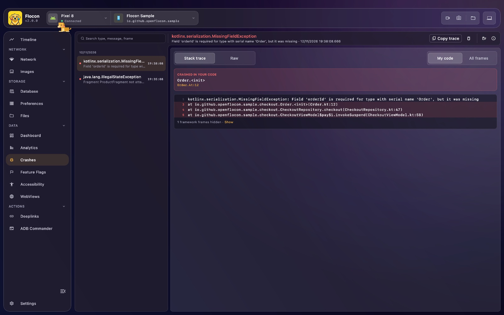
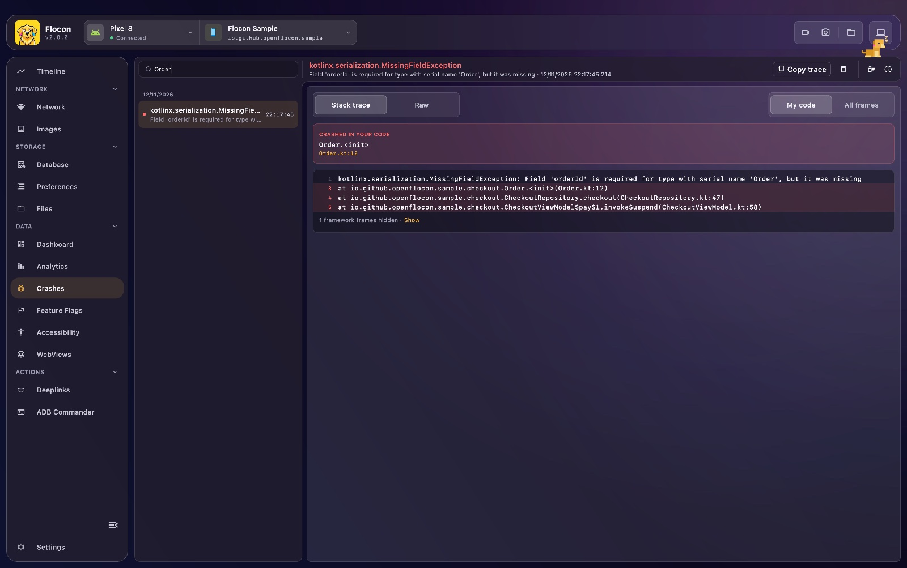

# 💥 Crash Reporter

Flocon records the **uncaught crashes** of your app (type, message, stack trace and time) and displays them in the desktop app, even when the crash happened while the desktop was not connected. On Android and JVM the previous crash handlers keep working, so Crashlytics, Sentry and friends still see the crash.



## Platform support

| | Android | KMP (iOS / JVM) | Swift (iOS / macOS) | Flutter |
|---|:---:|:---:|:---:|:---:|
| Uncaught Kotlin / Java exceptions | ✅ | ✅ (iOS, JVM) | ❌ | ❌ |
| Uncaught Dart / Flutter errors | ❌ | ❌ | ❌ | ✅ |
| `NSException` and crash signals (Swift runtime errors, `SIGSEGV`...) | ❌ | ❌ | ✅ | ❌ |

- **Kotlin**: Android, iOS and JVM. On Wasm the plugin does nothing (no crash is saved or sent).
- **Swift**: Objective-C exceptions (`NSException`) and the signals `SIGTRAP`, `SIGABRT`, `SIGSEGV`, `SIGBUS`, `SIGILL`, `SIGFPE`. That covers Swift runtime errors (force unwrap of `nil`, `fatalError`, index out of range...). The Swift error message is only printed in the console.
- **Flutter**: only the errors caught by `FlutterError.onError` (framework errors: build, layout, gestures...) and `PlatformDispatcher.instance.onError` (uncaught asynchronous errors). **Native crashes are not reported.**

## Setup

=== "Kotlin"

    ```kotlin
    dependencies {
        debugImplementation("io.github.openflocon:flocon-crashreporter:LAST_VERSION")
        releaseImplementation("io.github.openflocon:flocon-crashreporter-no-op:LAST_VERSION")
    }
    ```

    ```kotlin
    startFlocon(FloconContext(context)) {
        install(FloconCrashReporter)
    }
    ```

=== "Swift"

    ```swift
    import Flocon

    #if DEBUG
    startFlocon { flocon in
        flocon.install(.crashReporter)
    }
    #endif
    ```

    `Flocon.initialize()` installs every plugin, the crash reporter included. To install no handler at all with `Flocon.initialize`, pass `FloconConfig(isCrashReporterEnabled: false)`.

=== "Flutter"

    ```bash
    flutter pub add flocon flocon_crash_reporter
    ```

    ```dart
    import 'package:flocon/flocon.dart';
    import 'package:flocon_crash_reporter/flocon_crash_reporter.dart';

    await startFlocon((flocon) => flocon..install(const FloconCrashReporter()));
    ```

## Usage

Nothing to call: once installed, crashes are captured automatically.

1. The plugin registers its handlers. On Android and JVM the previous ones are kept and still called, so the app crashes as usual. On iOS (KMP) it replaces the Kotlin/Native unhandled-exception hook, then terminates the app.
2. The crash is saved on the device.
3. On the next connection to Flocon Desktop, the saved crashes are sent and deleted from the device.

=== "Kotlin"

    To install the handler yourself, disable the automatic setup and call `setupCrashHandler()`:

    ```kotlin
    startFlocon(FloconContext(context)) {
        install(FloconCrashReporter) {
            catchFatalErrors = false
        }
    }

    // later
    Flocon.crashReporterPlugin.setupCrashHandler()
    ```

=== "Swift"

    A crash cannot be sent while the app crashes: it is saved and sent the next time the app connects. Crashes are **not caught while the Xcode debugger is attached**, because the debugger catches them first: launch the app from the simulator or the device, without the debugger, to try it.

=== "Flutter"

    The hooks are installed by `install(FloconCrashReporter())`. Errors are saved on disk and sent on the next connection, even after a restart.

## In Flocon Desktop

!!! tip "In the Timeline"
    Crashes also show up in the [Timeline](timeline.md): open it to see what the app did right before.

- **Crash list** of the selected app, newest first, with the exception type, message and time. Use the search field to filter on type, message or frame.
- **Detail**: type, date and message, then two tabs: **Stack trace** (with a **Crashed in your code** block on top, and a **My code** / **All frames** switch that hides the framework frames) and **Raw**. A **Suppressed** tab shows the suppressed exceptions when there are some.
- **Actions**: copy the stack trace, delete the selected crash, or delete all the crashes of the app.
- Crashes also appear in the [timeline](timeline.md), so you can read what happened right before.



## With AI agents (MCP)

- `list_crash_reports`: crashes of the app (type and message), newest first, filterable by text and date.
- `get_crash_report`: full details of one crash, with its stack trace.

> "Why did the app crash? Read the last crash report and the timeline just before it."

See the [MCP cookbook](mcp-cookbook.md) for full workflows.

## Limitations

- Crashes are sent on the **next** connection: the app cannot send them while it crashes.
- Flutter does not report native crashes. Kotlin does not report native (NDK) crashes either.
