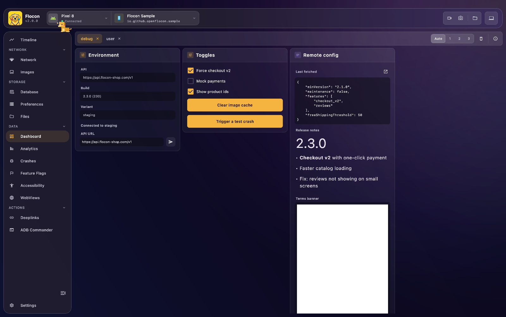

# 📈 Reactive Custom Dashboards

Your app declares **custom dashboards** (sections of texts, buttons, inputs, JSON, Markdown...) and Flocon Desktop renders them as interactive controls. When your data changes the dashboard updates live, and when you click a button or submit a field on the desktop, a callback runs inside your app.

Use cases:

- Toggle mock environments or debug options.
- Display live business metrics, session data or tokens.
- Change a state value on the fly without rebuilding.
- Trigger in-app test actions (clear a cache, seed test data, fire a notification).



<!-- screenshot: dashboard-mobile | scenario=doc-dashboard | screen=dashboard | the same dashboard, as it is declared in the app -->


## Platform support

| | Android | KMP (iOS / JVM / Wasm) | Swift (iOS / macOS) | Flutter |
|---|:---:|:---:|:---:|:---:|
| Dashboards | ✅ | ✅ | ✅ | ✅ |

Every SDK supports the same elements:

| Element | Kotlin | Swift | Flutter | Description |
| :--- | :--- | :--- | :--- | :--- |
| Text | `text` | `FloconText` | `FloconText` | Read-only `label: value`, with an optional ARGB color. |
| Label | `label` | `FloconLabel` | `FloconLabel` | A heading or a status line, with an optional ARGB color. |
| Button | `button` | `FloconButton` | `FloconButton` | Runs a callback in your app when clicked. |
| Text field | `textField` | `FloconTextField` | `FloconTextField` | Sends the entered text to your app on submit. |
| Check box | `checkBox` | `FloconCheckBox` | `FloconCheckBox` | Sends the new boolean to your app on change. |
| Plain text | `plainText` | `FloconPlainText` | `FloconPlainText` | Multi-line selectable text (logs, dumps). |
| JSON | `json` | `FloconJSON` | `FloconJson` | A JSON string, formatted. |
| Markdown | `markdown` | `FloconMarkdown` | `FloconMarkdown` | Rendered Markdown. |
| HTML | `html` | `FloconHTML` | `FloconHtml` | A styled HTML snippet. |
| Form | `form` | `FloconForm` | `FloconForm` | A group of inputs with one submit button. |

What drives a reactive section differs per platform:

| | Reactive section | Stop updating |
|---|---|---|
| Kotlin | a `Flow<T>` | cancel the returned `Job`, or the `CoroutineScope` you passed |
| Swift | a Combine `Publisher` (such as a `@Published` property) | release or `cancel()` the returned `FloconDashboardHandle` |
| Flutter | a `ValueListenable<T>` (`FloconSection.listen`) or a `Stream<T>` (`FloconSection.fromStream`) | `dispose()` the returned `FloconDashboardHandle` |

A dashboard is sent once every reactive section has emitted a first value, and sent again each time one emits and on each connection to the desktop.

## Setup

=== "Kotlin"

    Dashboards are part of the core module (`flocon`, and `flocon-no-op` for release), so there is nothing more to add than the [core dependencies](setup.md). Install the plugin:

    ```kotlin
    startFlocon(FloconContext(context)) {
        install(FloconDashboard)
    }
    ```

=== "Swift"

    Dashboards are part of the `Flocon` product. Install the plugin:

    ```swift
    import Flocon

    startFlocon { flocon in
        flocon.install(.dashboard)
    }
    ```

    `Flocon.initialize()` installs every plugin.

=== "Flutter"

    ```bash
    flutter pub add flocon
    ```

    The dashboard plugin is part of the `flocon` package and is always available: no `install(...)` is needed, you only have to start Flocon (see [Setup](setup.md)). Every call does nothing before Flocon is started, so you can leave them in your code.

    ```dart
    import 'package:flocon/flocon.dart';

    await startFlocon((flocon) => flocon..connect(host: 'localhost'));
    ```

## Usage

### Reactive dashboard

=== "Kotlin"

    A dashboard is attached to a `CoroutineScope`: it is updated while the scope is active, and every section bound to a `Flow` is re-rendered on the desktop each time the flow emits:

    ```kotlin
    import io.github.openflocon.flocon.Flocon
    import io.github.openflocon.flocon.plugins.dashboard.dashboard
    import io.github.openflocon.flocon.plugins.dashboard.dashboardPlugin
    import io.github.openflocon.flocon.plugins.dashboard.dsl.*

    Flocon.dashboardPlugin.dashboard(id = "user_dashboard", scope = viewModelScope) {
        section(name = "Active User", flow = userFlow) { user ->
            text(label = "User ID", value = user.id)
            text(label = "Email", value = user.email, color = 0xFFFF0000.toInt()) // ARGB

            textField(
                id = "display_name",
                label = "Display Name",
                placeHolder = "John",
                value = user.displayName,
                onSubmitted = { newName -> userViewModel.updateName(newName) },
            )

            checkBox(
                id = "beta",
                label = "Beta Features Enabled",
                value = user.isBeta,
                onUpdated = { isEnabled -> userViewModel.setBeta(isEnabled) },
            )
        }

        section(name = "App Status") {
            text(label = "Environment", value = "Staging")
            label(label = "Build: #142")
            button(text = "Clear Image Cache", id = "clear_cache", onClick = { clearImageCache() })
        }
    }
    ```

    `dashboard(...)` returns a `Job`: cancel it to stop updating the dashboard.

=== "Swift"

    A section is either static, or rebuilt each time a Combine publisher emits. Keep the handle: the dashboard stops following the publishers when it is released.

    ```swift
    final class DebugDashboard {
        private var handle: FloconDashboardHandle?

        func start(session: Session) {
            handle = Flocon.dashboardPlugin.dashboard(id: "main") {
                FloconSection("User", publisher: session.$user) { user in
                    FloconText("name", user.name)
                    FloconText("status", user.status, color: 0xFFFF0000) // ARGB
                    FloconButton("Log out", id: "logout") { session.logOut() }
                    FloconTextField(id: "rename", label: "Rename", value: user.name) { session.rename($0) }
                    FloconCheckBox(id: "premium", label: "Premium", value: user.isPremium) { session.setPremium($0) }
                }
                FloconSection("Build") {
                    FloconPlainText("commit", buildCommit)
                    FloconJSON("config", configJSON)
                    FloconMarkdown("Release note", "# 1.0\nFirst **release**")
                    FloconHTML("About", "<h1>MyApp</h1>")
                }
            }
        }
    }
    ```

    Actions are called on the main actor. Registering a dashboard with the same `id` replaces the previous one.

=== "Flutter"

    A section is either static, or rebuilt each time a `ValueListenable` (`FloconSection.listen`) or a `Stream` (`FloconSection.fromStream`) emits. Keep the handle and call `dispose()` to stop following the sections.

    ```dart
    final handle = Flocon.dashboard.dashboard('main', [
      FloconSection.listen('User', session.user, (user) => [
        FloconText('name', user.name),
        FloconText('status', user.status, color: 0xFFFF0000), // ARGB
        FloconButton('Log out', id: 'logout', onClick: session.logOut),
        FloconTextField(id: 'rename', label: 'Rename', value: user.name, onSubmitted: session.rename),
        FloconCheckBox(id: 'premium', label: 'Premium', value: user.isPremium, onChanged: session.setPremium),
      ]),
      FloconSection('Build', [
        FloconPlainText('commit', buildCommit),
        FloconJson('config', configJson),
        FloconMarkdown('Release note', '# 1.0\nFirst **release**'),
        FloconHtml('About', '<h1>MyApp</h1>'),
      ]),
    ]);

    // later
    await handle.dispose();
    ```

### Static dashboard

=== "Kotlin"

    ```kotlin
    import io.github.openflocon.flocon.plugins.dashboard.dsl.registerDashboard

    Flocon.dashboardPlugin.registerDashboard(id = "main") {
        section(name = "App Status") {
            text(label = "Environment", value = "Staging")
            button(text = "Clear Image Cache", id = "clear_cache", onClick = { clearImageCache() })
        }
    }
    ```

=== "Swift"

    A dashboard with only static sections is declared the same way: you can ignore the returned handle.

    ```swift
    Flocon.dashboardPlugin.dashboard(id: "main") {
        FloconSection("App Status") {
            FloconText("Environment", "Staging")
            FloconButton("Clear Image Cache", id: "clear_cache") { clearImageCache() }
        }
    }
    ```

=== "Flutter"

    ```dart
    Flocon.dashboard.dashboard('main', [
      FloconSection('App Status', [
        FloconText('Environment', 'Staging'),
        FloconButton('Clear Image Cache', id: 'clear_cache', onClick: clearImageCache),
      ]),
    ]);
    ```

### Multi-input forms

A form groups inputs under a single submit button. The callback receives the values of all the inputs, keyed by their `id`, with check boxes as `"true"` or `"false"`.

=== "Kotlin"

    ```kotlin
    Flocon.dashboardPlugin.dashboard(id = "settings", scope = scope) {
        form(
            name = "Server Configuration",
            submitText = "Apply Settings",
            onSubmitted = { values ->
                val host = values["host_input"]
                val mockMode = values["mock_mode"] == "true"
                applyNewConfig(host, mockMode)
            },
        ) {
            textField(id = "host_input", label = "API Host", placeHolder = null, value = "https://staging.api.com")
            checkBox(id = "mock_mode", label = "Enable Mock Mode", value = false)
        }
    }
    ```

=== "Swift"

    ```swift
    Flocon.dashboardPlugin.dashboard(id: "settings") {
        FloconForm("Create user", submitText: "Create", onSubmitted: { values in
            session.createUser(name: values["name"] ?? "", isAdmin: values["admin"] == "true")
        }) {
            FloconTextField(id: "name", label: "Name", value: "")
            FloconCheckBox(id: "admin", label: "Admin", value: false)
        }
    }
    ```

=== "Flutter"

    ```dart
    Flocon.dashboard.dashboard('settings', [
      FloconForm('Create user', [
        FloconTextField(id: 'name', label: 'Name', value: ''),
        FloconCheckBox(id: 'admin', label: 'Admin', value: false),
      ], submitText: 'Create', onSubmitted: (values) => session.createUser(values['name'] ?? '', values['admin'] == 'true')),
    ]);
    ```

!!! warning "Element ids must be unique"
    The `id` of a button, text field, check box or form input must be unique inside its dashboard: it is how the desktop tells your app which element was used.

## In Flocon Desktop

Open **Dashboards** in the sidebar.

- **One tab per dashboard**, named after its `id`. Click a tab to switch, click its **x** to remove that dashboard, or use the trash icon (**Delete Dashboards**) to remove the current one.
- Each **section** or **form** is a card. Texts, labels, check boxes and text fields are laid out in the card; interacting with them calls your app back.
- A **plain text** or **JSON** element has an **Open in external editor** button to read long content comfortably.
- The **Auto / 1 / 2 / 3** switch at the top right sets how many cards are shown per row.

<!-- screenshot: dashboard-arrangement | scenario=doc-dashboard | screen=dashboard | the Auto/1/2/3 switch and the dashboard tabs with their close icon -->

A dashboard stays until you remove it. Sending a dashboard with an existing `id` replaces it.

## With AI agents (MCP)

- `list_dashboards`: the ids of the dashboards sent by the app.
- `get_dashboard`: one dashboard with its sections and elements (texts, values, check boxes, fields, buttons).

The MCP tools are read only: an agent can read what a dashboard shows, but it cannot click a button or submit a form.

> "What is the value of the `Environment` text in the `main` dashboard?"

> "List the dashboards of the app and tell me which options are enabled in `settings`."

See the [MCP cookbook](mcp-cookbook.md) for full workflows.
