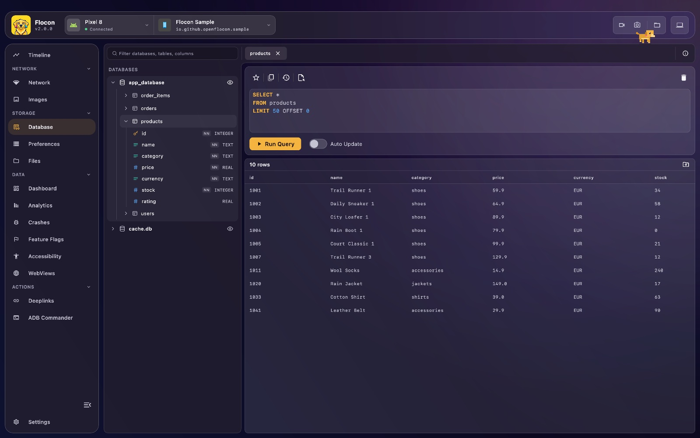
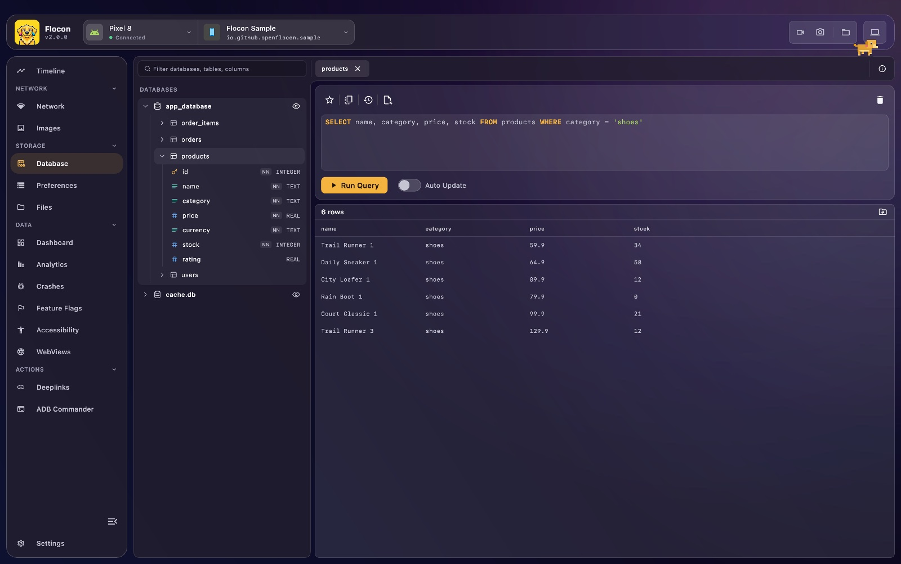
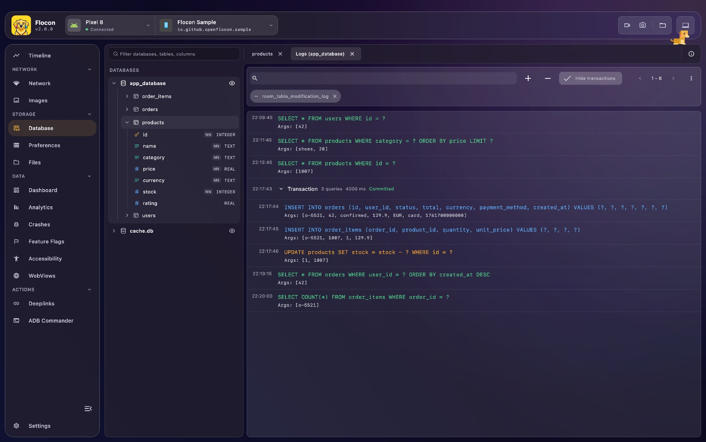

# 🧩 Database Explorer & SQL Editor

Flocon lists the **SQLite databases** of your app (Room, SQLDelight, Core Data stores, sqflite, plain SQLite files) and lets you browse their schema, run SQL queries on them from the desktop and see the queries your app runs, in real time. It helps you check what is really stored, test a query before writing it in code, and spot slow or unexpected queries.





## Platform support

| | Android | KMP (iOS / JVM / Wasm) | Swift (iOS / macOS) | Flutter |
|---|:---:|:---:|:---:|:---:|
| Automatic detection of SQLite files | ✅ (with `room()`) | ✅ iOS (Documents, Library), JVM with `room { path(...) }`, ❌ Wasm | ✅ (Documents, Application Support) | ✅ (databases, documents, support folders) |
| Browse schema and run SQL | ✅ | ✅ (Wasm: Room 3 only) | ✅ | ✅ |
| Query logging | ✅ (Room, SQLDelight, manual) | ✅ (Room 3, SQLDelight, manual) | ✅ (manual) | ✅ (manual) |
| Transactions grouped in the logs | ✅ (Room) | ✅ (Room 3) | ❌ | ❌ |

- **Wasm** has no file system and no SQLite file: only Room 3 with `WebWorkerSQLiteDriver` can be registered. The SQLDelight web worker driver is not supported yet.
- **Swift** and **Flutter** open the SQLite file itself, whatever library wrote it (Core Data, GRDB, SQLite.swift, Drift, sqflite...). A file is a database when it starts with the SQLite header, its extension does not matter.
- On every platform, only the listed databases can be queried.

## Setup

=== "Kotlin"

    Add the database core and the module matching your library (debug real module, release `-no-op`). Replace `LAST_VERSION` with the [latest release](install-kotlin.md), or use the BOM described in [Kotlin SDK](install-kotlin.md#1-add-the-dependencies):

    === "Room 2 (androidx.room)"

        ```kotlin
        dependencies {
            debugImplementation("io.github.openflocon:flocon-database-core:LAST_VERSION")
            debugImplementation("io.github.openflocon:flocon-database-room:LAST_VERSION")
            releaseImplementation("io.github.openflocon:flocon-database-core-no-op:LAST_VERSION")
            releaseImplementation("io.github.openflocon:flocon-database-room-no-op:LAST_VERSION")
        }
        ```

    === "Room 3 (androidx.room3)"

        ```kotlin
        dependencies {
            debugImplementation("io.github.openflocon:flocon-database-core:LAST_VERSION")
            debugImplementation("io.github.openflocon:flocon-database-room3:LAST_VERSION")
            releaseImplementation("io.github.openflocon:flocon-database-core-no-op:LAST_VERSION")
            releaseImplementation("io.github.openflocon:flocon-database-room3-no-op:LAST_VERSION")
        }
        ```

    === "SQLDelight 2"

        ```kotlin
        dependencies {
            debugImplementation("io.github.openflocon:flocon-database-sqldelight:LAST_VERSION")
            releaseImplementation("io.github.openflocon:flocon-database-sqldelight-no-op:LAST_VERSION")
        }
        ```

        `flocon-database-core` (and `-no-op` for release) comes with it.

    For Room, install the plugin. `room()` (from `io.github.openflocon.flocon.database.room`, or `.room3`) adds the Room provider:

    ```kotlin
    startFlocon(FloconContext(context)) {
        install(FloconDatabase) {
            room()
        }
    }
    ```

    For SQLDelight, or when you only register databases by hand, `install(FloconDatabase)` is enough.

=== "Swift"

    The database feature is part of the `Flocon` product, there is nothing else to add. Install it with `.database`:

    ```swift
    import Flocon

    #if DEBUG
    startFlocon { flocon in
        flocon.install(.database)
    }
    #endif
    ```

    The SQLite files of `Documents` and `Library/Application Support` are listed without any registration, so Core Data stores, GRDB and SQLite.swift databases usually show up right away.

=== "Flutter"

    ```bash
    flutter pub add flocon flocon_database
    ```

    ```dart
    import 'package:flocon/flocon.dart';
    import 'package:flocon_database/flocon_database.dart';

    await startFlocon((flocon) => flocon..install(const FloconDatabase()));
    ```

    The SQLite files of the databases folder (`sqflite`), the documents folder (Android, iOS and the macOS sandbox) and the application support folder are listed without any registration. Pass `searchDirectories:` to `FloconDatabase` to scan other folders.

## Usage

### Registering databases

=== "Kotlin"

    **Automatic detection.** With `room()`, Flocon scans for SQLite database files: the app's databases folder on Android, Documents and Library on iOS. On JVM, give the folders to scan with `room { path("/path/to/folder") }`. Nothing is detected on Wasm.

    **Room databases (all platforms).** To register a Room database (in-memory databases included) with a display name:

    ```kotlin
    val dogDatabase = Room.inMemoryDatabaseBuilder(context, DogDatabase::class.java).build()

    Flocon.databasePlugin.register(
        id = "inmemory_dogs",
        displayName = "In-Memory Dogs",
        database = dogDatabase,
    )
    ```

    The `id` is required, stable and **unique**: registering two different databases with the same id throws an
    `IllegalArgumentException`. It is the id the desktop app uses for everything on this database (browsing, queries,
    query logs), so the query logs of a database must be sent with the same id (see [Query logging](#query-logging)).

    `register(id, displayName, database)` comes from `io.github.openflocon.flocon.database.room` (Room 2) or `io.github.openflocon.flocon.database.room3` (Room 3).

    **SQLDelight databases.** SQLDelight drivers are plain objects, so the database is registered through its driver. `withFlocon` registers it
    and shows its queries in the desktop app (see [Query logging](#query-logging)):

    ```kotlin
    val driver = AndroidSqliteDriver(AppDatabase.Schema, context, "app.db")
        .withFlocon(id = "app", displayName = "App database") // io.github.openflocon.flocon.database.sqldelight.withFlocon
    val database = AppDatabase(driver)
    ```

    It works with every driver (`AndroidSqliteDriver`, `JdbcSqliteDriver`, `NativeSqliteDriver`) and needs
    `install(FloconDatabase)`, with no provider: `FloconDatabase` itself is enough.
    Same rules on `id` as for Room. To only browse the database, without the query logs, use
    `withFlocon(id, displayName, logQueries = false)`, or `Flocon.databasePlugin.register(id, displayName, driver)`.

    The SQL you run from the desktop app does not refresh the SQLDelight `Flow`s of your app, and the column names
    of `PRAGMA` and `EXPLAIN` results are `column_0`, `column_1`... The web worker driver is not supported yet.

    **Room 3 on the web (Wasm).** Room 3 runs on Wasm with `WebWorkerSQLiteDriver` (`androidx.sqlite:sqlite-web`), which talks to a SQLite
    Web Worker. There is no file system, so the databases are not discovered: register each Room database
    with `register(id, displayName, database)` (the plugin still has to be installed with `install(FloconDatabase) { room() }`):

    ```kotlin
    val dogDatabase = Room.databaseBuilder<DogDatabase>(name = "dogs.db")
        .setDriver(WebWorkerSQLiteDriver(createWorker()))
        .build()

    Flocon.databasePlugin.register(id = "dogs", displayName = "dogs", database = dogDatabase)
    ```

    See `FloconAndroid/sample/wasm` in the repository for a complete setup (worker, npm package and KSP for wasmJs).

    **SQLite files (Kotlin Multiplatform).** Any SQLite file can be registered with its absolute path:

    ```kotlin
    Flocon.databasePlugin.register(
        FloconFileDatabaseModel(
            id = "app_db",
            displayName = "App DB",
            absolutePath = dbFile.absolutePath,
        )
    )
    ```

=== "Swift"

    Register a database that is not in `Documents` or `Application Support`, or give one a clearer name. Either at install time:

    ```swift
    let url = URL.documentsDirectory.appending(path: "app.sqlite")

    #if DEBUG
    startFlocon { flocon in
        flocon.install(.database) {
            $0.register(displayName: "App", url: url)
        }
    }
    #endif
    ```

    or later, once the SDK is started:

    ```swift
    Flocon.databasePlugin.register(displayName: "Shared", url: sharedDatabaseURL)
    Flocon.databasePlugin.register(displayName: "Shared", absolutePath: "/path/to/shared.sqlite")
    ```

    Registering a file that is already listed renames it. Databases found automatically are named after their path from their root, such as `Documents/app.sqlite`.

    The id of a database is the absolute path of its file (`FloconDatabase(displayName:url:).id`), the same whatever the way the path is written.

=== "Flutter"

    Register a database stored elsewhere, or give one a clearer name:

    ```dart
    import 'package:flocon/flocon.dart';
    import 'package:flocon_database/flocon_database.dart';

    Flocon.database.register('Shared', '/path/to/shared.sqlite');
    ```

    The plugin must be installed first (the call does nothing before). A database already listed is renamed.

### Query logging

Flocon can display all SQL queries executed by your app in real time. It is great to verify the queries generated by Room or to detect slow multi-table joins.



=== "Kotlin"

    The queries run in the same transaction are grouped in one row, with the number of queries, the duration and whether
    the transaction was committed or rolled back. Click the row to show or hide its queries. Room 2 and Room 3 logging group
    them automatically, and the transactions nested in a transaction (savepoints) get a row of their own inside it, which you can
    fold too. A transaction of a single query is shown as a plain row. With manual logging, `logQuery` finds the transaction of a
    query from the `BEGIN`, `SAVEPOINT`, `COMMIT`... statements you log before it.

    === "Room 2 (Android)"

        ```kotlin
        val database = Room.databaseBuilder(
            context.applicationContext,
            DogDatabase::class.java,
            "dogs_database"
        )
            .floconLogs(id = "dogs") // io.github.openflocon.flocon.database.room.extensions.floconLogs
            .build()
            .also { Flocon.databasePlugin.register(id = "dogs", displayName = "dogs", database = it) }
        ```

        The `id` given to `floconLogs` must be the one the database is registered with, otherwise the desktop app
        cannot show the queries with the database.

    === "Room 3"

        Room 3 has no query callback: wrap its SQLite driver instead.

        ```kotlin
        Room.databaseBuilder<DogDatabase>(context, "dogs_database")
            .setDriver(AndroidSQLiteDriver().floconLogs(id = "dogs")) // io.github.openflocon.flocon.database.room3.floconLogs
            .build()
            .also { Flocon.databasePlugin.register(id = "dogs", displayName = "dogs", database = it) }
        ```

        Wraps a synchronous driver (`BundledSQLiteDriver`, `NativeSQLiteDriver`, `AndroidSQLiteDriver`...), checked on Android with `AndroidSQLiteDriver`. Each statement
        is logged when it runs, with its arguments. Same rule as Room 2: the `id` is the one the database is registered with.

    === "SQLDelight"

        ```kotlin
        val driver = AndroidSqliteDriver(AppDatabase.Schema, context, "app.db")
            .floconLogs(id = "app") // io.github.openflocon.flocon.database.sqldelight.floconLogs
        ```

        `withFlocon` does this and registers the database. Each query is logged once, when it is done, with its arguments
        (blobs are shown as their size). Failing queries are logged too. Unlike Room, the transactions are not grouped yet.

    === "Manual Query Logging"

        ```kotlin
        Flocon.databasePlugin.logQuery(
            dbId = "my_custom_db", // the id the database was registered with
            sqlQuery = "SELECT * FROM users WHERE id = ?",
            bindArgs = listOf(42),
        )
        ```

        Room only accepts one query callback per database. If your app already sets its own
        `setQueryCallback`, call `logQuery` from it to forward the queries to Flocon:

        ```kotlin
        Room.databaseBuilder(context, DogDatabase::class.java, "dogs_database")
            .setQueryCallback({ sqlQuery, bindArgs ->
                Flocon.databasePlugin.logQuery("dogs", sqlQuery, bindArgs)
                myOwnLogger.log(sqlQuery)
            }, Executors.newSingleThreadExecutor())
            .build()
        ```

=== "Swift"

    The SDK does not hook into Core Data, GRDB or SQLite.swift: call `logQuery` from the place where your app runs a statement (a trace callback, your own database wrapper...).

    ```swift
    // by file location
    Flocon.databasePlugin.logQuery(
        database: databaseURL,
        sqlQuery: "SELECT * FROM users WHERE id = ?",
        bindArgs: [42]
    )

    // or by id, the one of the registered database
    Flocon.databasePlugin.logQuery(dbId: database.id, sqlQuery: "DELETE FROM users")
    ```

    `bindArgs` is `[Any?]`, a `nil` value is shown as `null`. The queries are linked to a database by its file, so they show up under it in the desktop app.

=== "Flutter"

    `flocon_database` browses and queries databases with `sqflite`, which has no query hook: log the queries from the hook of your database library. A query is linked to its database by the path of its file.

    ```dart
    import 'package:flocon/flocon.dart';
    import 'package:flocon_database/flocon_database.dart';

    Flocon.database.logQuery(db.path, 'SELECT * FROM users WHERE id = ?', [42]);
    ```

    For example with Drift, from a `QueryInterceptor`:

    ```dart
    class FloconQueryInterceptor extends QueryInterceptor {
      FloconQueryInterceptor(this.path);
      final String path;

      @override
      Future<List<Map<String, Object?>>> runSelect(QueryExecutor e, String statement, List<Object?> args) {
        Flocon.database.logQuery(path, statement, args);
        return super.runSelect(e, statement, args);
      }
      // same for runInsert, runUpdate, runDelete, runCustom
    }
    ```

## In Flocon Desktop

!!! tip "In the Timeline"
    Logged queries also show up in the [Timeline](timeline.md), in the Database lane of the graph.

- **Sidebar**: the databases of the app with their tables and columns (type, primary key, not null). Use the filter field to find a database, table or column, and double-click a table to open it.
- **SQL editor**: write a query and run it, the result is shown as a table. Open several tabs, turn on auto-update to re-run a query regularly, copy the result or export it to CSV.
- **Row detail**: select a row to see its values in full.
- **Saved queries**: save a query as a favorite from the editor and run it again later.
- **Query logs**: **See all queries** opens the queries your app ran on a database, newest first, with their arguments (you can copy the query or its arguments). The queries of a transaction are grouped in one row (count, duration, committed, rolled back or in progress).


!!! note
    Queries from the desktop run on their own connection, next to the one of your app. With Flutter, blobs are shown in hexadecimal, truncated after 64 bytes.

## With AI agents (MCP)

- `list_databases`: the SQLite databases of the app, with the `databaseId` used by the other tools.
- `list_database_tables`: the tables of a database with their columns, types and primary keys.
- `query_database`: run a **read-only** SQL query (`SELECT`, `PRAGMA` without a value, `EXPLAIN`).
- `list_database_query_logs`: the queries your app executed, newest first. Only available when the app logs its queries to Flocon (see [Query logging](#query-logging)).

Example prompts: "Show me the `users` table of the app database and tell me why two rows have the same email.", "Which queries did the app run when I opened the profile screen?"

See the [MCP cookbook](mcp-cookbook.md) for full workflows.

## Limitations

- Kotlin: SQL run from the desktop does not refresh your SQLDelight `Flow`s, and the web worker driver of SQLDelight is not supported.
- Wasm: no SQLite files, only Room 3 with `WebWorkerSQLiteDriver`.
- Swift and Flutter: queries are logged by hand, and transactions are not grouped.
- The MCP tools only run read-only queries.
