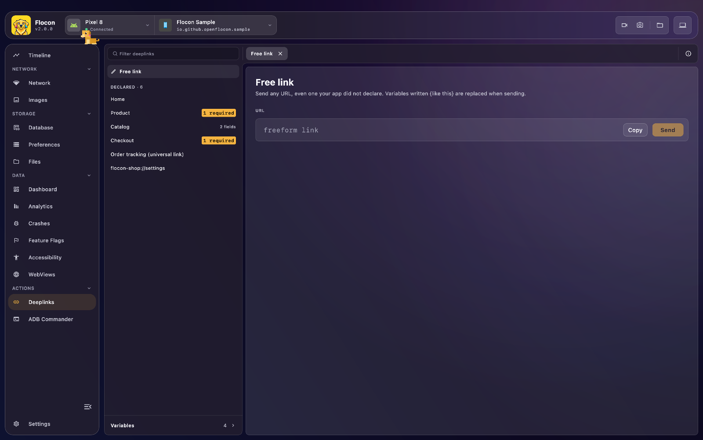

# 🔗 Deeplink Launcher

Your app declares its deeplinks, with the parts to fill in (`[userId]`) and values shared between links (`[host]`). Flocon Desktop lists them, lets you fill the parameters with autocomplete, and opens the link on the device in one click. No more hand-written `adb shell am start` or `xcrun simctl openurl` commands.



## Platform support

| | Android | KMP (iOS / JVM / Wasm) | Swift (iOS / macOS) | Flutter |
|---|:---:|:---:|:---:|:---:|
| Declare deeplinks, with parameters and variables | ✅ | ✅ | ✅ | ✅ |
| Open a link from the desktop | ✅ (adb) | ✅ iOS Simulator only (`simctl`) | ✅ iOS Simulator only (`simctl`) | ✅ Android (adb), iOS Simulator |

- **Android**: the desktop runs `adb shell am start -W -a android.intent.action.VIEW -d "<link>" <your package>`. It works on emulators and on real devices reachable with `adb`, and needs `adb` to be available on the desktop.
- **iOS Simulator**: the desktop runs `xcrun simctl openurl booted "<link>"` (macOS with Xcode only). It targets the **booted** simulator.
- **Physical iOS devices are not supported**: the links are listed, but the desktop cannot open them. Open the link from Safari or the Notes app on the device, or use `xcrun simctl openurl` on a simulator.
- **JVM / Wasm apps**: the links are listed, but the **Send** button is disabled.
- A desktop version that includes the iOS Simulator support is required (older versions only open links with `adb`).

## Setup

=== "Kotlin"

    Add the module (the `-no-op` twin keeps the same API in release builds, see [Release builds](setup.md#release-builds)):

    ```kotlin
    dependencies {
        debugImplementation("io.github.openflocon:flocon-deeplinks:LAST_VERSION")
        releaseImplementation("io.github.openflocon:flocon-deeplinks-no-op:LAST_VERSION")
    }
    ```

    Declare the deeplinks and variables when you install the plugin:

    ```kotlin
    startFlocon(FloconContext(context)) {
        install(FloconDeeplinks) {
            variable("host") {
                description = "Host scheme/domain"
                autoComplete(listOf("flocon", "myapp"))
            }

            variable("sample_comment")

            deeplink("[host]://home") {
                "host" withVariable "host"
            }

            deeplink("[host]://user/[userId]") {
                label = "User Profile"
                "userId" withAutoComplete listOf("101", "202", "303")
                "host" withVariable "host"
            }

            deeplink("[host]://post/[postId]?comment=[commentText]") {
                label = "Post Detail"
                description = "Opens a post and pre-fills comment text"
                "postId" withAutoComplete listOf("1", "2", "3")
                "commentText" withVariable "sample_comment"
                "host" withVariable "host"
            }
        }
    }
    ```

=== "Swift"

    Deeplinks are part of the `Flocon` product. Install the plugin and list the links in its options:

    ```swift
    import Flocon

    #if DEBUG
    startFlocon { flocon in
        flocon.install(.deeplinks) { options in
            options.register(
                [
                    FloconDeeplink("myapp://home", label: "Home"),
                    FloconDeeplink(
                        "myapp://user/[userId]",
                        label: "User",
                        description: "Open the profile of a user",
                        parameters: [.autoComplete("userId", ["Florent", "David"])]
                    ),
                    FloconDeeplink("myapp://[env]/settings", parameters: [.variable("env", variableName: "env")]),
                ],
                variables: [FloconDeeplinkVariable("env", suggestions: ["staging", "production"])]
            )
        }
    }
    #endif
    ```

=== "Flutter"

    ```bash
    flutter pub add flocon
    ```

    The deeplinks plugin is part of the `flocon` package and is always available: no `install(...)` is needed, you only have to start Flocon (see [Setup](setup.md)). Once Flocon is started, list your links:

    ```dart
    import 'package:flocon/flocon.dart';

    Flocon.deeplinks.register(
      [
        FloconDeeplink('myapp://home', label: 'Home'),
        FloconDeeplink(
          'myapp://user/[userId]',
          label: 'User',
          description: 'Open the profile of a user',
          parameters: [FloconDeeplinkParameter.autoComplete('userId', ['Florent', 'David'])],
        ),
        FloconDeeplink('myapp://[env]/settings', parameters: [FloconDeeplinkParameter.variable('env', variableName: 'env')]),
      ],
      variables: [FloconDeeplinkVariable('env', suggestions: ['staging', 'production'])],
    );
    ```

## Usage

### Parameters and variables

Write the parts to fill in between brackets: `myapp://user/[userId]`. Each part is one of:

- **A field** you type each time, optionally with **autocomplete suggestions** (`withAutoComplete` in Kotlin, `.autoComplete(name, suggestions)` in Swift, `FloconDeeplinkParameter.autoComplete(name, suggestions)` in Flutter).
- **A variable**: a value shared by several deeplinks (`[host]`, a user id, an environment), edited once in the desktop (`withVariable` in Kotlin, `.variable(name, variableName:)` in Swift, `FloconDeeplinkParameter.variable(name, variableName:)` in Flutter).

A variable is either a free text input, or has a list of suggestions (`autoComplete(...)` in Kotlin, `suggestions:` in Swift and Flutter). A link that uses a variable without a value shows **N required** in the sidebar and cannot be sent.

`label` is the short name shown instead of the link, `description` says what it opens.

### Register deeplinks later

Some values are only known after Flocon starts (a user id after login, a feature enabled remotely...). Register more links at any time; the desktop is updated immediately and after each reconnection.

=== "Kotlin"

    `register` **adds** to the existing links: a deeplink with the same link, or a variable with the same name, replaces the previous one.

    ```kotlin
    Flocon.deeplinksPlugin.register {
        variable("userId")

        deeplink("myapp://user/[userId]") {
            "userId" withVariable "userId"
        }
    }
    ```

=== "Swift"

    `register` **replaces** the whole list: pass every deeplink and variable you want to keep.

    ```swift
    Flocon.deeplinksPlugin.register(
        deeplinks: [FloconDeeplink("myapp://user/[userId]", parameters: [.variable("userId", variableName: "userId")])],
        variables: [FloconDeeplinkVariable("userId")]
    )
    ```

=== "Flutter"

    `register` **replaces** the whole list: pass every deeplink and variable you want to keep.

    ```dart
    Flocon.deeplinks.register(
      [FloconDeeplink('myapp://user/[userId]', parameters: [FloconDeeplinkParameter.variable('userId', variableName: 'userId')])],
      variables: [FloconDeeplinkVariable('userId')],
    );
    ```

## In Flocon Desktop

Open **Deeplinks** in the sidebar. The screen has a filter and tabs at the top, a list on the left and the content of the selected tab on the right.

- **The list** starts with **Free link**, then your **Declared** deeplinks (with a `N required` pill when a variable is missing, or the number of fields to fill), then **Recent**. The filter field above it filters both sections. A **Variables** entry at the bottom of the list shows how many shared variables exist.
- **Tabs**: clicking an entry opens it in a tab at the top, so you can keep several links at hand. Close a tab with its **x**.
- **A declared link** shows its resolved URL with **Copy** and **Send** buttons, the **shared variables** it uses and the **fields of this link**, with autocomplete. **Send** is enabled once every variable and field has a value.
- **Free link** sends any URL, even one your app did not declare. Variables written `{like_this}` are replaced with the shared variable of that name, with a **Resolved preview** and the **Detected variables** below. Recent free links have a **Reuse** button.
- **Recent** keeps the links you opened with fields filled, and the free links. Open one to send it again, or delete it from the history.
- **Variables** edits the shared variables once, for every link that uses them.

<!-- screenshot: deeplinks-freelink | scenario=doc-deeplinks | screen=deeplink | the Free link tab with a URL, the resolved preview, the detected variables and the recent links -->

<!-- screenshot: deeplinks-variables | scenario=doc-deeplinks | screen=deeplink | the Variables tab listing the shared variables with their values -->

## With AI agents (MCP)

- `list_deeplinks`: the deeplinks declared by the app (link, label, description, parameters) and their variables.
- `list_deeplink_history`: the links recently opened from Flocon, with the parameters used.
- `open_deeplink`: opens a full link on the device (adb on Android, the booted Simulator on iOS), optionally keeping it in the history.

> "List the deeplinks of the app, then open the profile of user 42 and tell me what the app shows."

See the [MCP cookbook](mcp-cookbook.md) for full workflows.

## Limitations

- The desktop opens links on Android (adb) and on the booted iOS Simulator only, not on physical iOS devices or JVM/Wasm apps.
- Kotlin `register` merges into the existing list, while the Swift and Flutter `register` replace it.
