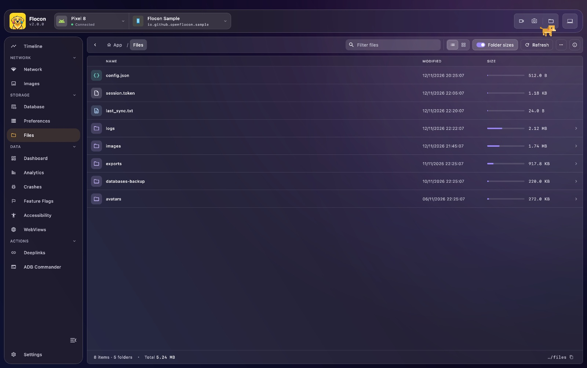
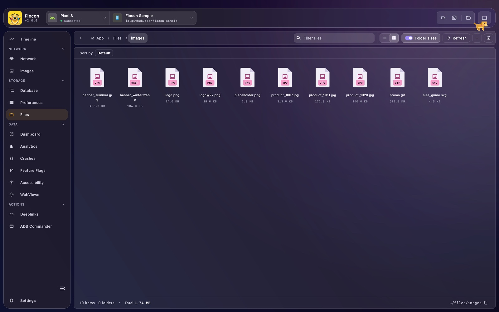

# 📁 Sandbox File Explorer

Flocon lets you explore the **sandboxed storage** of your app (files, caches, exports, logs, database files) from the desktop, without ADB shell commands or Xcode container downloads. You can open a file, copy its path, download it and delete files or the content of a folder.



## Platform support

| | Android | KMP (iOS / JVM / Wasm) | Swift (iOS / macOS) | Flutter |
|---|:---:|:---:|:---:|:---:|
| Browse, download, delete | ✅ | ✅ (iOS, JVM; no Wasm) | ✅ | ✅ |
| Default folders | ✅ | ✅ | ✅ | ✅ |
| Register your own folder | ✅ | ✅ | ✅ | ✅ |
| App Group container | n/a | ✅ (iOS) | ✅ | ❌ |

| Platform | Folders shown without registering anything |
|----------|---------|
| Android  | Files (`filesDir`), Caches (`cacheDir`), Databases |
| iOS (Kotlin) | Documents, Application Support, Caches, tmp, App container |
| JVM (Kotlin) | Working directory, Temp, Home |
| Swift | Documents, Application Support, Caches, tmp, App container |
| Flutter | Documents, Application Support, Caches, tmp, and on Android and iOS the whole App container (on macOS only inside the sandbox) |

Only these folders and the ones you register can be browsed: nothing outside of them is listed, downloaded or deleted,
and a root folder itself is never deleted.

!!! info "Wasm"
    On Wasm there is no file system, so the plugin lists no files.

## Setup

=== "Kotlin"

    ```kotlin
    dependencies {
        debugImplementation("io.github.openflocon:flocon-files:LAST_VERSION")
        releaseImplementation("io.github.openflocon:flocon-files-no-op:LAST_VERSION")
    }
    ```

    ```kotlin
    startFlocon(FloconContext(context)) {
        install(FloconFiles)
    }
    ```

=== "Swift"

    Files are part of the `Flocon` product, there is nothing else to add:

    ```swift
    import Flocon

    #if DEBUG
    startFlocon { flocon in
        flocon.install(.files)
    }
    #endif
    ```

    The files are sent to the desktop over HTTPS, on the HTTP port of the desktop (`9024` by default), with the same self-signed trust as the WebSocket. On a physical device, the app only needs the local network permission (`NSLocalNetworkUsageDescription` in `Info.plist`): **no App Transport Security exception is needed**.

=== "Flutter"

    ```bash
    flutter pub add flocon flocon_files
    ```

    ```dart
    import 'package:flocon/flocon.dart';
    import 'package:flocon_files/flocon_files.dart';

    await startFlocon((flocon) => flocon..install(const FloconFiles()));
    ```

    Downloads are uploaded to the desktop over HTTPS (port `9024`), streamed.

## Usage

### Showing another folder

=== "Kotlin"

    At install time:

    ```kotlin
    startFlocon(FloconContext(context)) {
        install(FloconFiles) {
            folder(
                displayName = "Shared preferences",
                absolutePath = "${context.filesDir.parentFile!!.absolutePath}/shared_prefs",
            )
        }
    }
    ```

    or later, once the plugin is installed:

    ```kotlin
    Flocon.filesPlugin.register(displayName = "Exports", absolutePath = exportsDir.absolutePath)
    ```

    Registering the same folder again replaces its name; registering a default folder renames it. A folder that does not exist is not shown.

    On iOS, show the container of an App Group shared with your widgets and extensions (the app needs the App Groups capability):

    ```kotlin
    Flocon.filesPlugin.registerAppGroup("group.com.example.app")
    ```

=== "Swift"

    At install time:

    ```swift
    #if DEBUG
    startFlocon { flocon in
        flocon.install(.files) { options in
            options.folder(displayName: "Exports", url: URL.documentsDirectory.appending(path: "exports"))
            options.appGroup("group.com.example.app")
        }
    }
    #endif
    ```

    or later:

    ```swift
    Flocon.filesPlugin.register(displayName: "Exports", url: exportsURL)
    Flocon.filesPlugin.register(displayName: "Exports", absolutePath: exportsPath)
    Flocon.filesPlugin.registerAppGroup("group.com.example.app")
    ```

    `registerAppGroup(_:)` shows the container of an App Group shared with your widgets and extensions, under the name `App Group · <identifier>`. The app needs the App Groups capability with this identifier, otherwise nothing is shown (with logs enabled, Flocon prints a message). Registering the same folder again renames it.

=== "Flutter"

    ```dart
    import 'package:flocon/flocon.dart';
    import 'package:flocon_files/flocon_files.dart';

    Flocon.files.register('Exports', Directory('${docs.path}/exports'));
    ```

    The plugin must be installed first (the call does nothing before). Registering the same folder again renames it. Pass `defaultRoots:` to `FloconFiles` to replace the default folders.

## In Flocon Desktop

- **Roots**: the first level lists the root folders of the app (the **App** breadcrumb goes back to it).
- **Browse**: open a folder, go back or use the breadcrumb. Switch between the list and grid views, filter by name, sort by name, size or modification date, and refresh.
- **Metadata**: size, modification date and path of each file or folder. Turn on **Folder sizes** to compute folder sizes (this can be costly on the device).
- **Open / download**: open a file to download and view it on your desktop (logs, JSON, exported databases, cached images...).
- **Copy path** of a file or folder.
- **Delete**: delete a file or a folder, or the **content** of a folder (the folder itself stays). Use the multi-select mode to delete several items at once.



!!! warning
    Deleting a file removes it from the device or simulator for good.

## With AI agents (MCP)

- `list_file_roots`: the root folders announced by the app (id, name, absolute path).
- `list_files`: the content of a directory (name, path, size, last modification).
- `read_file`: download a file and return its content (text as text, images as images, other binary files as metadata only). The file is also saved on your computer.

Example prompts: "List the cache folder of the app and show me the biggest files.", "Read `app.log` and explain the last crash."

See the [MCP cookbook](mcp-cookbook.md) for full workflows.

## Limitations

- The MCP tools read files, they do not delete them.
- Wasm: no file system.
- Flutter: no App Group helper.
