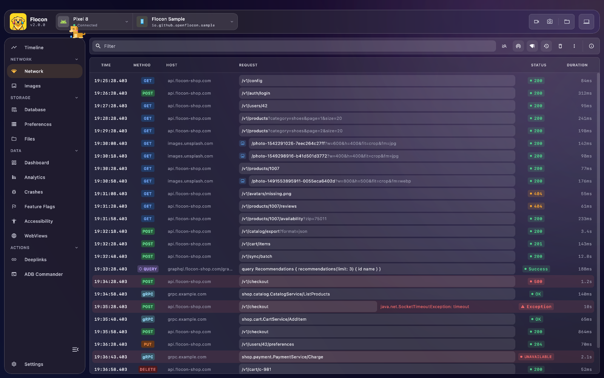

# 🛰️ GraphQL

Flocon recognises GraphQL calls among your HTTP traffic and shows them with their operation type and query, next to the usual headers, bodies and timings. There is nothing GraphQL-specific to install: if your GraphQL client goes through a [network](network.md) interceptor, its calls are captured.


<!-- screenshot: graphql-detail | scenario=doc-network | screen=network | Detail of a GraphQL call: GraphQl section with query name and type, JSON request body and response -->

## How Flocon detects GraphQL

Detection happens in the desktop app, from the HTTP request, on every platform. A call is a GraphQL call when:

- its **body is a JSON object with a `query` field** (the standard `{ "query": "...", "variables": {...} }` POST) containing a `query`, `mutation` or `subscription` operation; or
- its **URL has an `operationName` and an `extensions` query parameter containing `persistedQuery`** (a persisted query sent with GET). It is shown as a `persistedQuery` operation.

Anything else stays a regular HTTP call.

## Platform support

| | Android | KMP (iOS / JVM / Wasm) | Swift (iOS / macOS) | Flutter |
|---|:---:|:---:|:---:|:---:|
| GraphQL detection | ✅ | ✅ | ✅ | ✅ |

The detection does not depend on the SDK, only on the shape of the request. What changes is which client you plug Flocon into.

## Setup

Use the [network setup](network.md#setup) of the HTTP client your GraphQL library relies on.

=== "Kotlin"

    Apollo Kotlin on Android and JVM delegates its calls to OkHttp. Give it an `OkHttpClient` with the Flocon interceptor:

    ```kotlin
    val okHttpClient = OkHttpClient.Builder()
        .addInterceptor(FloconOkhttpInterceptor())
        .build()

    val apolloClient = ApolloClient.Builder()
        .serverUrl("https://your-api.com/graphql")
        .okHttpClient(okHttpClient)
        .build()
    ```

    `okHttpClient(...)` is the Apollo extension from `com.apollographql.apollo.network.okHttpClient`. Do not forget `install(FloconNetwork)` when you start Flocon.

=== "Swift"

    Any GraphQL client that sends its requests with `URLSession` is captured once its session uses a Flocon configuration:

    ```swift
    startFlocon { $0.install(.network) }

    let session = URLSession(configuration: .default.withFlocon())
    ```

    Hand `session` (or the configuration) to the GraphQL client, if it lets you choose one. The calls made with `URLSession.shared` are captured by `install(.network)` alone.

=== "Flutter"

    Use a Dio or `package:http` client wrapped with Flocon, and give it to your GraphQL client:

    ```dart
    final client = http.Client().withFlocon();   // flocon_http
    ```

    With `graphql_flutter`, pass it to the link: `HttpLink('https://api.example.com/graphql', httpClient: client)`.

## In Flocon Desktop

GraphQL calls are listed in the **Network** screen, tagged with their operation (query, mutation, ...), and open in the usual detail panel with an extra **GraphQl** section:

- the **query**, its **type** and its **status**;
- the formatted request body, with the `variables`, and the formatted response;
- the HTTP headers, status code, duration and size;
- the **Export GraphQl as image** action, to share the section.

<!-- screenshot: graphql-section | scenario=doc-network | screen=network | GraphQl section of the detail panel -->

!!! note "Status of a GraphQL call"
    The GraphQL status follows the **HTTP status code** (success for 2xx). A GraphQL response that returns an `errors` array with a `200` is shown as a success: read the response body to see the errors.

## With AI agents (MCP)

GraphQL calls come through the network tools, with their type and query:

- `list_network_calls`: use the `type` filter to keep GraphQL calls.
- `get_network_call`: returns the GraphQL query and the response.
- `search_network_calls`: finds a query by its name.

> "Which GraphQL mutation failed in the last session, and with what variables?"

See the [MCP cookbook](mcp-cookbook.md) for full workflows.

## Limitations

- Calls made with a GraphQL client that does not use an intercepted HTTP client are not captured.
- GraphQL over WebSocket (subscriptions) is a WebSocket connection: see [WebSockets](websocket.md).
