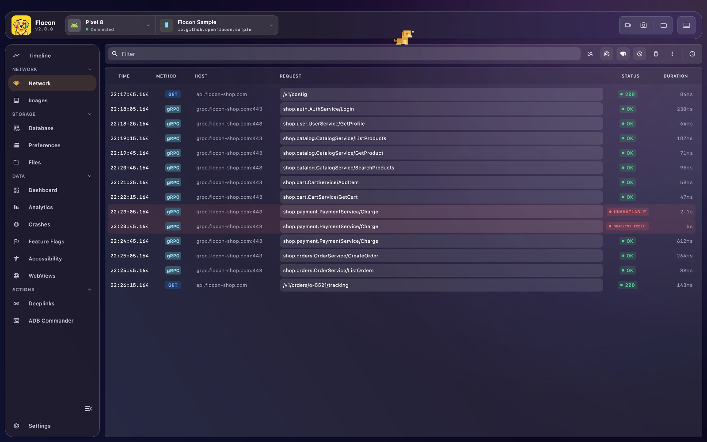
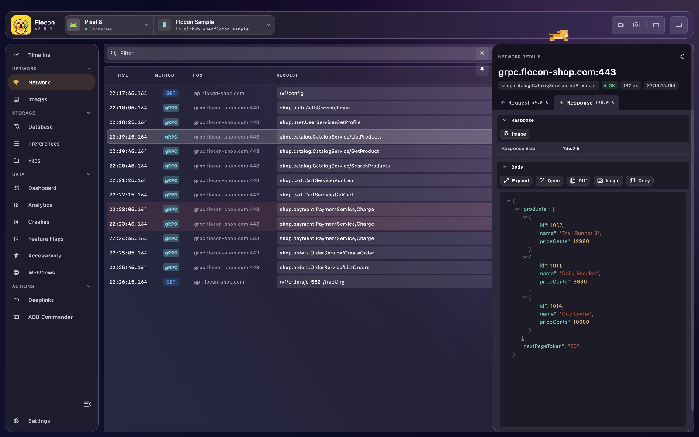
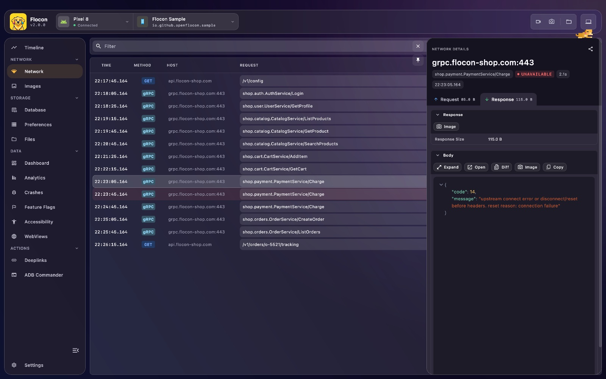

# ⚡ gRPC

Flocon logs your **gRPC calls** in the Network screen. Open a call to see the server, method, decoded messages, metadata, duration and gRPC status.




For each call you see:

- the **server** as the URL, and the **full method name** (`helloworld.Greeter/SayHello`);
- the **request and response messages**, as JSON for grpc-java and grpc-swift, or as generated message strings for Square Wire (for example, `HelloRequest{name=World}`);
- the **metadata** (headers), the **duration** and the **gRPC status** (`OK`, `NOT_FOUND`...);
- the **error**, such as a refused connection, when the call fails.

## Platform support

| | Android | KMP (iOS / JVM / Wasm) | Swift (iOS / macOS) | Flutter |
|---|:---:|:---:|:---:|:---:|
| Inspect grpc-java or grpc-swift calls | ✅ `grpc-java` / `grpc-android` | ❌ | ✅ `grpc-swift` 1.x | ❌ |
| Inspect unary Square Wire calls | Upcoming | Upcoming (requires a Wire client for the target) | — | — |
| Bad network simulation | ✅ latency and exceptions with `grpc-java` | ❌ | ❌ | ❌ |
| Mocks | ❌ | ❌ | ❌ | ❌ |

!!! note "Not available in the Flutter SDK yet"
    Flutter has no gRPC interceptor. Only HTTP calls (Dio, `package:http`) and WebSocket events are reported.

## Setup

=== "Kotlin (grpc-java)"

    !!! warning "gRPC version"
        Use `grpc-android` / `grpc-java` **`1.70.0`** or later.

    gRPC calls are reported to the network plugin: the network plugin is part of `flocon` (see [Network](network.md#setup)), install it:

    ```kotlin
    startFlocon(FloconContext(context)) {
        install(FloconNetwork)
    }
    ```

    Android projects use either the standard Protobuf runtime or the lite one. Flocon has one artifact for each, to serialise the messages to JSON properly:

    === "Protobuf Lite (recommended for Android)"

        ```kotlin
        dependencies {
            implementation("com.google.protobuf:protobuf-kotlin-lite:$PROTOBUF_VERSION")

            implementation("io.github.openflocon:flocon-grpc-interceptor-lite:LAST_VERSION")
        }
        ```

    === "Full Protobuf"

        ```kotlin
        dependencies {
            implementation("com.google.protobuf:protobuf-kotlin:$PROTOBUF_VERSION")

            implementation("io.github.openflocon:flocon-grpc-interceptor:LAST_VERSION")
        }
        ```

    !!! note "Before 2.0.1"
        The gRPC interceptors were added with `debugImplementation`, and their `-no-op` twin (`flocon-grpc-interceptor-lite-no-op` or `flocon-grpc-interceptor-no-op`) with `releaseImplementation`. The network plugin was in a separate `flocon-network-core` module. See the [migration guide](migration.md#after-200-one-flocon-no-op-for-release-builds).

    With `flocon-no-op` in release builds (see [Release builds](install-kotlin.md#release-builds)), the interceptor forwards every call untouched, so the same code runs in debug and release.

=== "Kotlin (Square Wire)"

    !!! info "Unreleased adapter"
        No published Flocon SDK version contains this module yet. To try it, check out [FloconKotlin PR #4](https://github.com/openflocon/FloconKotlin/pull/4) and run `PROJECT_VERSION_NAME=wire-local ./publishLocal.sh` from the SDK root. Add `mavenLocal()` to your app's dependency repositories and use `wire-local` for `LAST_VERSION` in your Flocon dependencies.

    Install the [network plugin](network.md#setup) at startup with `install(FloconNetwork)`. Add the adapter to the module that creates your Wire service. For Kotlin Multiplatform, put the dependency in `commonMain.dependencies`.

    ```kotlin
    implementation("io.github.openflocon:flocon-wire-grpc:LAST_VERSION")
    ```

    Use the same version for the adapter and the Flocon SDK. The adapter depends on Wire 7.2.2 and wraps the client your app already uses. On iOS and Wasm, supply a Wire `GrpcClient` with a transport for that target.

    On Android, add `flocon-no-op` to the app's [release configuration](install-kotlin.md#release-builds). In those builds, `withFlocon` returns the original client.

=== "Swift"

    gRPC lives in a separate package, `FloconSwiftGrpc`, so that apps without gRPC do not depend on `grpc-swift` and SwiftNIO. It needs iOS 15+ or macOS 12+ and `grpc-swift` 1.26.0 or a later 1.x.

    ```swift
    dependencies: [
        .package(url: "https://github.com/openflocon/FloconSwiftGrpc.git", from: "LAST_VERSION"),
    ],
    targets: [
        .target(name: "MyApp", dependencies: [
            .product(name: "FloconGrpc", package: "FloconSwiftGrpc"),
        ]),
    ]
    ```

    `FloconGrpc` includes the Flocon SDK: `import FloconGrpc` is enough to start it. The calls are logged through the network plugin, so install it:

    ```swift
    import FloconGrpc

    #if DEBUG
    startFlocon { flocon in
        flocon.install(.network)
    }
    #endif
    ```

    `Flocon.initialize()` installs every plugin and needs nothing more. The interceptor does nothing until the SDK is started.

=== "Flutter"

    !!! note "Not available in the Flutter SDK yet"
        Flutter cannot report gRPC calls.

## Usage

=== "Kotlin (grpc-java)"

    Attach `FloconGrpcInterceptor` to your `ManagedChannelBuilder`:

    ```kotlin
    // lite artifact: io.github.openflocon.flocon.grpc.lite.FloconGrpcInterceptor
    // full artifact: io.github.openflocon.flocon.grpc.FloconGrpcInterceptor
    val channel = ManagedChannelBuilder.forAddress(host, port)
        .intercept(FloconGrpcInterceptor())
        .build()
    ```

=== "Kotlin (Square Wire)"

    Wrap your configured `GrpcClient` before constructing the generated service. Pass the host and port from your endpoint configuration as `authority`. Flocon uses it as the displayed server name.

    ```kotlin
    import io.github.openflocon.flocon.wire.grpc.withFlocon

    val client = grpcClient.withFlocon(authority = "api.example.com:443")
    val greeter = GrpcGreeterClient(client)
    val reply = greeter.SayHello().execute(HelloRequest(name = "World"))
    ```

    In **Network**, open `helloworld.Greeter/SayHello` to see the request, response and final gRPC status. Streaming calls pass directly to Wire. If you also use Flocon's OkHttp interceptor, exclude requests tagged with Wire's `GrpcMethod` in its `shouldLog` filter to avoid a second HTTP entry.

=== "Swift"

    `grpc-swift` builds the interceptors of each call from the interceptor factory of the generated client. Return a `FloconGrpcClientInterceptor` for each method:

    ```swift
    import FloconGrpc
    import GRPC

    struct GreeterInterceptors: Helloworld_GreeterClientInterceptorFactoryProtocol {
        func makeSayHelloInterceptors() -> [ClientInterceptor<Helloworld_HelloRequest, Helloworld_HelloReply>] {
            [FloconGrpcClientInterceptor(authority: "api.example.com:443")]
        }
    }

    let client = Helloworld_GreeterAsyncClient(channel: channel, interceptors: GreeterInterceptors())
    ```

    `authority` is shown as the URL of the calls: an interceptor does not know the channel it runs on.

    !!! warning "Streaming calls"
        For a streaming call, Flocon shows the **first request message** and the **last response message** only.

=== "Flutter"

    !!! note "Not available in the Flutter SDK yet"

## In Flocon Desktop

!!! tip "In the Timeline"
    gRPC calls also show up in the [Timeline](timeline.md), like any network call.

gRPC calls are listed with the other calls in the **Network** screen. Their URL is the server, their method is the full method name, and their status is the gRPC status (`OK`, `NOT_FOUND`...). Click a call to see its metadata and decoded request and response messages.



The [bad network simulation](bad-quality.md) applies to the Android grpc-java interceptor. gRPC mocks are unavailable across SDKs.

## With AI agents (MCP)

gRPC calls come through the network tools, with their status:

- `list_network_calls`: filter on the gRPC type, or on errors only (a status other than `OK`).
- `get_network_call`: returns the metadata, decoded messages and gRPC status.

> "List the gRPC calls that failed with a status other than OK and show me the request of the first one."

See the [MCP cookbook](mcp-cookbook.md) for full workflows.

## Limitations

- The Square Wire adapter records unary calls only. On JVM, keep the original `GrpcClient` for Wire's `newBuilder()`.
- The Flutter SDK has no gRPC interceptor.
- gRPC calls cannot be mocked.
- On Swift, a streaming call shows only its first request message and its last response message.
- The Swift SDK does not apply the bad network simulation to gRPC.
