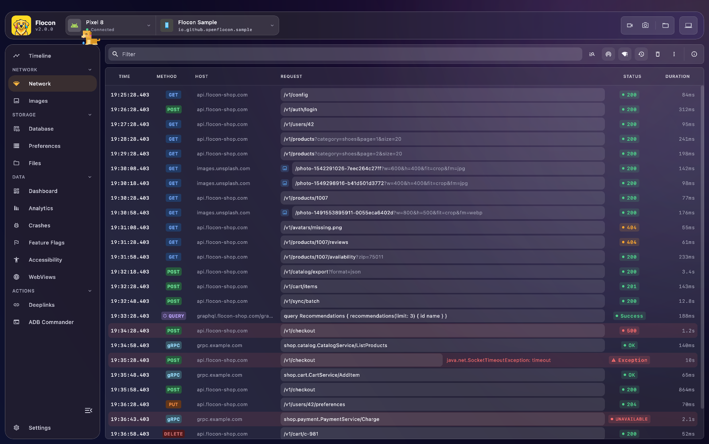

# ⚡ gRPC

Flocon logs your **gRPC calls** in the Network screen: the server, the method, the request and response messages as JSON, the metadata, the duration and the gRPC status. It saves you from decoding Protocol Buffers by hand.


<!-- screenshot: grpc-detail | scenario=doc-network | screen=network | Detail of a gRPC call: authority, full method name, JSON request and response messages, metadata -->

For each call you see:

- the **server** as the URL, and the **full method name** (`helloworld.Greeter/SayHello`);
- the **request and response messages**, serialised as JSON;
- the **metadata** (headers), the **duration** and the **gRPC status** (`OK`, `NOT_FOUND`...);
- the **error**, such as a refused connection, when the call fails.

## Platform support

| | Android | KMP (iOS / JVM / Wasm) | Swift (iOS / macOS) | Flutter |
|---|:---:|:---:|:---:|:---:|
| Inspect gRPC calls | ✅ `grpc-java` / `grpc-android` | ❌ | ✅ `grpc-swift` 1.x | ❌ |
| Bad network simulation | ✅ latency and exceptions | ❌ | ❌ | ❌ |
| Mocks | ❌ | ❌ | ❌ | ❌ |

!!! note "Not available in the Flutter SDK yet"
    Flutter has no gRPC interceptor. Only HTTP calls (Dio, `package:http`) and WebSocket events are reported.

!!! note "Not available in Kotlin Multiplatform yet"
    The gRPC interceptors are Android only (`grpc-java`). On iOS, use the [Swift SDK](#setup) with `grpc-swift`.

## Setup

=== "Kotlin"

    !!! warning "gRPC version"
        Use `grpc-android` / `grpc-java` **`1.70.0`** or later.

    gRPC calls are reported to the network plugin: add `flocon-network-core` (see [Network](network.md#setup)) and install it:

    ```kotlin
    startFlocon(FloconContext(context)) {
        install(FloconNetwork)
    }
    ```

    Android projects use either the standard Protobuf runtime or the lite one. Flocon has one artifact for each, to serialise the messages to JSON properly:

    === "Protobuf Lite (recommended for Android)"

        ```kotlin
        dependencies {
            implementation("com.google.protobuf:protobuf-kotlin-lite:$PROTOBUF_VERSION")

            debugImplementation("io.github.openflocon:flocon-grpc-interceptor-lite:LAST_VERSION")
            releaseImplementation("io.github.openflocon:flocon-grpc-interceptor-lite-no-op:LAST_VERSION")
        }
        ```

    === "Full Protobuf"

        ```kotlin
        dependencies {
            implementation("com.google.protobuf:protobuf-kotlin:$PROTOBUF_VERSION")

            debugImplementation("io.github.openflocon:flocon-grpc-interceptor:LAST_VERSION")
            releaseImplementation("io.github.openflocon:flocon-grpc-interceptor-no-op:LAST_VERSION")
        }
        ```

    The `-no-op` artifacts expose the same API (`FloconGrpcInterceptor`, `FloconGrpcFormatter`) and forward every call untouched, so the same code compiles in debug and release.

=== "Swift"

    gRPC lives in a separate package, `FloconSwiftGrpc`, so that apps without gRPC do not depend on `grpc-swift` and SwiftNIO. It needs iOS 15+ or macOS 12+ and `grpc-swift` 1.26.0 or a later 1.x.

    ```swift
    dependencies: [
        .package(url: "https://github.com/openflocon/FloconSwiftGrpc.git", from: "LAST_VERSION"),
    ],
    targets: [
        .target(name: "MyApp", dependencies: [
            .product(name: "FloconGrpc", package: "FloconSwiftGrpc"),
        ]),
    ]
    ```

    `FloconGrpc` includes the Flocon SDK: `import FloconGrpc` is enough to start it. The calls are logged through the network plugin, so install it:

    ```swift
    import FloconGrpc

    startFlocon { flocon in
        flocon.install(.network)
    }
    ```

    `Flocon.initialize()` installs every plugin and needs nothing more. The interceptor does nothing until the SDK is started.

=== "Flutter"

    !!! note "Not available in the Flutter SDK yet"
        Flutter cannot report gRPC calls.

## Usage

=== "Kotlin"

    Attach `FloconGrpcInterceptor` to your `ManagedChannelBuilder`:

    ```kotlin
    // lite artifact: io.github.openflocon.flocon.grpc.lite.FloconGrpcInterceptor
    // full artifact: io.github.openflocon.flocon.grpc.FloconGrpcInterceptor
    val channel = ManagedChannelBuilder.forAddress(host, port)
        .intercept(FloconGrpcInterceptor())
        .build()
    ```

=== "Swift"

    `grpc-swift` builds the interceptors of each call from the interceptor factory of the generated client. Return a `FloconGrpcClientInterceptor` for each method:

    ```swift
    import FloconGrpc
    import GRPC

    struct GreeterInterceptors: Helloworld_GreeterClientInterceptorFactoryProtocol {
        func makeSayHelloInterceptors() -> [ClientInterceptor<Helloworld_HelloRequest, Helloworld_HelloReply>] {
            [FloconGrpcClientInterceptor(authority: "api.example.com:443")]
        }
    }

    let client = Helloworld_GreeterAsyncClient(channel: channel, interceptors: GreeterInterceptors())
    ```

    `authority` is shown as the URL of the calls: an interceptor does not know the channel it runs on.

    !!! warning "Streaming calls"
        For a streaming call, Flocon shows the **first request message** and the **last response message** only.

=== "Flutter"

    !!! note "Not available in the Flutter SDK yet"

## In Flocon Desktop

gRPC calls are listed with the other calls in the **Network** screen. Their URL is the server, their method is the full method name, and their status is the gRPC status (`OK`, `NOT_FOUND`...). Click a call to see its metadata and its request and response messages as formatted JSON.

<!-- screenshot: grpc-error | scenario=doc-network | screen=network | A gRPC call that failed, with its error and status in the detail panel -->

The [bad network simulation](bad-quality.md) applies to gRPC calls on Android. Mocks do not.

## With AI agents (MCP)

gRPC calls come through the network tools, with their status:

- `list_network_calls`: filter on the gRPC type, or on errors only (a status other than `OK`).
- `get_network_call`: returns the metadata, the JSON messages and the gRPC status.

> "List the gRPC calls that failed with a status other than OK and show me the request of the first one."

See the [MCP cookbook](mcp-cookbook.md) for full workflows.

## Limitations

- Android (`grpc-java`) and iOS / macOS (`grpc-swift` 1.x) only. No Kotlin Multiplatform, no Flutter.
- gRPC calls cannot be mocked.
- On Swift, a streaming call shows only its first request message and its last response message.
- The Swift SDK does not apply the bad network simulation to gRPC.
