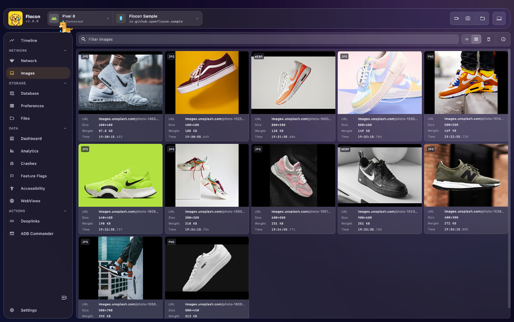

# 🖼️ Images

Flocon collects the **images your app downloads** (avatars, feed thumbnails, banners, media) in a gallery. It helps you debug a missing placeholder, a CDN that resolves wrong, an image that is too heavy, or a cache that does not cache.



There is no separate plugin for images. An image is **a network call whose response is flagged as an image**: Flocon does not send the image bytes, it sends the call, and the desktop app downloads the image from its URL to display it.

!!! info "The URL must be reachable from your computer"
    Since the desktop fetches the image itself, an image behind a private network, a short-lived signed URL or a header only your app can send will not show up as a picture. The call is still listed.

## How an image is detected

A response is an image when:

- its `Content-Type` starts with `image/` (automatic, on every SDK), or
- your `isImage` option returns `true` for it. Use it for CDNs that answer with `application/octet-stream` or without a content type.

## Platform support

| | Android | KMP (iOS / JVM / Wasm) | Swift (iOS / macOS) | Flutter |
|---|:---:|:---:|:---:|:---:|
| `image/*` detection | ✅ | ✅ | ✅ | ✅ |
| `isImage` predicate | ✅ OkHttp, Ktor | ✅ Ktor (and OkHttp on JVM) | ✅ `FloconNetworkOptions` | ✅ `FloconNetwork` |

Images are captured through the [network](network.md) interceptors, so an image loader is covered only when it uses an intercepted HTTP client (OkHttp or Ktor, a `URLSession` with `withFlocon()`, a Dio or `http` client).

## Setup

Follow the [network setup](network.md#setup). Then make your image loader use the intercepted HTTP client.

=== "Kotlin"

    With Coil 3, give the `ImageLoader` the client that has the Flocon interceptor.

    === "OkHttp"

        ```kotlin
        SingletonImageLoader.setSafe {
            ImageLoader.Builder(context = context)
                .components {
                    add(
                        OkHttpNetworkFetcherFactory(
                            callFactory = { okHttpClient }, // built with FloconOkhttpInterceptor
                        )
                    )
                }
                .build()
        }
        ```

        `OkHttpNetworkFetcherFactory` comes from `io.coil-kt.coil3:coil-network-okhttp`.

    === "Ktor"

        ```kotlin
        SingletonImageLoader.setSafe {
            ImageLoader.Builder(context = context)
                .components {
                    add(KtorNetworkFetcherFactory(httpClient)) // built with FloconKtorPlugin
                }
                .build()
        }
        ```

        `KtorNetworkFetcherFactory` comes from `io.coil-kt.coil3:coil-network-ktor3`.

=== "Swift"

    Make your image downloader use a Flocon session configuration. Kingfisher, for example:

    ```swift
    KingfisherManager.shared.downloader.sessionConfiguration = .default.withFlocon()
    ```

    Images loaded through `URLSession.shared` are captured by `install(.network)`.

    To flag more images than `Content-Type: image/*`:

    ```swift
    #if DEBUG
    startFlocon { flocon in
        flocon.install(.network) { options in
            options.isImage = { request, _ in request.url?.path.hasPrefix("/images/") == true }
        }
    }
    #endif
    ```

=== "Flutter"

    Load your images through a `flocon_http` or `flocon_dio` client. Responses with an `image/*` type are flagged automatically. To flag more:

    ```dart
    await startFlocon((flocon) => flocon
      ..install(FloconNetwork(
        isImage: (request, response) => request.url.host == 'images.example.com',
      )));
    ```

    `Image.network` and the image packages that use their own HTTP client are not captured.

## Usage

Nothing to call: images appear in the **Images** screen as your app loads them.

## In Flocon Desktop

Open the **Images** screen.

- **Gallery**: switch between a **grid** and a **list**. Each image shows its thumbnail, URL, size, weight, format and load time.
- **Filter**: type in **Filter images** to keep the URLs that match.
- **Viewer**: click an image to open it large. **Zoom in**, **Zoom out**, **Fit to window**, move with the previous and next arrows or the filmstrip, and close it with **Close**.
- **Actions**: **Copy URL**, **Open in browser** and **Download image** save the file to your computer.
- **Clear images**: empties the gallery.

<!-- screenshot: images-viewer | scenario=doc-images | screen=images | Image viewer open with zoom controls, the filmstrip and the URL, size and weight of the image -->

The call of an image is also in the **Network** screen, flagged as an image response, with its headers and timings.

## With AI agents (MCP)

- `list_images`: lists the images loaded by the app (URL and load time, newest first), with a text filter. It does not return the image content.

> "List the images loaded on the home screen and tell me which hosts serve them."

See the [MCP cookbook](mcp-cookbook.md) for full workflows.

## Limitations

- The image bytes are not sent by the app: the desktop downloads them from the URL.
- Only images loaded by an intercepted HTTP client are listed.
