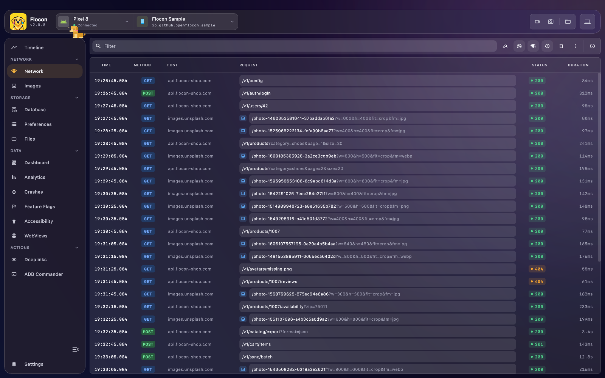
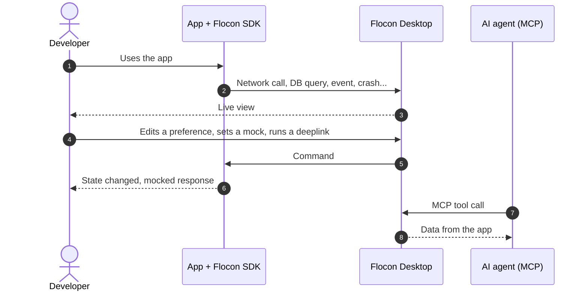

# Flocon

Inspect and control your running <strong>Android</strong>, <strong>Kotlin Multiplatform</strong>, <strong>iOS (Swift)</strong> and <strong>Flutter</strong> apps from a desktop app: network, databases, preferences, files, dashboards, crashes and more. AI agents can drive it too, through <strong>MCP</strong>.

[Get Started :octicons-arrow-right-24:](setup.md){ .md-button .md-button--primary }
[Download Desktop App :octicons-download-24:](https://github.com/openflocon/Flocon/releases){ .md-button }
[View on GitHub :octicons-mark-github-16:](https://github.com/openflocon/Flocon){ .md-button }

---

<!-- screenshot: home-timeline-graph | scenario=doc-timeline | screen=timeline | the timeline graph view of one session, network bars, database, analytics and log lanes -->

---

## ⚡ Highlights

-   :material-chart-timeline-variant: __Timeline: start here__

    ---

    Everything your app did, in order, on one screen: network calls, database queries, analytics, logs, crashes. Switch to the graph to see a whole session at a glance.

    [:octicons-arrow-right-16: Timeline](timeline.md)

-   :material-swap-horizontal: __Network__

    ---

    HTTP (OkHttp, Ktor, URLSession, Dio, `http`), GraphQL, WebSockets and gRPC, with live mocks, bad network simulation and an image preview.

    [:octicons-arrow-right-16: HTTP & REST](network.md) · [Mocking](mocking.md) · [gRPC](grpc.md)

-   :material-database: __Storage__

    ---

    Browse and query your SQLite databases, edit preferences and key-value stores, explore and download the files of your app.

    [:octicons-arrow-right-16: Databases](database.md) · [Preferences](sharedpref.md) · [Files](files.md)

-   :material-view-dashboard: __Custom debugging__

    ---

    Dashboards with buttons and forms, tables, parameterized deeplinks, analytics events and feature flags, all rendered on your desktop.

    [:octicons-arrow-right-16: Dashboards](dashboard.md) · [Deeplinks](deeplink.md) · [Analytics](analytics.md)

-   :material-bug: __Observability__

    ---

    Crash reports with stack traces, accessibility events and WebView traffic.

    [:octicons-arrow-right-16: Crash reporter](crashreporter.md) · [Accessibility](accessibility.md) · [WebView](webview.md)

-   :material-robot: __AI agents (MCP)__

    ---

    Flocon Desktop is an MCP server: let Claude Code, Cursor or Gemini read your network calls, query a database or set a mock.

    [:octicons-arrow-right-16: MCP overview](mcp.md) · [Cookbook](mcp-cookbook.md)

-   :material-cellphone-link: __Four SDKs, one desktop__

    ---

    Kotlin (Android, KMP), Swift (iOS, macOS) and Flutter SDKs share the same protocol and the same desktop app. Pick yours and connect in minutes.

    [:octicons-arrow-right-16: Connect your app](setup.md)

---

## 🏗️ Architecture Overview

Your app, with the Flocon SDK in its debug build, connects to Flocon Desktop over a secure WebSocket (through `adb reverse` on Android emulators and USB devices, directly on iOS simulators and over Wi-Fi):

---

## 📱 Platform support

What each SDK sends to the desktop. Click a feature for its details.

| Feature | Android | KMP (iOS / JVM / Wasm) | Swift (iOS / macOS) | Flutter |
| :--- | :---: | :---: | :---: | :---: |
| [HTTP & REST](network.md) | ✅ OkHttp, Ktor | ✅ Ktor (OkHttp on JVM) | ✅ `URLSession` | ✅ Dio, `http` |
| [Mocking](mocking.md) | ✅ | ✅ | ✅ | ✅ |
| [Bad network simulation](bad-quality.md) | ✅ | ✅ | ✅ | ✅ |
| [GraphQL](graphql.md) | ✅ | ✅ | ✅ | ✅ |
| [WebSockets](websocket.md) | ✅ automatic (OkHttp) | ✅ manual logging | ✅ manual logging | ✅ manual logging |
| [gRPC](grpc.md) | ✅ | ❌ | ✅ add-on `FloconSwiftGrpc` | ❌ |
| [Images](image.md) | ✅ | ✅ | ✅ | ✅ |
| [Databases](database.md) | ✅ Room, SQLDelight | ✅ Room, SQLDelight (Wasm: Room 3 only) | ✅ SQLite (Core Data, GRDB...) | ✅ SQLite (sqflite, Drift...) |
| [Preferences](sharedpref.md) | ✅ SharedPreferences, DataStore | ✅ (DataStore: no Wasm) | ✅ UserDefaults, keychain | ✅ SharedPreferences |
| [Files](files.md) | ✅ | ✅ (Wasm: no browsing) | ✅ | ✅ |
| [Dashboards](dashboard.md) | ✅ | ✅ | ✅ | ✅ |
| [Tables](table.md) | ✅ | ✅ | ✅ | ✅ |
| [Deeplinks](deeplink.md) | ✅ | ✅ | ✅ | ✅ |
| [Analytics](analytics.md) | ✅ | ✅ | ✅ | ✅ |
| [Feature flags](featureflags.md) | ✅ | ✅ | ✅ | ✅ |
| [Timeline](timeline.md) | ✅ | ✅ | ✅ | ✅ |
| [Crash reporter](crashreporter.md) | ✅ | ✅ | ✅ | ✅ Dart errors only |
| [Accessibility](accessibility.md) | ✅ automatic | ⚠️ iOS partial, JVM / Wasm manual | ❌ | ❌ |
| [WebView](webview.md) | ✅ automatic `attach` | ⚠️ manual API only | ❌ | ❌ |

See each page for the exact limits per platform, and [Connect your app](setup.md) for the modules and packages to add.

---

Ready to inspect your app in real-time?

[Connect your app :octicons-arrow-right-24:](setup.md){ .md-button .md-button--primary .md-button--large }

