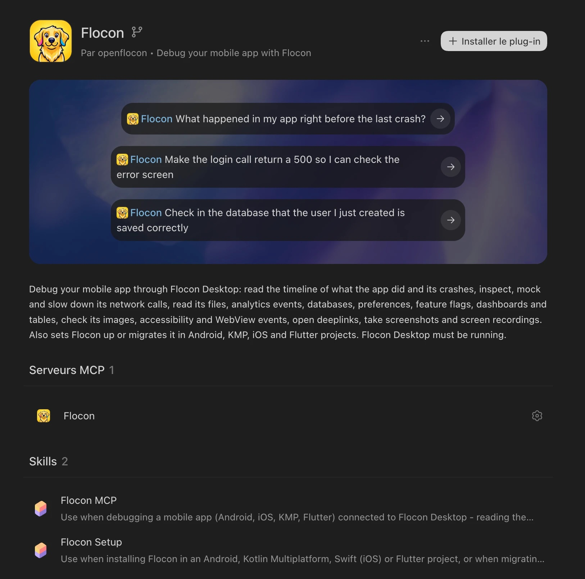
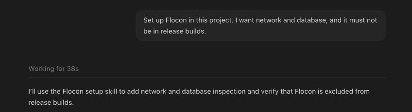

# Install with the Flocon plugin

The Flocon plugin for AI coding agents comes with the `flocon-setup` skill: ask your agent to set Flocon up, and it adds the SDK to your project for you, whatever the platform (Android, Kotlin Multiplatform, Swift, Flutter). The same plugin also connects the agent to the [MCP server](mcp.md) of Flocon Desktop, to debug your app afterwards.

## 1. Install the plugin

=== "Claude Code"

    ```
    /plugin marketplace add openflocon/Flocon
    /plugin install flocon@flocon
    ```

=== "Codex"

    ```bash
    codex plugin marketplace add openflocon/Flocon
    ```

    Then install **flocon** from the `/plugins` browser: it brings the Flocon MCP server and the two skills, **Flocon MCP** and **Flocon Setup**.

    { width="560" }

=== "Cursor"

    In the Cursor dashboard, open **Plugins & MCPs → Add Marketplace → Import from Repo**, paste `https://github.com/openflocon/Flocon`, then install **flocon** from **Customize**.

Other agents (Gemini CLI, Antigravity, VS Code...) get the MCP server but not the skills: install the SDK by hand ([Kotlin](install-kotlin.md), [Swift](install-swift.md), [Flutter](install-flutter.md)).

## 2. Ask your agent

Open your agent in the folder of your app and ask, in plain text:

> Set up Flocon in this project. I want network and database, and it must not be in release builds.



The agent:

1. **Detects the platform** from the project files: Android, Kotlin Multiplatform, Swift (`.xcodeproj`, `Package.swift`) or Flutter (`pubspec.yaml`).
2. **Detects the version** if Flocon is already there, and picks a path: install, migrate from 1.x to 2.0, or only add the missing plugins.
3. **Adds the dependencies**: debug module and `-no-op` twin for release in Kotlin, `FloconSwift` with Swift Package Manager, or `flutter pub add flocon` and the plugin packages.
4. **Starts Flocon** in the app, and installs **only the plugins the project really uses** (it searches the code instead of guessing).
5. **Keeps it out of release**: it inspects the real build variants and tells you exactly what it did (SDK inactive vs absent from the binary).
6. **Builds** the touched targets and says what was **not** verified (running on a device, connection to Flocon Desktop, release build).

It works on a branch and does not touch your unrelated uncommitted changes. The same prompt migrates a Kotlin 1.x integration, see [Migrating from 1.x](migration.md).

## 3. Check it works

Run the app with Flocon Desktop open (see [Connect](connect.md)), then ask your agent:

> List my network calls.

If a tool returns nothing, the agent can tell which wiring is missing. More prompts in the [Cookbook](mcp-cookbook.md).
