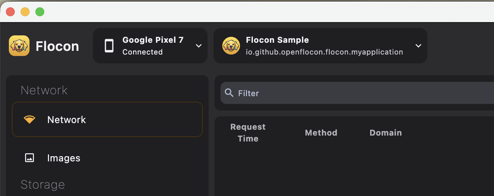
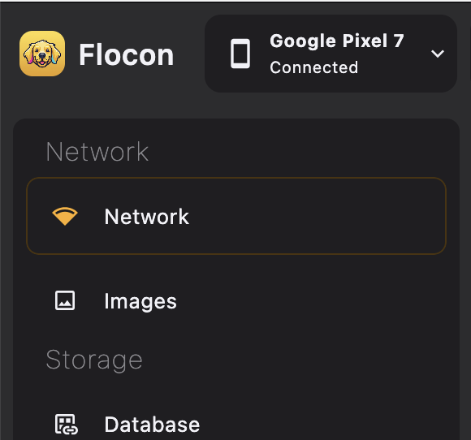
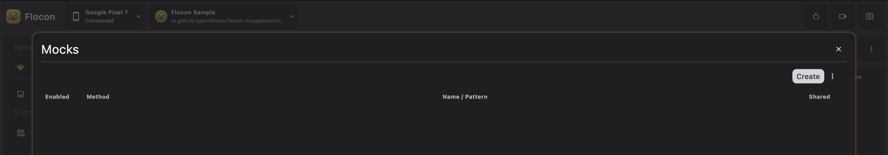
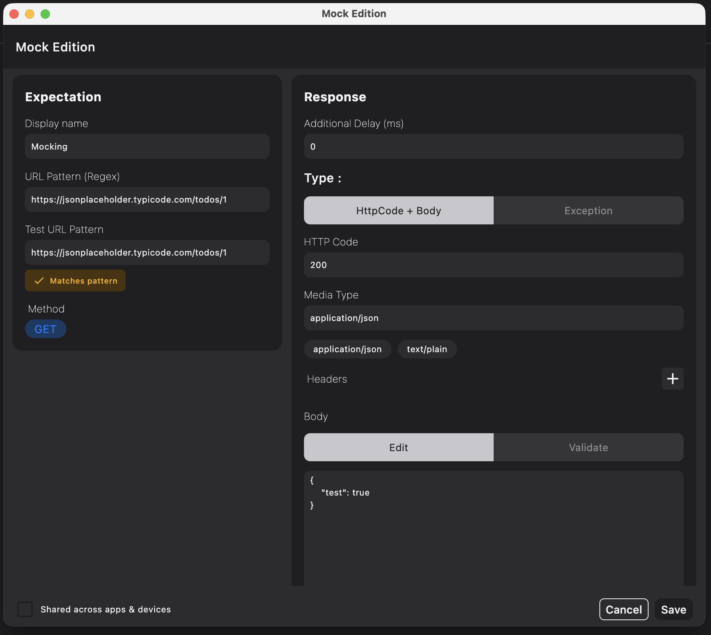
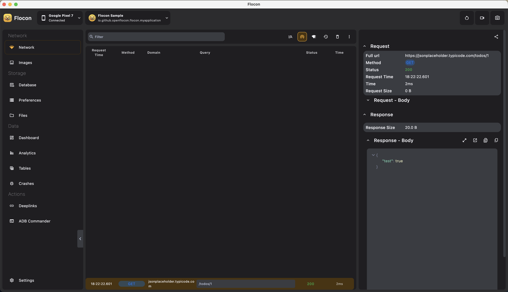

# 🎭 Mocking

Flocon lets you **intercept a live HTTP call and answer it with a response you wrote**, from the desktop app. Test a 401, a 404 or a 500, feed your screen a JSON from an unreleased backend, or add a delay to see your loaders, all without editing your code or redeploying.

<!-- screenshot: mocking-list | scenario=doc-network | screen=network | Mocks manager open, listing two mocks (one enabled, one disabled) -->


You can:

- **Simulate errors**: return `401`, `404`, `429` or `500` and check your error handling.
- **Inject a payload**: answer with any JSON body, headers and status code.
- **Throw an exception**: simulate a dropped connection (`IOException`, timeout) instead of a response.
- **Add a delay**: slow the mocked response down.
- **Clone a real call**: turn a captured call into a mock in one click.

Mocks are applied by the [network](network.md) interceptors. To degrade the real network instead of replacing responses, see [Bad Network Simulation](bad-quality.md).

## Platform support

| | Android | KMP (iOS / JVM / Wasm) | Swift (iOS / macOS) | Flutter |
|---|:---:|:---:|:---:|:---:|
| HTTP mocks | ✅ OkHttp, Ktor | ✅ Ktor (and OkHttp on JVM) | ✅ `URLSession` | ✅ Dio, `package:http` |
| gRPC mocks | ❌ | ❌ | ❌ | ❌ |
| WebSocket message injection | ✅ | ❌ | ❌ | ❌ |

- The mocks are saved on the device and apply from the next launch too, before the app reconnects to the desktop (on every SDK).
- gRPC calls cannot be mocked, on any platform. See [gRPC](grpc.md).
- A WebSocket cannot be mocked, but on Android you can inject a message into a connection. See [WebSockets](websocket.md).

## Setup

Mocking needs nothing more than the [network setup](network.md#setup): install the network plugin and attach the interceptor of your HTTP client. Mocks are then applied automatically.

=== "Kotlin"

    ```kotlin
    startFlocon(FloconContext(context)) {
        install(FloconNetwork)
    }
    ```

    === "OkHttp"

        ```kotlin
        val okHttpClient = OkHttpClient.Builder()
            .addInterceptor(FloconOkhttpInterceptor())
            .build()
        ```

    === "Ktor"

        ```kotlin
        val httpClient = HttpClient {
            install(FloconKtorPlugin)
        }
        ```

=== "Swift"

    ```swift
    startFlocon { flocon in
        flocon.install(.network)
    }

    let session = URLSession(configuration: .default.withFlocon())
    ```

    The mocks apply to `URLSession.shared` and to the sessions created with `withFlocon()`. A request excluded by `shouldLog` is neither logged nor mocked.

=== "Flutter"

    ```dart
    await startFlocon((flocon) => flocon..install(FloconNetwork()));

    final dio = Dio().withFlocon();             // flocon_dio
    final client = http.Client().withFlocon();  // flocon_http
    ```

## Usage

The mocks are managed from the desktop: follow the steps below.

!!! info "How a request is matched"
    A mock has a **URL pattern**, which is a **regular expression** that must match the **whole URL**, and an **HTTP method** (`GET`, `POST`, `PUT`, `DELETE`, `PATCH`, or `*` for all). The first matching mock answers the call.

    Example: `https://api.example.com/users/.*` matches every user URL.

### Step 1: Install the network interceptor

Follow the [Setup](#setup) above, then run your app.

### Step 2: Connect the app to Flocon Desktop

1. Launch your app on an emulator, a simulator or a physical device.
2. Open **Flocon Desktop**.
3. Check that your device and package name appear in the top-left device selector.

<!-- screenshot: mocking-connected | scenario=doc-network | screen=network | Device selector showing the connected app -->


### Step 3: Trigger a baseline call

1. In your app, do something that makes a network call (load a profile, fetch items).
2. In Flocon Desktop, open the **Network** tab.
3. The call appears in the list with its method, URL, status code and duration.

<!-- screenshot: mocking-captured-request | scenario=doc-network | screen=network | A captured GET call selected in the list -->


### Step 4: Open the Mocks manager

Two ways in:

- **From the toolbar**: click the **Mocks** icon in the toolbar of the Network tab. The manager lists your mocks and lets you add one.
- **From a captured call (recommended)**: select the call, then click **Create Mock** in the detail panel. The editor opens with the URL, the method, the headers and the original response body already filled in.

<!-- screenshot: mocking-create-button | scenario=doc-network | screen=network | Detail panel of a call with the Create Mock button visible -->


### Step 5: Write the mock

In the editor:

1. **Expectation**
    - **URL Pattern (Regex)**: the pattern to match. The **Test URL Pattern** field tells you whether a URL matches.
    - **Method**: `GET`, `POST`, `PUT`, `DELETE`, `PATCH` or `*`.
2. **Response**, choose a type:
    - **HttpCode + Body**: the **HTTP Code** (`200`, `401`, `404`, `500`...), the **Media Type**, the **Headers** and the **Body**, with JSON highlighting.
    - **Exception**: throw an exception instead of answering, to simulate a failed connection (see below).
3. **Additional Delay (ms)**: wait before answering (for example `1500`) to see loading states.
4. **Display name**, and **Shared across apps & devices** if the mock must apply to every app, not only this one.
5. Save.

<!-- screenshot: mocking-editor | scenario=doc-network | screen=network | Mock editor with a regex URL pattern, method, 500 status code and a JSON body -->


### Step 6: Trigger the call again

1. Go back to your app and repeat the action (pull to refresh, reopen the screen).
2. **In the app**: it receives the mocked response without reaching the server.
3. **In Flocon Desktop**: the call is in the Network list with a **MOCK** tag.

<!-- screenshot: mocking-mocked-result | scenario=doc-network | screen=network | Network list with a call tagged MOCK and its mocked body in the detail -->


### Step 7: Manage your mocks

In the Mocks manager:

- **Enable and disable**: each mock has a switch, so you can turn it off without losing it.
- **Simulate a hard failure**: choose the **Exception** type and select a class (`SocketTimeoutException`, `UnknownHostException`, `ConnectException`, `SSLHandshakeException`, `IOException`) to test your retry and offline states.
- **Export and import**: save your mocks to a file and import them back. Share a suite with your team, attach edge cases to a bug report, or switch between profiles (happy path, outage...).

On Swift and Flutter, the exception class of the desktop is turned into the closest native error (`URLError` on Swift, a `DioException` on Dio): a timeout class gives a timeout, a connection class a connection error.

## In Flocon Desktop

Everything above happens in the **Network** screen:

- the **Mocks** toolbar button opens the manager (list, switches, export, import);
- **Create Mock** in the call detail starts from a real call;
- mocked calls are tagged **MOCK** in the list.

## With AI agents (MCP)

- `list_network_mocks`, `get_network_mock`: read the mocks.
- `create_network_mock`: creates a mock, optionally from a captured call (`fromCallId`) with only the fields to override (for example the status code).
- `update_network_mock`: edits a mock, and enables or disables it.
- `delete_network_mock`: removes a mock.

> "Mock the `/profile` call with a 500 error, then reload the screen and tell me what the app displays."

See the [MCP cookbook](mcp-cookbook.md) for full workflows.

## Summary

| Step | Where |
| :--- | :--- |
| 1. Install | `install(FloconNetwork)` plus the interceptor, `install(.network)` plus `withFlocon()`, or `withFlocon()` on Dio / http |
| 2. Connect | The device appears in the top bar of Flocon Desktop |
| 3. Capture | Trigger a call from the app |
| 4. Open | **Mocks** toolbar button, or **Create Mock** on a call |
| 5. Write | URL regex, method, status, body, delay |
| 6. Verify | Repeat the call and look for the **MOCK** tag |

## Limitations

- gRPC calls cannot be mocked.
- WebSocket frames cannot be mocked. Only Android can inject a message into a connection.
- Requests excluded by your `shouldLog` option are never mocked.
