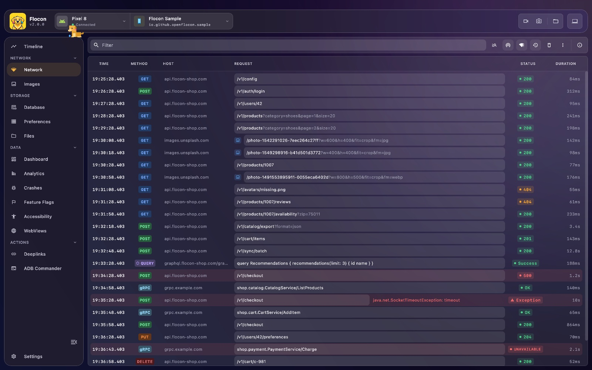
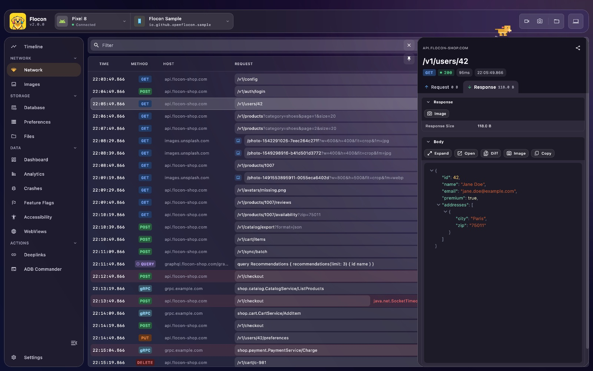
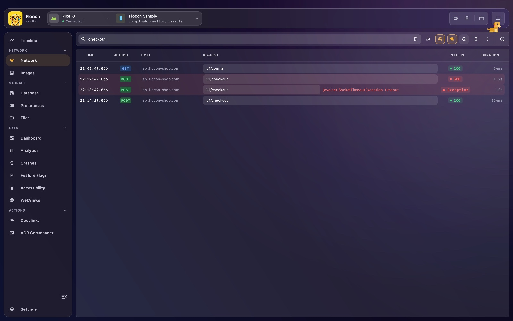

# 📡 Network

Flocon captures the HTTP calls your app makes and lists them live in the desktop app: method, URL, status, duration, size, headers and bodies. You see what your app really sends and receives, without a proxy or a certificate to install.





For every call, Flocon shows:

- **Method and URL**: the HTTP method and the full URL, with the query parameters split out.
- **Headers and body**: request and response, with a JSON viewer, search and copy.
- **Metrics**: status code, duration, payload size and timestamp.
- **Errors**: connection drops, timeouts and failed calls, with the error message.

The same capture also feeds [Mocking](mocking.md), [Bad Network Simulation](bad-quality.md), [GraphQL](graphql.md), [WebSockets](websocket.md), [gRPC](grpc.md) and [Images](image.md).

## Platform support

| | Android | KMP (iOS / JVM / Wasm) | Swift (iOS / macOS) | Flutter |
|---|:---:|:---:|:---:|:---:|
| HTTP capture | ✅ OkHttp, Ktor | ✅ Ktor (and OkHttp on JVM) | ✅ `URLSession` | ✅ Dio, `package:http` |
| Mocks | ✅ | ✅ | ✅ | ✅ |
| Bad network simulation | ✅ | ✅ | ✅ | ✅ |
| `shouldLog` / `isImage` options | ✅ | ✅ | ✅ | ✅ |

- **OkHttp** works on Android and JVM. **Ktor** works on every Kotlin target: Android, iOS, JVM and Wasm (Ktor `3.x`).
- On Swift, anything built on `URLSession` is captured once its configuration goes through `withFlocon()` (Alamofire, Kingfisher, ...).
- On Flutter, the `flocon_dio` and `flocon_http` packages add the capture. Other HTTP clients are not covered.
- gRPC and WebSockets have their own pages: [gRPC](grpc.md), [WebSockets](websocket.md).

## Setup

The network plugin is the one that talks to the desktop. The interceptors only report to it: without the plugin, they let your calls go through untouched.

=== "Kotlin"

    Add `flocon-network-core` and the interceptor of your HTTP client. `flocon-no-op` turns them off in release builds (see [Release builds](setup.md#release-builds)).

    === "OkHttp"

        ```kotlin
        dependencies {
            implementation("io.github.openflocon:flocon-network-core:LAST_VERSION")
            implementation("io.github.openflocon:flocon-okhttp-interceptor:LAST_VERSION")
        }
        ```

        With a version catalog:

        ```toml
        [libraries]
        flocon-network = { module = "io.github.openflocon:flocon-network-core", version.ref = "flocon" }
        flocon-okhttp = { module = "io.github.openflocon:flocon-okhttp-interceptor", version.ref = "flocon" }
        ```

    === "Ktor"

        ```kotlin
        kotlin {
            sourceSets {
                commonMain.dependencies {
                    implementation("io.github.openflocon:flocon-network-core:LAST_VERSION")
                    implementation("io.github.openflocon:flocon-ktor-interceptor:LAST_VERSION")
                }
            }
        }
        ```

        With a version catalog:

        ```toml
        [libraries]
        flocon-network = { module = "io.github.openflocon:flocon-network-core", version.ref = "flocon" }
        flocon-ktor = { module = "io.github.openflocon:flocon-ktor-interceptor", version.ref = "flocon" }
        ```

    Then install the plugin when you start Flocon:

    ```kotlin
    startFlocon(FloconContext(context)) {
        install(FloconNetwork)
    }
    ```

=== "Swift"

    Add the package `https://github.com/openflocon/FloconSwift.git` (`from: "LAST_VERSION"`, product `Flocon`), then install the network feature:

    ```swift
    import Flocon

    #if DEBUG
    startFlocon { flocon in
        flocon.install(.network)
    }
    #endif
    ```

    `install(.network)` also intercepts `URLSession.shared`. Sessions created with their own configuration need `withFlocon()` (see Usage).

=== "Flutter"

    ```bash
    flutter pub add flocon flocon_dio flocon_http
    ```

    Add only the package of the HTTP client you use (`flocon_dio` for Dio, `flocon_http` for `package:http`). `FloconNetwork` is optional: install it only to set options.

    ```dart
    import 'package:flocon/flocon.dart';
    import 'package:flutter/foundation.dart';

    Future<void> main() async {
      WidgetsFlutterBinding.ensureInitialized();
      if (kDebugMode) {
        await startFlocon((flocon) => flocon..install(FloconNetwork()));
      }
      runApp(const MyApp());
    }
    ```

## Usage

=== "Kotlin"

    === "OkHttp"

        Add the interceptor to your `OkHttpClient`:

        ```kotlin
        val okHttpClient = OkHttpClient.Builder()
            .addInterceptor(
                FloconOkhttpInterceptor(
                    // optional: show these responses in the Images screen
                    isImage = { it.request.url.toString().contains("cdn") },
                    // optional: calls to skip
                    shouldLog = { chain -> !chain.request().url.encodedPath.startsWith("/health") },
                )
            )
            .build()
        ```

        Imports come from `io.github.openflocon.flocon.okhttp`.

    === "Ktor"

        Install the plugin in your `HttpClient`:

        ```kotlin
        val httpClient = HttpClient {
            install(FloconKtorPlugin) {
                // optional
                isImage = { it.responseContentType?.startsWith("image/") == true }
                shouldLog = { request -> request.url.host != "localhost" }
            }
        }
        ```

        Imports come from `io.github.openflocon.flocon.ktor`.

        !!! tip "Ktor compatibility"
            Built and tested with Ktor `3.x`.

=== "Swift"

    Create your sessions from a configuration intercepted by Flocon:

    ```swift
    let session = URLSession(configuration: .default.withFlocon())
    ```

    It works with the libraries built on `URLSession`:

    ```swift
    // Alamofire
    let session = Session(configuration: URLSessionConfiguration.default.withFlocon())

    // Kingfisher
    KingfisherManager.shared.downloader.sessionConfiguration = .default.withFlocon()
    ```

    To intercept `URLSession.shared` without `install(.network)`:

    ```swift
    Flocon.interceptSharedSession()
    ```

    Choose which requests are sent and which responses are images with the options of the feature (`FloconNetworkOptions(shouldLog:isImage:)`):

    ```swift
    #if DEBUG
    startFlocon { flocon in
        flocon.install(.network) { options in
            options.shouldLog = { request in request.url?.host != "analytics.example.com" }
            options.isImage = { request, _ in request.url?.path.hasPrefix("/images/") == true }
        }
    }
    #endif
    ```

    A request excluded by `shouldLog` is neither logged nor mocked.

    ??? note "Log the calls of another client by hand"
        For a client Flocon does not intercept, report the request and its response yourself, with the same `callId`:

        ```swift
        let call = FloconNetworkCallRequest(
            networkType: "http",
            request: FloconNetworkRequest(url: "https://api.example.com/users", method: "GET")
        )
        Flocon.networkPlugin.logRequest(call)

        // later
        Flocon.networkPlugin.logResponse(
            FloconNetworkCallResponse(
                callId: call.callId,
                networkType: "http",
                durationMs: 120,
                response: FloconNetworkResponse(httpCode: 200, body: #"{"users": []}"#)
            )
        )
        ```

=== "Flutter"

    === "Dio"

        Add the interceptor **after** your own interceptors, so Flocon sees the final request and the raw response:

        ```dart
        import 'package:flocon_dio/flocon_dio.dart';

        final dio = Dio(BaseOptions(baseUrl: baseUrl)).withFlocon();
        ```

    === "http"

        ```dart
        import 'package:flocon_http/flocon_http.dart';

        final client = http.Client().withFlocon();
        final response = await client.get(Uri.parse('https://example.com'));
        ```

    The options are shared by both adapters. Give them once to `FloconNetwork`:

    ```dart
    await startFlocon((flocon) => flocon
      ..install(FloconNetwork(
        shouldLog: (request) => request.url.host != 'analytics.example.com',
        isImage: (request, response) => request.url.host == 'images.example.com',
      )));
    ```

    Without `shouldLog`, every call is sent.

## In Flocon Desktop

!!! tip "In the Timeline"
    Each call also shows up in the [Timeline](timeline.md): a request line and a response line in the list, a bar in the graph.

Open the **Network** screen. Calls appear as they are made, with their state (waiting, success, error).



- **List**: columns for time, method, host, request and status, plus the duration. Use the filter box to search, and include or exclude a value from the context menu of a cell (host, method, request, status). **Auto scroll** follows new calls and **Invert list** puts the newest first.
- **Sessions**: only the current app session is shown. Turn on **Display old sessions** to see earlier launches, and clear old sessions when the list gets long.
- **Deep Search**: searches inside the headers and bodies of the calls.
- **Detail panel**: click a call to see its request and response headers, bodies, query parameters, sizes and timings. You can pin the panel, open it in its own window, and decode the `Authorization` JWT.
- **Body viewer**: JSON bodies are formatted and searchable. Open one in full screen, or **Diff** two bodies.
- **Actions on a call**: **Copy cURL**, **Copy URL**, **Replay** the request, **Create Mock** from the call, and share it as Markdown, HTML or an image.
- **Selection**: select several calls to act on them together.
- **Import / export**: export the list to CSV, and import a CSV back.
- **Mocks** and **Bad network**: two toolbar buttons open the [Mocks](mocking.md) and [Bad Network Simulation](bad-quality.md) managers.

A call answered by a mock carries a **MOCK** tag.

## With AI agents (MCP)

- `list_network_calls`: lists the captured calls, newest first, with filters (URL, method, status code, errors only, type).
- `search_network_calls`: searches a text in URLs, headers and bodies, including old sessions.
- `get_network_call`: returns the full detail of a call, with the equivalent cURL command.

> "Find the failed calls since the last launch and tell me which endpoint returns the 500."

See the [MCP cookbook](mcp-cookbook.md) for full workflows.
