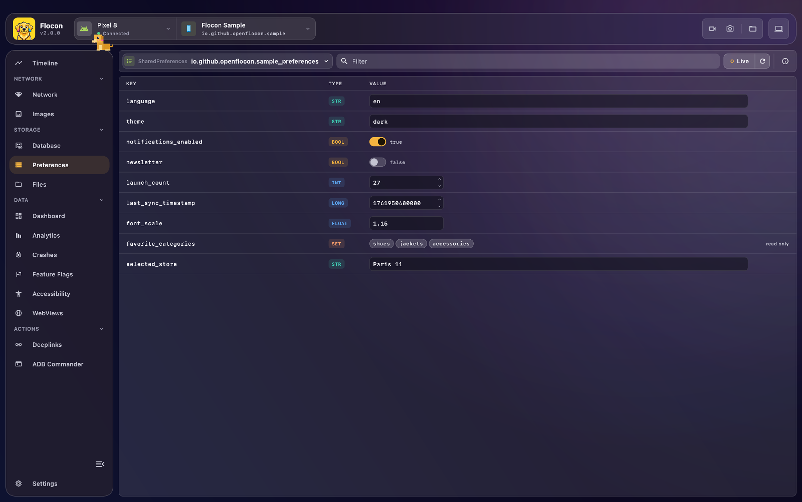

# 🗝️ Preferences & DataStore Editor

Flocon shows the key-value storage of your app (`SharedPreferences`, Jetpack DataStore, `UserDefaults`, the Keychain, Flutter `shared_preferences`, or a store of your own) and lets you **edit values live** from the desktop. It saves you from re-installing the app or writing debug screens to put it in a given state.



## Platform support

| | Android | KMP (iOS / JVM / Wasm) | Swift (iOS / macOS) | Flutter |
|---|:---:|:---:|:---:|:---:|
| `SharedPreferences` (auto-discovery, editable) | ✅ | n/a | n/a | n/a |
| Jetpack DataStore (editable) | ✅ | ✅ (iOS, JVM, no Wasm) | n/a | n/a |
| `UserDefaults` (editable) | n/a | ✅ (iOS, standard suite) | ✅ (standard, plus suites you register) | n/a |
| Keychain | n/a | ❌ (use a custom `FloconPreference`) | ✅ (opt-in, read-only by default) | n/a |
| `shared_preferences` (editable) | n/a | n/a | n/a | ✅ |
| Custom store (`FloconPreference`) | ✅ | ✅ | ✅ | ❌ |

- On JVM and Wasm nothing is detected automatically: register a store of your own.
- Values of type `String`, `Boolean`, number and a set / list of strings can be edited. An edit is only applied when its type matches the stored one.

## Setup

=== "Kotlin"

    ```kotlin
    dependencies {
        debugImplementation("io.github.openflocon:flocon-sharedprefs:LAST_VERSION")
        releaseImplementation("io.github.openflocon:flocon-sharedprefs-no-op:LAST_VERSION")
    }
    ```

    Install the plugin:

    ```kotlin
    startFlocon(FloconContext(context)) {
        install(FloconPreferences)
    }
    ```

    For Jetpack DataStore, add the `flocon-datastores` module too:

    === "libs.versions.toml"

        ```toml
        [libraries]
        flocon-datastores = { module = "io.github.openflocon:flocon-datastores", version.ref = "flocon" }
        flocon-datastores-no-op = { module = "io.github.openflocon:flocon-datastores-no-op", version.ref = "flocon" }
        ```

    === "build.gradle.kts"

        ```kotlin
        dependencies {
            debugImplementation("io.github.openflocon:flocon-datastores:LAST_VERSION")
            releaseImplementation("io.github.openflocon:flocon-datastores-no-op:LAST_VERSION")
        }
        ```

=== "Swift"

    Preferences are part of the `Flocon` product. `UserDefaults.standard` is listed automatically:

    ```swift
    import Flocon

    startFlocon { flocon in
        flocon.install(.preferences)
    }
    ```

=== "Flutter"

    ```bash
    flutter pub add flocon flocon_shared_preferences shared_preferences
    ```

    ```dart
    import 'package:flocon/flocon.dart';
    import 'package:flocon_shared_preferences/flocon_shared_preferences.dart';
    import 'package:shared_preferences/shared_preferences.dart';

    final prefs = await SharedPreferences.getInstance();
    await startFlocon((flocon) => flocon..install(FloconSharedPreferences(prefs)));
    ```

## Usage

=== "Kotlin"

    ##### Standard SharedPreferences (Android)

    All the `SharedPreferences` files of the app are automatically detected on Android. To register one with a custom display name:

    ```kotlin
    val userPrefs = context.getSharedPreferences("user_pref", Context.MODE_PRIVATE)
    Flocon.preferencesPlugin.register(FloconSharedPreference(name = "User Settings", userPrefs))
    ```

    ##### Jetpack DataStore

    Register your DataStore instance (Android, JVM and iOS):

    ```kotlin
    val Context.dataStore by preferencesDataStore(name = "settings")

    Flocon.preferencesPlugin.register(FloconDatastorePreference(name = "App Settings", context.dataStore))
    ```

    If the values are encrypted, pass a `FloconDatastoreMapper` to decode / encode them:

    ```kotlin
    FloconDatastorePreference(name = "Secure Settings", context.secureDataStore, mapper = myCipherMapper)
    ```

    ##### UserDefaults (iOS)

    The standard `UserDefaults` of the app are listed automatically on iOS and can be edited.

    ##### Custom key-value storage

    You can expose any proprietary storage system (such as EncryptedSharedPreferences or custom key-value stores, on every platform) by implementing `FloconPreference`:

    ```kotlin
    class MyCustomPreference : FloconPreference {
        override val name: String = "Encrypted Vault"
        override val type: String = "EncryptedSharedPreferences"

        override suspend fun columns(): List<String> = listOf("token", "is_authenticated")

        override suspend fun get(columnName: String): FloconPreferenceValue? {
            return FloconPreferenceValue(stringValue = readSecureKey(columnName))
        }

        override suspend fun set(columnName: String, value: FloconPreferenceValue) {
            writeSecureKey(columnName, value.stringValue)
        }
    }

    Flocon.preferencesPlugin.register(MyCustomPreference())
    ```

    ##### Preference type

    Each preference tells the desktop app which storage it comes from. The type is displayed with its icon next to the name in the preference selector (known types have their own icon, the others a generic one), and returned by the MCP `list_shared_preferences` tool.

    The built-in preferences set it for you. For your own `FloconPreference`, override `type` with one of the `FloconPreferenceType` constants or any free value (defaults to `"Custom"`):

    | Constant | Value | Platform |
    |---|---|---|
    | `FloconPreferenceType.SharedPreferences` | `SharedPreferences` | Android |
    | `FloconPreferenceType.DataStore` | `DataStore` | Android, iOS, JVM |
    | `FloconPreferenceType.UserDefaults` | `UserDefaults` | iOS |
    | `FloconPreferenceType.Keychain` | `Keychain` | iOS |
    | `FloconPreferenceType.JavaPreferences` | `Java Preferences` | JVM |
    | `FloconPreferenceType.LocalStorage` | `LocalStorage` | Wasm |
    | `FloconPreferenceType.Custom` | `Custom` | default |

=== "Swift"

    ##### UserDefaults suites

    `UserDefaults.standard` is listed automatically. Register the other suites of your app, such as the one shared with an App Group:

    ```swift
    let suiteName = "group.com.example.app"

    startFlocon { flocon in
        flocon.install(.preferences) { options in
            if let shared = UserDefaults(suiteName: suiteName) {
                options.userDefaults(shared, suiteName: suiteName)
            }
        }
    }
    ```

    or later: `Flocon.preferencesPlugin.registerUserDefaults(shared, suiteName: suiteName)`.

    Only the values written by your app are shown, not the system defaults. `String`, `Bool`, numbers, `Date` and `[String]` can be edited, other values (`Data`, dictionaries, mixed arrays) are read-only.

    ##### Keychain

    The Keychain is opt-in: its values are sent **unencrypted** to the Mac running Flocon, so only enable it in debug builds.

    ```swift
    startFlocon { flocon in
        flocon.install(.preferences) { options in
            #if DEBUG
            options.keychain(isEditable: false)
            #endif
        }
    }
    ```

    Generic and internet passwords appear as two stores, with one key per item (`service / account` and `server / account`). Values are shown as text when they are UTF-8, and as their size otherwise. Items protected by Face ID, Touch ID or the passcode are shown as `<protected>`: Flocon never shows an authentication prompt.

    With `isEditable: true`, values edited and items deleted in the desktop are applied to the Keychain. Only existing items with a readable text value can be edited, items are never added.

    ##### Custom key-value storage

    Implement `FloconPreference` to show another store (a remote config, Realm, an in-memory cache...), then install or register it:

    ```swift
    final class FeatureFlagsPreference: FloconPreference {
        let name = "Feature flags"
        let type = "Remote config"

        func keys() -> [String] { FeatureFlags.all.map(\.key) }

        func value(forKey key: String) -> FloconPreferenceValue? {
            FloconPreferenceValue(booleanValue: FeatureFlags.isEnabled(key))
        }

        func setValue(_ value: FloconPreferenceValue, forKey key: String) {
            if let isEnabled = value.booleanValue { FeatureFlags.set(key, isEnabled) }
        }

        // optional: lets the desktop delete keys
        func removeValue(forKey key: String) {}
    }

    startFlocon { flocon in
        flocon.install(.preferences) { $0.preference(FeatureFlagsPreference()) }
    }
    ```

    The methods are called from a background thread. `type` defaults to `FloconPreferenceType.custom`, the other values are `.userDefaults` and `.keychain`, and any string is accepted.

=== "Flutter"

    `FloconSharedPreferences(prefs, name:)` shows one `SharedPreferences` instance, under the name given (default `SharedPreferences`). Install it once, and register the other instances with `floconRegisterSharedPreferences` (installing a second `FloconSharedPreferences` would replace the first):

    ```dart
    final prefs = await SharedPreferences.getInstance();
    await startFlocon((flocon) => flocon..install(FloconSharedPreferences(prefs, name: 'App')));

    floconRegisterSharedPreferences(otherPrefs, name: 'Other');
    ```

    `String`, `bool`, `int`, `double` and `List<String>` values can be edited, and any key can be deleted. The store is shown with the type `SharedPreferences`.

    !!! note "Custom stores"
        The Flutter SDK only supports `shared_preferences`: custom stores (secure storage, Hive...) cannot be registered yet.

## In Flocon Desktop

- **Preference selector**: pick a store, with its type icon (`SharedPreferences`, `DataStore`, `UserDefaults`, `Keychain`, custom).
- **Keys list**: key, type and value. Filter by key, and refresh automatically with the auto-update delay.
- **Edit**: edit a value in the side panel and save it (**Send to app**, `⌘↵`). Booleans and numbers have dedicated controls (increment / decrement), and string values that contain JSON get a **Formatted** / **Raw** view with a validity check.
- **Delete**: delete a key, after confirmation. The key is removed from the app and this cannot be undone. Values the desktop cannot edit are marked **read only**.
- **Copy** a key or a value.

<!-- screenshot: preferences-edit-json | scenario=doc-sharedprefs | screen=shared_preferences | the edit panel with a JSON value in Formatted mode and the "valid JSON" status -->

!!! warning
    Editing a value changes your app's real data and can lose data. The app does not always observe the change (a cached `SharedPreferences` value, a `UserDefaults` value already read): restart the screen or the app to see its effect.

## With AI agents (MCP)

- `list_shared_preferences`: the stores of the app (SharedPreferences files, UserDefaults suites), with their id and type.
- `get_shared_preference_values`: the keys and values of a store, with their type.
- `set_shared_preference_value`: edit **one existing key** (keys cannot be created or removed). The previous value is returned so it can be restored, and agents should ask you to confirm first.

Example prompt: "Set `onboarding_done` to `false` in the app preferences, then tell me the previous value."

See the [MCP cookbook](mcp-cookbook.md) for full workflows.

## Limitations

- Kotlin: nothing is detected automatically on JVM and Wasm, and DataStore is not available on Wasm.
- Swift: the Keychain is opt-in and read-only unless `isEditable: true`; `Data` and dictionary values of `UserDefaults` are read-only.
- Flutter: only `shared_preferences` is supported for now.
