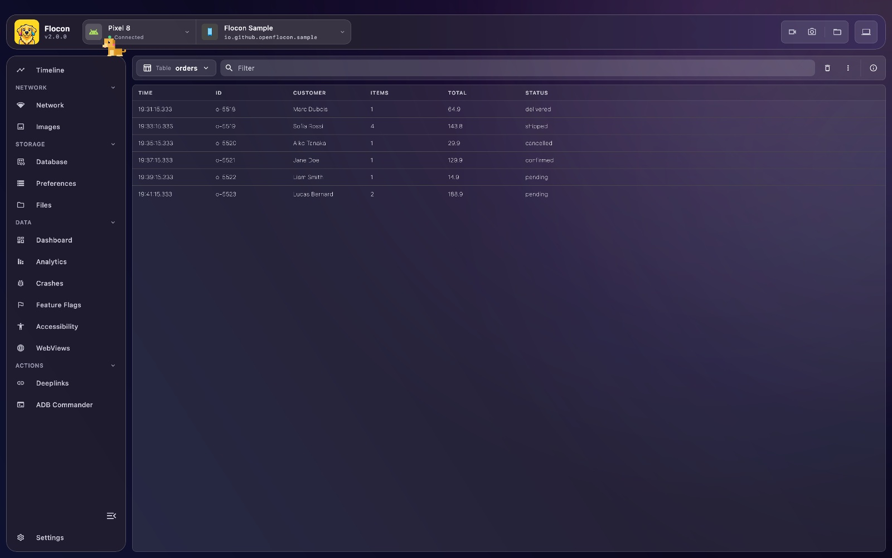
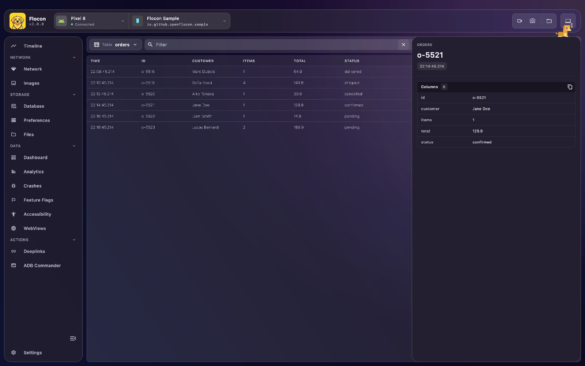

# 📋 Structured Data Tables

Tables let your app stream **rows of multi-column data** to Flocon Desktop. You name a table, log rows with the columns you want, and the desktop builds the table for you: no model to declare, columns are created from the names you use.

Common use cases:

- Inspect active in-memory user sessions or authentication states.
- Stream custom business domain telemetry.
- Monitor cache keys and eviction events.
- Track queued background jobs or workers.



## Platform support

| | Android | KMP (iOS / JVM / Wasm) | Swift (iOS / macOS) | Flutter |
|---|:---:|:---:|:---:|:---:|
| Log table rows | ✅ | ✅ | ✅ | ✅ |

Values are always strings: format numbers and dates yourself before logging them.

## Setup

=== "Kotlin"

    Add the module (`flocon-no-op` turns it off in release builds, see [Release builds](install-kotlin.md#release-builds)):

    ```kotlin
    dependencies {
        implementation("io.github.openflocon:flocon-tables:LAST_VERSION")
    }
    ```

    Then install the plugin:

    ```kotlin
    startFlocon(FloconContext(context)) {
        install(FloconTable)
    }
    ```

=== "Swift"

    Tables are part of the `Flocon` product. Install the plugin:

    ```swift
    import Flocon

    #if DEBUG
    startFlocon { flocon in
        flocon.install(.tables)
    }
    #endif
    ```

    `Flocon.initialize()` installs every plugin.

=== "Flutter"

    ```bash
    flutter pub add flocon
    ```

    The tables plugin is part of the `flocon` package and is always available: no `install(...)` is needed, you only have to start Flocon (see [Flutter SDK](install-flutter.md)). Logging does nothing before Flocon is started, so you can leave the calls in your code.

    ```dart
    import 'package:flocon/flocon.dart';

    await startFlocon((flocon) => flocon..connect(host: 'localhost'));
    ```

## Usage

Each call logs **one row** in the named table. Rows are appended in real time, with the time they were logged.

=== "Kotlin"

    ```kotlin
    import io.github.openflocon.flocon.Flocon
    import io.github.openflocon.flocon.tables.dsl.table
    import io.github.openflocon.flocon.tables.tablePlugin

    Flocon.tablePlugin.table("active_sessions") {
        column("user_id", "1024")
        column("name", "Raphael")
        column("status", "Active")
        column("last_seen", "2026-08-14 17:30")
    }
    ```

=== "Swift"

    ```swift
    Flocon.tablePlugin.table("active_sessions").log(
        TableColumnConfig("user_id", "1024"),
        TableColumnConfig("name", "Raphael"),
        TableColumnConfig("status", "Active"),
        TableColumnConfig("last_seen", "2026-08-14 17:30")
    )
    ```

    `log` also takes an array: `log([TableColumnConfig])`.

=== "Flutter"

    ```dart
    Flocon.table.table('active_sessions').log([
      TableColumnConfig('user_id', '1024'),
      TableColumnConfig('name', 'Raphael'),
      TableColumnConfig('status', 'Active'),
      TableColumnConfig('last_seen', '2026-08-14 17:30'),
    ]);
    ```

### Real-time event tracking

Log a row each time something happens to follow it live:

=== "Kotlin"

    ```kotlin
    fun onUserAction(user: User, action: String) {
        Flocon.tablePlugin.table("user_actions") {
            column("timestamp", System.currentTimeMillis().toString())
            column("user", user.name)
            column("action", action)
        }
    }
    ```

=== "Swift"

    ```swift
    func onUserAction(user: User, action: String) {
        Flocon.tablePlugin.table("user_actions").log(
            TableColumnConfig("timestamp", String(Date().timeIntervalSince1970)),
            TableColumnConfig("user", user.name),
            TableColumnConfig("action", action)
        )
    }
    ```

=== "Flutter"

    ```dart
    void onUserAction(User user, String action) {
      Flocon.table.table('user_actions').log([
        TableColumnConfig('timestamp', DateTime.now().millisecondsSinceEpoch.toString()),
        TableColumnConfig('user', user.name),
        TableColumnConfig('action', action),
      ]);
    }
    ```

## In Flocon Desktop

!!! tip "In the Timeline"
    Each row also shows up in the [Timeline](timeline.md).

Open **Tables** in the sidebar.

- The **Table** selector at the top switches between the tables your app logged.
- The **filter** field keeps the rows where a value contains the text.
- The columns are the names used in the logged rows. Click a row to read all its columns in the detail panel, where they can be copied.
- Right-click a row to **Remove** it or **Remove lines above**.
- The trash icon clears the rows of the table, and the overflow menu has **Export CSV**.



## With AI agents (MCP)

- `list_tables`: the tables sent by the app, with their `tableId`.
- `list_table_items`: the rows of a table (newest first), as column name to value maps, with optional text filter, order and limit.

> "Look at the `active_sessions` table and tell me which users have not been seen for more than an hour."

See the [MCP cookbook](mcp-cookbook.md) for full workflows.
