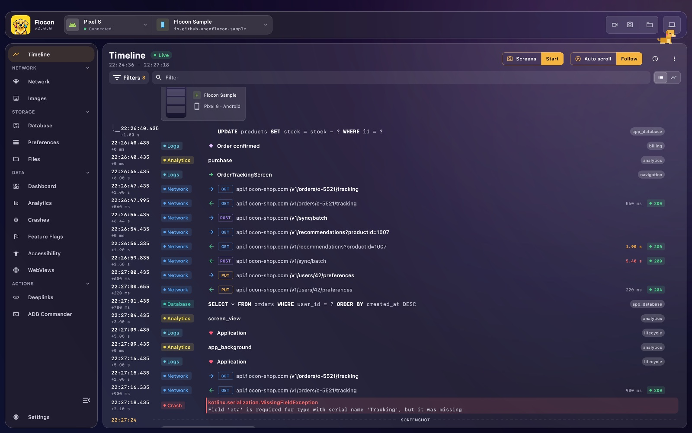
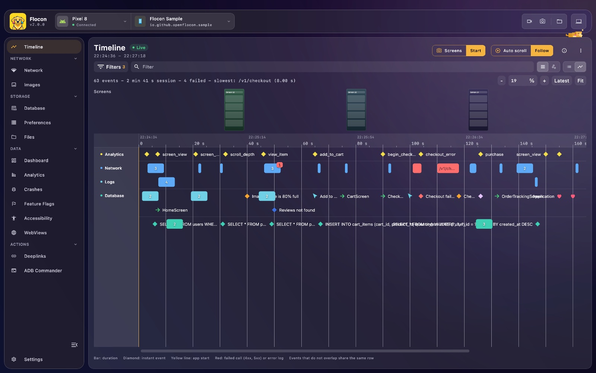

# 🕒 Timeline

The timeline merges the events received by Flocon Desktop into **one chronological list**, grouped by day and by app session, so you can see what happened right before a crash or an HTTP error. Your app can also push its own events into it (screens, user actions, lifecycle, milestones).



## Platform support

| | Android | KMP (iOS / JVM) | Swift (iOS / macOS) | Flutter |
|---|:---:|:---:|:---:|:---:|
| Merged view of the other plugins (desktop only, nothing to install) | ✅ | ✅ | ✅ | ✅ |
| Logs from your app (`navigation`, `userAction`, `lifecycle`, custom) | ✅ | ✅ | ✅ | ✅ |
| Automatic navigation / lifecycle logging | ❌ | ❌ | ❌ | ✅ (`FloconNavigatorObserver`, `FloconLifecycleObserver`) |

Each source of the timeline only shows up once its plugin is installed in your app. On Kotlin, Swift and Flutter the logs are sent by your own calls: Flocon does not detect screens or taps by itself, except with the two Flutter observers below.

---

## Setup

The timeline itself needs nothing: it is built on the desktop from the events of the other plugins. Each source appears once its plugin is installed, see:

- [Network](network.md#setup)
- [Analytics](analytics.md#setup)
- [Databases](database.md#setup)
- [Data Tables](table.md#setup)
- [Crash Reporter](crashreporter.md#setup)
- [Deeplinks](deeplink.md)
- [WebViews](webview.md#setup)
- [Logs from your app](#logs-from-your-app)

To send your own logs, install the timeline plugin:

=== "Kotlin"

    ```kotlin
    dependencies {
        debugImplementation("io.github.openflocon:flocon-timeline:LAST_VERSION")
        releaseImplementation("io.github.openflocon:flocon-timeline-no-op:LAST_VERSION")
    }
    ```

    ```kotlin
    startFlocon(FloconContext(applicationContext)) {
        install(FloconTimeline)
    }
    ```

    A plugin that is not installed does nothing instead of crashing.

=== "Swift"

    ```swift
    import Flocon

    #if DEBUG
    startFlocon { flocon in
        flocon.install(.timeline)
    }
    #endif
    ```

    `Flocon.initialize()` installs every plugin, the timeline included. Until Flocon is started, or if `.timeline` is not installed, the calls do nothing.

=== "Flutter"

    ```bash
    flutter pub add flocon
    ```

    The timeline is part of the `flocon` package and is registered by `startFlocon`: there is nothing to `install`.

    ```dart
    import 'package:flocon/flocon.dart';

    await startFlocon((flocon) => flocon..connect(host: 'localhost')); // 10.0.2.2 from the Android emulator
    ```

!!! tip
    Start with [Getting Started](setup.md) to connect your app to Flocon Desktop.

---

## Logs from your app

Besides the events of the other plugins, your app can push its own events into the timeline, to read what happened around a bug: which screen was open, what the user did, what the app lifecycle was, and any milestone of your own.

There are two kinds of calls, never mixed:

- **Typed, without level**: `log` with a type, and the shortcuts `logNavigation`, `logUserAction` and `logLifecycle`.
- **Tagged, with a level**: the tag is the type of the event, and the level is `Debug`, `Info`, `Warning` or `Error`.

`value` is the main text of the row (a screen name for example), `params` is a string-to-string map shown in the detail panel (text only, optional).

=== "Kotlin"

    ```kotlin
    import io.github.openflocon.flocon.Flocon
    import io.github.openflocon.flocon.timeline.*
    import io.github.openflocon.flocon.timeline.model.*

    Flocon.timelinePlugin.logNavigation("CheckoutScreen", params = mapOf("from" to "CartScreen"))
    Flocon.timelinePlugin.logUserAction("Tap on Pay")
    Flocon.timelinePlugin.logLifecycle("App moved to background")

    // a custom tag, with a level
    Flocon.timelinePlugin.log("payment", "Card declined", mapOf("code" to "402"), FloconTimelineLevel.Warning)
    ```

    **Navigation listener (Compose)**

    ```kotlin
    import androidx.compose.runtime.Composable
    import androidx.compose.runtime.DisposableEffect
    import androidx.navigation.NavController
    import io.github.openflocon.flocon.Flocon
    import io.github.openflocon.flocon.timeline.*

    @Composable
    fun NavigationLogger(navController: NavController) {
        DisposableEffect(navController) {
            val listener = NavController.OnDestinationChangedListener { _, destination, arguments ->
                Flocon.timelinePlugin.logNavigation(
                    value = destination.route ?: "unknown",
                    // string arguments only
                    params = arguments?.let { b -> b.keySet().associateWith { b.getString(it).orEmpty() } }.orEmpty(),
                )
            }
            navController.addOnDestinationChangedListener(listener)
            onDispose { navController.removeOnDestinationChangedListener(listener) }
        }
    }
    ```

    **Define your own type.** Declare it once and reuse it, optionally with an extension:

    ```kotlin
    import io.github.openflocon.flocon.Flocon
    import io.github.openflocon.flocon.timeline.*
    import io.github.openflocon.flocon.timeline.model.*

    val Billing = FloconTimelineType("billing")

    fun FloconTimelinePlugin.logBilling(value: String, params: Map<String, String> = emptyMap()) =
        log(Billing, value, params)

    Flocon.timelinePlugin.logBilling("Subscription started", mapOf("sku" to "premium_yearly"))
    ```

=== "Swift"

    ```swift
    import Flocon

    // typed events, without a level
    Flocon.timelinePlugin.logNavigation("CheckoutScreen", params: ["from": "CartScreen"])
    Flocon.timelinePlugin.logUserAction("tap_buy", params: ["sku": "premium_yearly"])
    Flocon.timelinePlugin.logLifecycle("didBecomeActive")

    // tagged event, with a level: .debug, .info (default), .warning or .error
    Flocon.timelinePlugin.log(tag: "billing", value: "Purchase failed", params: ["sku": "premium_yearly"], level: .error)
    ```

    **Define your own type.** Declare it once and reuse it:

    ```swift
    extension TimelineType {
        static let billing = TimelineType("billing")
    }

    Flocon.timelinePlugin.log(type: .billing, value: "Purchase started")
    ```

    See also the [FloconSwift README](https://github.com/openflocon/FloconSwift#timeline-logs).

=== "Flutter"

    ```dart
    import 'package:flocon/flocon.dart';

    // typed events, without a level
    Flocon.timeline.logNavigation('CheckoutScreen', params: {'from': 'CartScreen'});
    Flocon.timeline.logUserAction('tap_buy');
    Flocon.timeline.logLifecycle('App moved to background');

    // tagged event, with a level: TimelineLevel.debug, info (default), warning or error
    Flocon.timeline.logTagged('payment', 'Card declined', params: {'code': '402'}, level: TimelineLevel.warning);

    // a custom type, without a level
    Flocon.timeline.log(const TimelineType('billing'), 'Subscription started');
    ```

    **Automatic navigation and lifecycle logs.** Add the observer to your navigator (`MaterialApp`, `GoRouter`...) and start the lifecycle observer:

    ```dart
    MaterialApp(
      navigatorObservers: [FloconNavigatorObserver()],
      // ...
    );

    FloconLifecycleObserver.start(); // logs each AppLifecycleState (resumed, paused...)
    ```

    `FloconNavigatorObserver` logs push, pop and replace, with `from` and `action` in the params.

!!! note
    The reserved types are `navigation`, `userAction` and `lifecycle` (matched without case sensitivity). A tag equal to one of them is shown as that type.

!!! note
    Typed logs (navigation, user action, lifecycle and your own types) have no level on the wire: the desktop stores them as **Info** (a custom type shows as an Info diamond) and hides the level in their detail. The Level filter only applies to tagged logs: unticking **Info** does not hide navigation, user action or lifecycle logs.

A new type shows up by itself as a value of the Type filter: the desktop does not need an update. The wire format is described in the [protocol](https://github.com/openflocon/Flocon/blob/main/internal-docs/protocol/timeline.md).

---

## In Flocon Desktop

### Overview

From the desktop UI, you can:

- **Follow the events in order**: network calls (a request line with a → arrow, then a response line with a ← arrow when it arrives; selecting or hovering one highlights both, and hovering shows a bar linking them), analytics events, WebView events (console messages, page loads and errors, bridge calls), database queries, table rows, logs sent by your app, crashes, deeplinks, ADB commands and app starts.
- **Switch between the list and the graph** (the **List** and **Graph** chips next to the filter bar, the choice is remembered), see [Graph](#graph).
- **Read the counters**: number of events, sessions, HTTP errors and crashes of what is displayed.
- **Options** (⋮ menu): auto scroll to the newest event, invert the direction of the list, pin the detail panel (it then stays next to the list instead of covering it).
- **Filter**: toggle the sources (the selection is remembered) and search a text (`Ctrl+K` / `Cmd+K` focuses the search field).
- **Open an event**: click a row to open its detail in a side panel (network call, analytics event, log, database query, table row, crash, deeplink, ADB command). App starts and WebView events have nothing to open: the WebViews screen shows them.

---

### Graph



The **Graph** view shows one session at a time on a time axis, with the app start at 0. The filters and the selected event are shared with the list.

- **One lane per type**: App, Analytics, Network, Logs, Database (a lane without event is hidden). The other sources only appear in the list.
- **One graph instead of lanes**: the switch left of **List** / **Graph** in the top bar (the choice is remembered) puts every type in the same rows, one under the other, packed as tightly as possible. The graph is much shorter, and what happened around a moment is read in one vertical slice. A type is told by its color, the column on the left becomes the legend.
- **A network call is one bar**, from its request to its response. The method and an image icon are shown when the bar is wide enough, and a failed call (HTTP 4xx or 5xx) is red, like a log with the **Error** level. A call still waiting for its response (or a stream that never ends) is not drawn.
- **Database queries, analytics events and logs are diamonds**: they have no duration.
- **Events that do not overlap share the same row**, to keep the graph short.

| Action | Result |
|---|---|
| Click a bar or a diamond | Opens the event in the detail panel and selects it in the list too |
| Mouse wheel | Scrolls the lanes |
| `Ctrl` / `Cmd` + wheel, `+` / `-` buttons | Zooms around the pointer |
| `Shift` + wheel, drag | Moves along the time axis |
| **Fit** | Shows the whole session again and follows the new events |
| `‹` / `›` | Previous / next session |

#### Grouped events

Events closer than about 14 px on the graph are merged into one rounded marker, so a burst of 100 events takes one slot of a row instead of 100 rows.

- **The marker** is cut in one segment per type (in the order of the lanes), each as wide as its share of the events (never under 8 %), with the same colors as the lanes. The total number of events is written on top. A marker with failed events has a small red badge on its top right corner with their number, and the failed events are tinted red in the popover.
- **Click a marker** to open a popover: the number of events and the time the group spans, then one chip per type with its count (click a chip to hide or show that type), and the list of **every event** of the group in start order, filtered by the chips. Each row gives the time since the start of the group, the type, the duration, the name and the status code of a network call; click a row to open the event in the detail panel. **Zoom on the group** zooms on it, **Show every event** opens the group into rows, like without grouping: it is the way to see events at the very same instant, which no zoom can separate. Turning the option off and on again groups them back.
- **Zooming in splits the markers**, until each event is back to its own bar or diamond. Events are grouped by their start, whatever their duration.
- **Turn it off** with **Cluster close events** in the overflow menu of the timeline (on by default, remembered).

---

### Logs sent by your app

- Logs are a **Log** source, in the list and in the graph (one marker per log, in its own lane).
- Filter them in the **Logs** card of the filter panel, see [Logs filters](#logs-filters).
- The same shape and color are used in the list, the graph, the detail and the filters (shapes and lightness differ, so they do not rely on color alone):

| Log | Shape | Color |
|---|---|---|
| `navigation` | right arrow | green |
| `userAction` | mouse pointer | cyan |
| `lifecycle` | heart | red-pink |
| Tagged or custom type, **Debug** | diamond | dark blue |
| Tagged or custom type, **Info** | diamond | pale violet |
| Tagged or custom type, **Warning** | diamond | orange |
| Tagged or custom type, **Error** | diamond | red |

- Click a row to open its detail: value, type, level, params and time.
- The desktop keeps at most 20 000 logs per device and app, the oldest ones are dropped first.

#### Logs filters

The **Logs** card of the filter panel (shown while the Log source is selected) has three filters:

- **Types**: one menu to show or hide **Navigation**, **User action**, **Lifecycle** and **Tagged logs** (every log whose type is not one of the three, your custom types included), each with its count. When some are hidden, the menu shows the types still shown as chips (the x hides one).
- **Tag**: type a word and press Enter (or **+**) to keep the tagged logs whose tag contains it, or **−** to hide them. The match is a case-insensitive "contains". The known tags are suggested while you type, each with **+** and **−**. The rules are listed under **Includes** and **Excludes**, with a checkbox to switch one off without deleting it.
- **Level**: Debug, Info, Warning and Error, with their counts.

The **Tag** and **Level** filters only apply to tagged logs: navigation, user action and lifecycle logs are never hidden by them. Unticking **Tagged logs** hides every tagged log and locks (dims) the Tag and Level filters.

---

## With AI agents (MCP)

- `get_timeline`: reads a window of the timeline (the latest crash, the last minutes, a session, around a time or an event id), with a text search over the events.
- `show_in_timeline`: moves the desktop window to the timeline (graph view) and centers it on an event, a time, or the latest crash.

> "Show me what happened in the minute before the last crash, and tell me which network call failed."

See the [MCP cookbook](mcp-cookbook.md) for full workflows.

---

## Limitations

- No custom icon or color per tag: custom tags use a default style.
- `params` are text only, not nested.
- No clear button for the logs: they are removed with the device or app data.
- It is not a replacement for [analytics events](analytics.md), which keep their own plugin.
