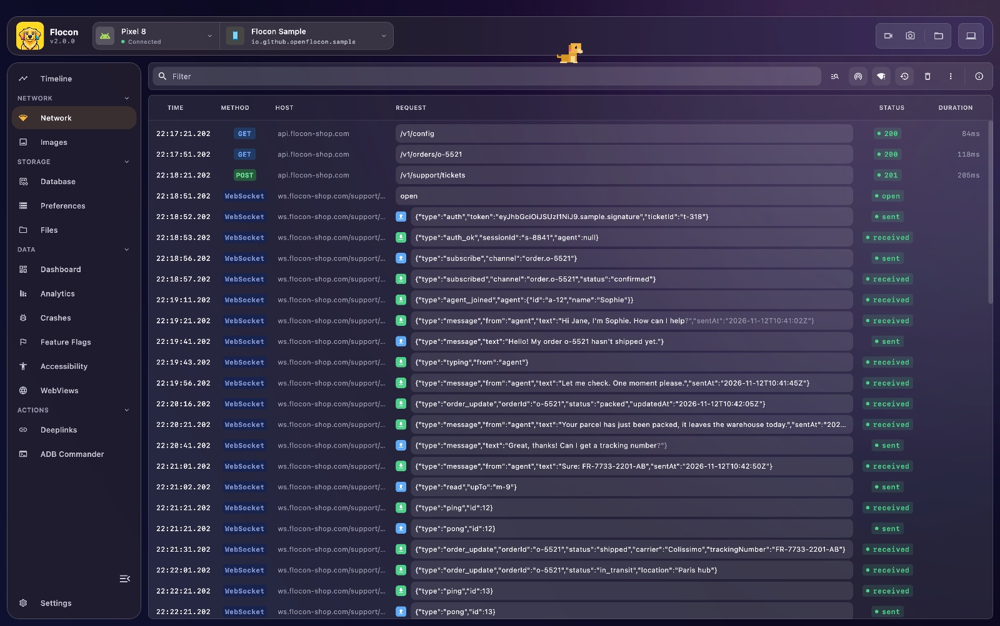
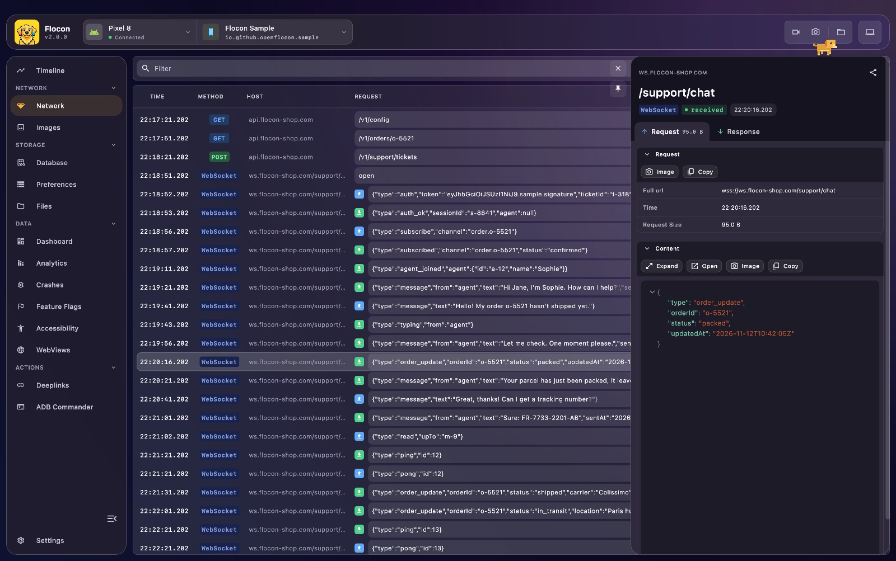

# 💬 WebSockets

Flocon shows the WebSocket traffic of your app next to its HTTP calls: when a connection opens, every message sent and received, errors and closings. It helps with live feeds, chats and multiplayer events, where the bug is often in a frame you cannot see.



For every connection, Flocon records:

- **Lifecycle**: the URL, open, closing, closed and error events.
- **Messages**: the text of each message sent and received, with its size.
- **Order and time**: events in the order they happened, with their timestamp.

## Platform support

| | Android | KMP (iOS / JVM / Wasm) | Swift (iOS / macOS) | Flutter |
|---|:---:|:---:|:---:|:---:|
| Automatic capture | ✅ OkHttp listener | ✅ OkHttp listener (JVM only), otherwise manual | ❌ manual | ❌ manual |
| Manual logging | ✅ | ✅ | ✅ `logWebSocketEvent` | ✅ `floconLogWebSocketEvent` |
| Inject a message (mock) | ✅ | ✅ JVM (OkHttp) | ❌ | ❌ |

- On Android with OkHttp, wrap your listener to log the incoming frames, and send with a Flocon helper to log the outgoing ones. Other WebSocket clients (Ktor, `URLSessionWebSocketTask`, `web_socket_channel`) are not intercepted: log their events yourself.
- Binary messages are logged as text (`ByteString.toString()` on OkHttp).
- Only the OkHttp listener (`listenWithFlocon`) can receive messages injected from the desktop side. The MCP tools describe it as Android only for now.

## Setup

WebSocket events go through the network plugin: follow the [network setup](network.md#setup) first.

=== "Kotlin"

    ```kotlin
    startFlocon(FloconContext(context)) {
        install(FloconNetwork)
    }
    ```

    The OkHttp helpers are in the `flocon-okhttp-interceptor` module (Android and JVM):

    ```kotlin
    dependencies {
        debugImplementation("io.github.openflocon:flocon-network-core:LAST_VERSION")
        releaseImplementation("io.github.openflocon:flocon-network-core-no-op:LAST_VERSION")
        debugImplementation("io.github.openflocon:flocon-okhttp-interceptor:LAST_VERSION")
        releaseImplementation("io.github.openflocon:flocon-okhttp-interceptor-no-op:LAST_VERSION")
    }
    ```

=== "Swift"

    ```swift
    #if DEBUG
    startFlocon { $0.install(.network) }
    #endif
    ```

=== "Flutter"

    ```dart
    await startFlocon((flocon) => flocon..install(FloconNetwork()));
    ```

## Usage

=== "Kotlin"

    === "OkHttp"

        Wrap your `WebSocketListener` to log every incoming frame, and send with `sendWithFlocon` to log the outgoing ones. The `id` identifies the connection, and is what lets you inject messages into it (see below).

        ```kotlin
        val request = Request.Builder()
            .url("wss://your-websocket-endpoint.com")
            .build()

        val myListener = object : WebSocketListener() {
            override fun onMessage(webSocket: WebSocket, text: String) {
                // your handler
            }
        }

        val webSocket = client.newWebSocket(
            request,
            myListener.listenWithFlocon(id = "wss://your-websocket-endpoint.com"),
        )

        // sends the message and logs it
        webSocket.sendWithFlocon("hello")
        ```

        Imports come from `io.github.openflocon.flocon.okhttp.websocket`.

    === "Manual (any client, KMP)"

        For another WebSocket client, forward the events to the network plugin:

        ```kotlin
        Flocon.networkPlugin.logWebSocket(
            FloconWebSocketEvent(
                websocketUrl = "wss://api.example.com/ws",
                event = FloconWebSocketEvent.Event.SendMessage,
                message = outgoingText,
            )
        )

        Flocon.networkPlugin.logWebSocket(
            FloconWebSocketEvent(
                websocketUrl = "wss://api.example.com/ws",
                event = FloconWebSocketEvent.Event.ReceiveMessage,
                message = incomingText,
            )
        )
        ```

        The other events are `Open`, `Closing`, `Closed` and `Error` (pass `error = throwable`).

=== "Swift"

    WebSocket traffic is not intercepted automatically. Log the events of the connections you want to inspect:

    ```swift
    let task = URLSession.shared.webSocketTask(with: url)
    task.resume()
    Flocon.networkPlugin.logWebSocketEvent(
        FloconWebSocketEvent(websocketUrl: url.absoluteString, event: .open)
    )

    try await task.send(.string(text))
    Flocon.networkPlugin.logWebSocketEvent(
        FloconWebSocketEvent(websocketUrl: url.absoluteString, event: .sendMessage, message: text)
    )
    ```

    The events are `.open`, `.sendMessage`, `.receiveMessage`, `.closing`, `.closed` and `.error`.

=== "Flutter"

    WebSocket traffic is not intercepted automatically. Call `floconLogWebSocketEvent` for each event you want to see:

    ```dart
    import 'package:flocon/flocon.dart';

    floconLogWebSocketEvent(FloconWebSocketEvent(
      websocketUrl: url,
      event: FloconWebSocketEventType.open,
    ));

    channel.sink.add(text);
    floconLogWebSocketEvent(FloconWebSocketEvent(
      websocketUrl: url,
      event: FloconWebSocketEventType.sendMessage,
      message: text,
    ));
    ```

    The events are `open`, `sendMessage`, `receiveMessage`, `closing`, `closed` and `error`.

## Inject a message (Android)

On Android and JVM (OkHttp), a connection created with `listenWithFlocon(id = ...)` registers itself with the desktop. You can then inject a text message into it, **as if the server had sent it**, to see how your app reacts to a payload you choose. The message goes through your own listener (`onMessage`).

This is done from an AI agent with the MCP tools below (their description says Android, the JVM works the same way). The Swift and Flutter SDKs do not support it.

## In Flocon Desktop

!!! tip "In the Timeline"
    WebSocket events also show up in the [Timeline](timeline.md), next to the other network calls.

WebSocket events appear in the **Network** list, with the other calls:

- the type column shows a **WebSocket** tag, with an up arrow for a message sent and a down arrow for a message received;
- open, closing, closed and error events have their own line;
- click an event to see its message and size in the detail panel, with the JSON viewer for JSON payloads.



## With AI agents (MCP)

- `list_network_calls`: includes the WebSocket events, with their messages in the detail.
- `list_websocket_clients`: lists the ids of the connections that accept injected messages.
- `send_websocket_message`: injects a text message into one of them.

> "Send `{\"type\":\"price\",\"value\":0}` to the prices socket and tell me what the app shows."

See the [MCP cookbook](mcp-cookbook.md) for full workflows.

## Limitations

- Only OkHttp WebSockets on Android are captured without code on your side; every other case is logged by hand.
- Mocking WebSocket messages is Android only, with `listenWithFlocon`.
- Binary frames are logged as text.
