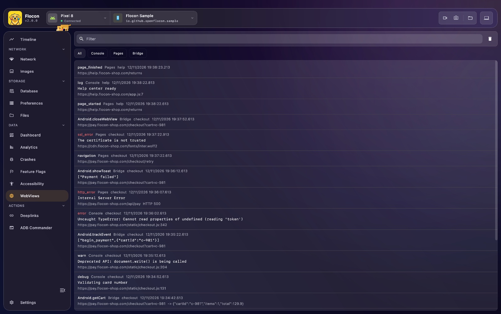
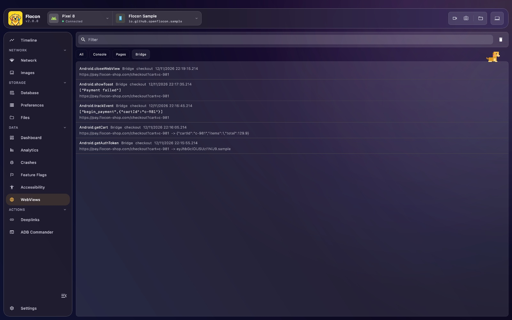

# 🌐 WebView Viewer

Flocon displays what happens inside the **WebViews** of your application: the JS console, the page loads and errors, and the calls from the page to your native code.
No more `chrome://inspect` and USB debugging to read a `console.error`.



## Platform support

The WebView plugin is available in the **Kotlin / KMP** and **Swift** SDKs. The Flutter SDK does not have it yet.

| | Android | KMP (iOS / JVM / Wasm) | Swift (iOS / macOS) | Flutter |
|---|:---:|:---:|:---:|:---:|
| Automatic capture (`attach`) | ✅ | ❌ | ✅ `WKWebView` | ❌ |
| Manual API (`logConsole`, `logPageEvent`, `logBridgeCall`) | ✅ | ✅ | ✅ | ❌ |

On iOS, JVM and Wasm (Kotlin) there is no `attach` yet: use the manual API. The requests made by the page (`fetch`, `XMLHttpRequest`) are not captured yet.

## Setup

=== "Kotlin"

    The WebView plugin is part of the core module (`flocon`, and `flocon-no-op` for release, see [Release builds](install-kotlin.md#release-builds)), so there is nothing more to add than the [core dependencies](install-kotlin.md#1-add-the-dependencies).

    Install the plugin when you start Flocon:

    ```kotlin
    startFlocon(FloconContext(applicationContext)) {
        install(FloconWebView)
    }
    ```

=== "Swift"

    ```swift
    import Flocon

    #if DEBUG
    startFlocon { flocon in
        flocon.install(.webView)
    }
    #endif
    ```

    `Flocon.initialize()` installs every plugin, the WebView included. Until Flocon is started, or if `.webView` is not installed, the calls do nothing.

=== "Flutter"

    !!! note "Not available in the Flutter SDK yet"
        There is no WebView plugin in the Flutter packages.

## Usage

=== "Kotlin"

    **Attach a WebView (Android).** Attach each WebView once, **after** you set your own `WebViewClient` / `WebChromeClient`:

    ```kotlin
    webView.settings.javaScriptEnabled = true
    webView.webViewClient = MyWebViewClient()
    webView.webChromeClient = MyWebChromeClient()

    Flocon.webViewPlugin.attach(webView, webViewId = "checkout")
    ```

    `attach` wraps your clients: every callback is still forwarded to them, so the behavior of your WebView does not change. The wrappers are read back from the WebView on Android 8.0 (API 26) and above. Below, wrap your clients yourself:

    ```kotlin
    webView.webViewClient = FloconWebViewClient(Flocon.webViewPlugin, "checkout", delegate = MyWebViewClient())
    webView.webChromeClient = FloconWebChromeClient(Flocon.webViewPlugin, "checkout", webView, delegate = MyWebChromeClient())
    ```

    **Bridge calls.** Flocon cannot see the calls made to an object you expose with `addJavascriptInterface`: log them from the method itself.

    ```kotlin
    class AppBridge {
        @JavascriptInterface
        fun share(text: String): String {
            val result = shareUseCase(text)
            Flocon.webViewPlugin.logBridgeCall(
                webViewId = "checkout",
                interfaceName = "Android",
                method = "share",
                arguments = text,
                result = result,
            )
            return result
        }
    }
    ```

    **Manual API.** The same functions are available on every Kotlin platform, for a WebView Flocon does not attach to:

    ```kotlin
    Flocon.webViewPlugin.logConsole(webViewId = "checkout", level = WebViewConsoleLevel.Warn, message = "slow render")
    Flocon.webViewPlugin.logPageEvent(webViewId = "checkout", type = WebViewPageEventType.PageFinished, url = "https://example.com")
    ```

=== "Swift"

    **Attach a `WKWebView`.** Attach each web view once, **after** starting Flocon and setting your own `navigationDelegate`, and before loading a page:

    ```swift
    let webView = WKWebView()
    webView.navigationDelegate = self

    Flocon.webViewPlugin.attach(webView, webViewId: "checkout")
    webView.load(URLRequest(url: url))
    ```

    `attach` adds a user script that sends the `console` messages, uncaught errors and unhandled promise rejections of every frame, and wraps your `navigationDelegate` to send the page events. Every delegate call is still forwarded to your delegate, so the behavior of your web view does not change. Navigation events (main frame only) are sent only when your delegate implements `webView(_:decidePolicyFor:decisionHandler:)` or its `preferences:` variant. A delegate set after `attach` replaces the wrapper: the page events then stop.

    **Bridge calls.** Flocon cannot see the messages the page sends to a `WKScriptMessageHandler`: log them from the handler itself.

    ```swift
    func userContentController(_ controller: WKUserContentController, didReceive message: WKScriptMessage) {
        Flocon.webViewPlugin.logBridgeCall(
            webViewId: "checkout",
            interfaceName: message.name,
            method: (message.body as? [String: Any])?["method"] as? String ?? "postMessage",
            arguments: String(describing: message.body)
        )
    }
    ```

    **Manual API.** For a web view Flocon does not attach to:

    ```swift
    Flocon.webViewPlugin.logConsole(webViewId: "checkout", level: .warn, message: "slow render")
    Flocon.webViewPlugin.logPageEvent(webViewId: "checkout", type: .pageFinished, url: "https://example.com")
    ```

=== "Flutter"

    !!! note "Not available in the Flutter SDK yet"

## In Flocon Desktop

!!! tip "In the Timeline"
    Console messages, page loads and bridge calls also show up in the [Timeline](timeline.md).

The WebViews screen lists three kinds of events, newest first:

- **Console**: `console.log`, `info`, `warn` and `error` of the page, with the source file and line when the browser gives them
- **Pages**: page started / finished, navigation, and the errors (network error, HTTP error, SSL error)
- **Bridge**: the calls from the page to a native object exposed with `addJavascriptInterface` (Android) or a `WKScriptMessageHandler` (Swift), with their arguments and result

Filter by kind with the chips at the top (**All**, **Console**, **Pages**, **Bridge**), or search in the level, message, url and WebView id. Each WebView is identified by the id you give it, so several WebViews of the same app can be told apart. The events also show up in the [timeline](timeline.md) as a **WebView** source.



## With AI agents (MCP)

- `list_webview_events`: the console, page and bridge events of the WebViews, newest first.

> "Is there a JS error in the checkout WebView? Read the console events."

See the [MCP cookbook](mcp-cookbook.md) for full workflows.
